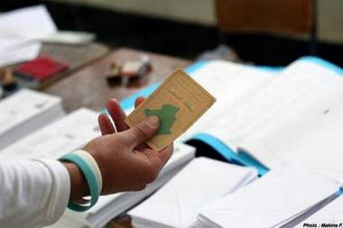

+++
title = "في الانتخابات .. حواء خير دواء!"
date = 2009-02-25
authors = ["كامل الشيرازي"]

[taxonomies]
authors = ["kaml-elshirazi"]
sections = ["siyasa"]

[extra]
section_name = "سياسة"
share_image = "/media/masr.20at.com/currentarticleassets/marwah/electiont.aspx.jpg"
summary = "بعد عامين من أكبر نكسة في تاريخ الجزائر الانتخابي، وهي سابقة امتناع 11 مليون ناخب جزائري عن التصويت في انتخابات مجالس المحافظات قبل عامين، ومع قرب الانتخابات ال"
section_slug = "siyasa"
section_colour = "#9E2A2B"
thumb = "/media/masr.20at.com/currentarticleassets/marwah/electiont.aspx.jpg"
n_comments = 0
original_url = "http://20at.com/20at/politics/11414.html"
archived = "20100105193358"
date_source = "byline/meta"
aliases_20at = ["/20at/politics/11414.html"]

[extra.provenance]
original_url = "http://20at.com/20at/politics/11414.html"
capture_url = "https://web.archive.org/web/20100105193358/http://20at.com/20at/politics/11414.html"
capture_label = "٥ يناير ٢٠١٠، ١٩:٣٣ UTC"
date_note = "من سطر التوقيع في المقال"
other_urls = []
comments = ""
missing_images = ""
+++

<figure></figure>

بعد عامين من أكبر نكسة في تاريخ الجزائر الانتخابي، وهي سابقة امتناع 11 مليون ناخب جزائري عن التصويت في انتخابات مجالس المحافظات قبل عامين، ومع قرب الانتخابات الرئاسية المقبلة في الجزائر، وعلو صوت مقاطعتها، اهتدت السلطات إلى حيلة تجنيد حسناوات في مقتبل العمر لتنشيط حملة دعائية سيكون عنوانها الأكبر إقناع اكبر عدد من ممكن من الجزائريين بجدوى المشاركة بكثافة في موعد التاسع أبريل/ نيسان القادم تحت شعار "حواء .. خير دواء"!.

وتقوم الخطة المستحدثة على انتقاء عشرات الفتيات في مقتبل العمر وغالبيتهنّ ممن يشتركن عادة في مسابقات ملكات الجمال وكذا عارضات الأزياء، وسيجري توزيعهنّ على مختلف فضاءات الحملة الدعائية التي ستقام في الفترة ما بين 19 مارس/آذار و6 أبريل/نيسان، وقيامهنّ بـ"مغازلة انتخابية" لمواطنيهم، واستبعاد هؤلاء عن نداءات المقاطعة التي تدعو إليها قوى المعارضة.

يقول "مراد الساسي" أحد المشرفين على العملية لـ (عشرينات)، أنّه جرى الشروع في المبادرة، عبر الاستعانة بخدمات 500 فتاة سيجري إرسالهنّ إلى نحو 48 محافظة، وأضاف الساسي أنّ الفتيات المعنيات سيقمن برفع صور الرئيس الجزائري عبد العزيز بوتفليقة الباحث عن نيل فترة رئاسية جديدة، كما ستطلب الفتيات من الشبان المعروفين بزهدهم في الانتخابات بـ"أداء واجبهم الوطني".

<h3>خطوة نبيلة</h3>

أجمعت كلا من سمية (20 سنة)، نجلاء (21 سنة) وعفيفة (22 سنة) اللواتي انضممنّ إلى المبادرة، على أنّ "نبل" الخطوة جعلهنّ يستجبنّ للنداء، وترفض الفتيات الثلاثة النظرة القائلة بـ"استغلالهنّ انتخابيا" واستفادتهنّ من "امتيازات مادية" لقاء عملهنّ المرتقب، وتشدّد سمية الطالبة بكلية "التخطيط والإحصاء" أنّه من العيب ربط ما تسميه "سلوكا حضاريا" بخلفيات غير بريئة وتأويلات سلبية، وتهيب نجلاء وعفيفة المتخرجتان من معهدي الحقوق والآداب، بالفتيات بالانضمام للمسعى، طالما أنّ الأمر يتعلق باجتياز الجزائر لمرحلة هامة في تاريخها.

لا يحس المتجول في العاصمة الجزائرية كما سائر البلدات والمحافظات، بأنّ البلد مقبل على انتخابات في وزن الانتخابات الرئاسية، لاسيما مع رسوخ انطباع عام في مخيلة الشعب بعجز المجالس المنتخبة عن مقاربة مشاكل الجماهير، واشتهارها فقط بسوء التسيير وفضائح منتخبيها..

يقول خير الدين،28 سنة، خريج كلية الطب: "يتساءلون لماذا لا ننتخب؟، لأنّه وببساطة روح المسؤولية اختفت والإبداع محي، كل شيء يدفعنا إلى تجاهل ما يحدث ويدفعنا إلى الارتماء في اليأس".

بينما يقول عماد،21 سنة، القاطن بحي الصفيح "صادلمي ماية": "قبل إقناعنا بالمشاركة في مسرحية الانتخابات، لماذا لا يكلفوا أنفسهم عناء هزم الفقر والحدّ من تسلل الشباب اليائس"، ويشاطره جمال،30 سنة، العامل بمؤسسة خاصة: "إننا نتجرع مرارة الحياة الصعبة ونعاني ألم البطالة، والقبضة الأمنية الصارمة، والتمييز".

<h3>قصور وتساؤلات</h3>

يرى الحقوقي البارز "مقران آيت العربي"، أنّ السلطات مثل القوى السياسية عجزت عن استيعاب رسائل المقاطعين، ويشاطره الإعلامي هيثم رباني الرأي، ويستغرب تجنيد دوائر القرار في الجزائر لكل إمكانيات التعبئة الجماهيرية حتى تضمن نسبة مشاركة "محترمة"، دون أن تكلّف نفسها عناء معالجة عمق الأشياء وأصل الداء، ما كان سيمكنها من منح "مصداقية أكبر" للانتخابات.

ويعزو السوسيولوجي ناصر جابي، المقاطعة المحتملة إلى جملة تراكمات، بالنظر إلى الدور غير المقنع الذي قدمته تجارب المجالس السابقة، فنصف رؤساء المجالس البلدية، متابعون أمام القضاء، بتهم سوء التسيير وتبديد المال العام. اللافت، أنّ إنجاح العملية الانتخابية صار هما مشتركا بين السلطة والأحزاب، إذ التقت الحكومة والمعارضة، على انشغال واحد وهو هاجس المشاركة.

ولا يمكن برأي بعض المتتبعين من حل معضلة المقاطعة، لأن الأسباب تكمن في صدقية الفعل السياسي، وقصور رؤى الطبقة السياسية، في استحداث التغيير اللازم على مستوى الهيئات المنتخبة.

