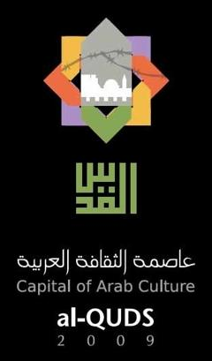

+++
title = "في احتفالية القدس..(غابت العروس)!"
date = 2009-03-22
authors = ["لبابة ذوقان"]

[taxonomies]
authors = ["lababa-zokan"]
sections = ["siyasa"]

[extra]
section_name = "سياسة"
share_image = "/media/masr.20at.com/currentarticleassets/marwah/joursiliam.jpg"
summary = "حُرمت مدينة القدس المحتلة عشية الاحتفال بها كعاصمة للثقافة العربية من أن تقام على أرضها أي فعاليات بهذه المناسبة، حيث كثفت قوات الاحتلال الإسرائيلي من نشر جنوده"
section_slug = "siyasa"
section_colour = "#9E2A2B"
thumb = "/media/masr.20at.com/currentarticleassets/marwah/joursiliam.jpg"
n_comments = 0
original_url = "http://20at.com/20at/politics/11658.html"
archived = "20100105193113"
date_source = "byline/meta"
aliases_20at = ["/20at/politics/11658.html"]

[extra.provenance]
original_url = "http://20at.com/20at/politics/11658.html"
capture_url = "https://web.archive.org/web/20100105193113/http://20at.com/20at/politics/11658.html"
capture_label = "٥ يناير ٢٠١٠، ١٩:٣١ UTC"
date_note = "من سطر التوقيع في المقال"
other_urls = []
comments = ""
missing_images = ""
+++

<figure></figure>

حُرمت مدينة القدس المحتلة عشية الاحتفال بها كعاصمة للثقافة العربية من أن تقام على أرضها أي فعاليات بهذه المناسبة، حيث كثفت قوات الاحتلال الإسرائيلي من نشر جنودها في شوارع المدينة، لمنع أي مظاهر للاحتفال.

ومنعت قوات الاحتلال المتواجدة في شوارع البلدة القديمة ومداخل الحرم القدسي طلبة المدارس الذين اتجهوا منذ صباح أمس السبت مع معلميهم إلى باب العامود من الوصول إلى المسجد الأقصى، وشددت إجراءاتها في جميع شوارع القدس.

<h3>12 ألف بالون</h3>

وكان من المقرر أن يتم إطلاق 12 ألف بالون من مناطق متعددة داخل البلدة القديمة وخارجها، لكن المقدسيون حرموا من إقامة المهرجان بهذه المناسبة.

وأصدر وزير الأمن الداخلي الإسرائيلي "آفي ديختر" قرارا بمنع وإلغاء الاحتفال في مدينة القدس والناصرة داخل الخط الأخضر، بذريعة أنها أنشطة ممولة من السلطة الفلسطينية.

وكانت مدينة الناصرة ستستضيف فعاليات ونشاطات فنية وثقافية عديدة بمناسبة "القدس عاصمة الثقافة العربية 2009" بمشاركة فرق فنية ومسرحية من داخل الخط الأخضر.

<h3>منع الوفود العربية</h3>

وتكريسا لمفاهيم الاحتلال، منعت إسرائيل الوفود العربية المشاركة في مهرجان القدس من الوصول إلى مدينة بيت لحم حيث المهرجان المركزي بواسطة المروحيات من الأردن، حيث اشترطت أن يكون دخول هذه الوفود عبر جسر الليمبي الذي تشرف عليه إسرائيل.

ولكن الوضع اختلف في بيت لحم حيث كان الاحتفال الرئيسي في قصر المؤتمرات بمناسبة "القدس عاصمة الثقافة العربية 2009"، حيث حضره الرئيس محمود عباس إضافة إلى الآلاف من المدعوين ووزراء ثقافة عرب ووفود رسمية عربية.

الربط الفضائي بين بيت لحم، ومخيم مار الياس في لبنان، كان بمثابة أكبر تعبير عن مشاركة أبناء الشعب العربي الفلسطيني في مراسيم الافتتاح الرسمي الخاص بالاحتفالية الوطنية الكبرى، وتحدياً للشتات في المهجر وحواجز الاحتلال في الوطن، وتأكيداً على جسر التواصل مع أبناء الأمة العربية بحضور عدد من وزراء الثقافة العرب ومشاركة نخبة من المبدعين في الحقل الفني والثقافي.

وفي الافتتاح وقف الحضور دقيقة صمت حداداً على أرواح الشهداء وأدت "جوقة القدس" النشيد الوطني "فدائي" ورتل المقرئ آيات من القرآن الكريم فيما قرعت الكنائس أجراسها في القدس على وقع شريط مصور يبرز معالم المدينة المقدسة المحتلة.

وفي مخيم مار الياس قرب بيروت قدم الفنان العربي اللبناني أحمد قعبور أغنياته الكفاحية بمشاركة فرقة "حنين" بينما ألقى الإعلامي اللبناني زاهي وهبة مقاطع جميلة من قصائده الشعرية، ومن غزة قدّم الفنان محمد عساف أغنيته "علّى الكوفية" فيما تقدم الفنانة الجليلية سناء موسى ومجموعة "نوى أثر" وصلة تراثية، تلتها كلمات مسجلة للأدباء العرب.

<h3>مقاومة ثقافية</h3>

وتعددت آراء الشباب الفلسطيني حول أهمية هذه فعالية "القدس عاصمة للثقافة العربية.. 2009" في نصرة المدينة المحتلة والقضية الفلسطينية بشكل عام.

رانيا عبد اللطيف (25 عاما) قالت لـ"عشرينات":"إعلان القدس عاصمة للثقافة العربية هو بحد ذاته مقاومة للحصار المفروض على شعبنا الفلسطيني، وأيضا هو كسر لهذا الاحتلال المفروض عليها وكسر قيوده وجبروته، بإعلانها عاصمة للثقافة ولو أن هناك الكثير من التقصير باتجاه المدينة المقدسة وبالذات من قبل المثقفين العرب، الذين غابت القدس عن اهتماماتهم ، لأن مضمون ثقافتهم لم تتمحور حول أهمية هذه المدينة وعروبتها وتسليط الضوء عليها بالقدر المطلوب".

سهيل خالد (24 عاما) كانت تتمنى أن تقوم حملات للدفاع عن القدس من الناحية الثقافية كـ"افتتاح دور نشر ومكتبات بالقدس لحماية مخطوطاتها، ورفع قضايا عالمية من أجل القدس في مثل هذه المناسبة لحماية الإرث الحضاري والتاريخي بها، فلا يكفي الفعاليات بالدبكات الشعبية والأهازيج والشعر بل يجب أن يتخطى ذلك بفعاليات ترقى إلى أهمية المدينة تاريخيا وحضاريا ودينيا، وبالعالم اجمع ليس فقط بالدول العربية".

<h3>نقطة بداية..</h3>

أما الشاب خليل جمعة فقد كان طموحه بأن يتم افتتاح فضائية بمثل هذا اليوم من أجل القدس، وأضاف:"ولكن للأسف، تبقى فعاليات متواضعة مقابل المخططات الإسرائيلية الرامية إلى تهوديها، ومقابل أن يكون هناك رجل أعمال صهيوني يدفع مليارات الدولارات من أجل إقامة متحف يهودي بينما أغنياء العرب يقومون بفتح فضائيات هابطة وشراء عقارات وسيارات بمليارات الدولارت ويبخلون على مدينتهم الأولى".

حسن الطالب في جامعة النجاح الوطنية يرى هو الآخر أن القدس تحتاج لأكثر من أن يتم اختيارها كعاصمة للثقافة عربيا، ويقول:" القدس عاصمة الثقافة العربية هي فعالية جيدة ولكن القدس تحتاج إلى أكثر من التضامن اللفظي معها وهذا مطلوب من العرب ومن الفلسطينيين فالعاصمة الثقافية مهددة بعدم بقاء أي عربي بها بفعل السياسيات الإسرائيلية".

أيهم (28 عاما) يرى أن انطلاقة فعالية القدس عاصمة الثقافة العربية لعام 2009 هو أمر مهم جدا ويجب أن يكون نقطة بداية واضحة لوضع مدينة القدس ضمن جدول الأولويات ليس على المستوى الثقافي فحسب بل على جميع المستويات، وخاصة أن الاحتلال الإسرائيلي يسعى إلى طمس الحضارة الإسلامية العربية في هذه المدينة.

وأضاف:"وهنا لا بد من التذكير أن القدس والاهتمام بها يجب أن لا يكون وليد احتفالية أو موسم ما، بل يجب أن يكون الاهتمام بها نابع من الثقافة والتربية الذاتية لكل فرد مسلم وعربي".

