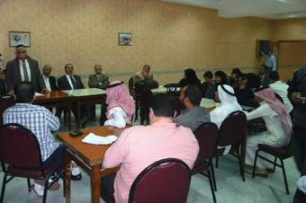

+++
title = "بالفصحى.. استيقظ وركز واصحى!"
date = 2009-03-24
authors = ["خباب عبد المقصود"]

[taxonomies]
authors = ["khbab-abdel-elmaksod"]
sections = ["eshtbak"]

[extra]
section_name = "اشتباك"
share_image = "/media/currentarticleassets/p1000078.jpg"
summary = "من أوطان عربية، بأزياء مختلفة ولهجات متعددة وأعمار متقاربة، جمعتهم المسابقة السنوية الـ12 والتي تقيمها وزارة التربية والتعليم المصرية تحت رعاية الجامعة العربية "
section_slug = "eshtbak"
section_colour = "#E77B13"
thumb = "/media/currentarticleassets/p1000078.jpg"
n_comments = 0
original_url = "http://20at.com/20at/politics/11694-2009-04-16-07-46-30.html"
archived = "20100105192753"
date_source = "byline/meta"
aliases_20at = ["/20at/politics/11694-2009-04-16-07-46-30.html"]

[extra.provenance]
original_url = "http://20at.com/20at/politics/11694-2009-04-16-07-46-30.html"
capture_url = "https://web.archive.org/web/20100105192753/http://20at.com/20at/politics/11694-2009-04-16-07-46-30.html"
capture_label = "٥ يناير ٢٠١٠، ١٩:٢٧ UTC"
date_note = "من سطر التوقيع في المقال"
other_urls = []
comments = ""
missing_images = ""
+++

<figure></figure>

من أوطان عربية، بأزياء مختلفة ولهجات متعددة وأعمار متقاربة، جمعتهم المسابقة السنوية الـ12 والتي تقيمها وزارة التربية والتعليم المصرية تحت رعاية الجامعة العربية بعنوان "التحدث باللغة العربية الفصحى وتعميق النحو" في قلب القاهرة.

"الفصحى مدخل لإصلاح التعليم"، "إنقاذ علم النحو ضرورة قومية"، "إحياء فن الخطابة دعم للديمقراطية"، تحت هذه العبارات قامت المسابقة لهذا العام وسط منافسة قوية بين الدول المشاركة مصر والإمارات والسعودية والسودان واليمن والأردن وسوريا وعُمان وتونس والكويت.

وركزت كلمات الخطابة التي ألقاها الطلاب على ضرورة تحرير الأرض المحتلة، وعلى حب الأوطان، وضرورة العودة إلى الدين والإلتزام بالأخلاق.

وفازت متسابقة من مصر بالمركز الأول في مسابقة المرحلة الثانوية، أما الإمارات فقد حصلت واحد من طلابها على المركز الأول في المرحلة الإعدادية؛ لكن يبقى أن كل الطلاب المشاركين إستطاعوا اجتياز المسابقة بنجاح وحصلوا على جوائز مالية وشهادات تقدير.

شاهد تقرير خطب الطلاب بالمسابقة

