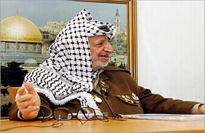

+++
title = "عرفات..لو كنت حيا !!"
date = 2006-11-14
authors = ["منى سليم"]

[taxonomies]
authors = ["mona-selim"]
sections = ["eshtbak"]

[extra]
section_name = "اشتباك"
share_image = "/media/admins.20at.com/do3a2/3arafat3.jpg"
summary = "جاءت الذكرى الثانية لوفاة ياسر عرفات مع إعلان هنية أنه لو ُخير بين رئاسة الوزراء ورفع الحصار عن الشعب الفلسطيني فسيختار الأخير، فيما قال عباس أنه تفاءل لأن هذه "
section_slug = "eshtbak"
section_colour = "#E77B13"
thumb = "/media/admins.20at.com/do3a2/3arafat3.jpg"
n_comments = 3
original_url = "http://www.20at.com:80/20at/politics/2759.html"
archived = "20100215070300"
date_source = "byline/meta"
aliases_20at = ["/20at/politics/2759.html?layout=default&page=&print=1&tmpl=component", "/20at/politics/2759.html"]

[extra.provenance]
original_url = "http://www.20at.com:80/20at/politics/2759.html"
capture_url = "https://web.archive.org/web/20100215070300/http://www.20at.com:80/20at/politics/2759.html"
capture_label = "١٥ فبراير ٢٠١٠، ٠٧:٠٣ UTC"
date_note = "من سطر التوقيع في المقال"
other_urls = ["/20at/politics/2759.html?layout=default&page=&print=1&tmpl=component"]
comments = "٣"
missing_images = ""
+++

<figure></figure>

جاءت الذكرى الثانية لوفاة ياسر عرفات مع إعلان هنية أنه لو ُخير بين رئاسة الوزراء ورفع الحصار عن الشعب الفلسطيني فسيختار الأخير، فيما قال عباس أنه تفاءل لأن هذه التطورات الجديدة تزامنت مع الذكرى الثانية لوفاة الزعيم ياسر عرفات.

هو ما جعلني أفكر في ما كان يمكن أن نتجنبه أو نفقده لو كان الراحل عرفات مازال يحوم بأفق حياتنا حتى اليوم، ولو تركنا الماضي وتكلمنا بصيغة المستقبل..هل نحتاج في الفترة الحالية لشخصية لها سمات وتاريخ عرفات أم أن الأمر لن يثمر عن الكثير؟

وقبل أن أحاول أن أجد ردا، حاولت إلقاء نظرة على المشهد الفلسطيني من يوم رحيل الرجل حتى يوم الاحتفال الثاني بذكرى وفاته..

<h3>لقطة عمرها سنتين</h3>

بداية النهاية، كانت تحت الحصار والرئيس يعيش داخل غرفتين فاقد كل أشكال الاتصال ويحاول استغلالا هذا دعائيا لصالح الموقف الفلسطيني، وعندما استطاعت الصحافة الوصول إليه وسألوه عن صحته قال يا جبل ما يهزك ريح، إلى أن جاءت الوفاة ورائحة الاغتيال تعبق أجوائها.

على الصعيد الداخلي كان الصراع الحزبي ـ والذي هو في جزء منه شخصي وآخر عقائدي أو مبدأي ـ مستمرا لكن في الخفاء، فسجون دحلان ورجوب مفتوحة تلاحق قيادات حركات حماس والجهاد، ومن ناحية أخرى تواجه هذه الحركات تهم بأنها عسكرة الانتفاضة وحولتها إلى أهداف خاصة لا تصب في خدمة الشعب الفلسطيني وتاريخ قضيته.

أما بالنسبة للصهاينة والأمريكان ساعد وجود كل من شارون وجورج بوش على رأٍس الإدارتين على تبنى فكرة أن عرفات رجل لا يمكن الوصول معه إلى اتفاق ومن ثم توقفت كل الأوراق المطروحة والمصطلحات المفتعلة، وتوقف عرفات مع انسداد الطرق خارطة الطريق.

<h3>الاستفادة من التجربة</h3>

عقب الوفاة بقليل عقد في جامعة الأقصى مؤتمر بعنوان "ياسر عرفات ذاكرة وطن ومسيرة شعب"، وكان الهدف تقديم أبحاث تحليلية نقدية موضوعية لخبرات الحركة الوطنية الفلسطينية في النصف الثاني من القرن العشرين والتي تجسدت في شخصية الرئيس ياسر عرفات وأكدت أن الهدف هنا ليس نعى الرجل لكن محاول الاستفادة من التجربة فئ الأيام القادمة.

وكانت أهم الأوراق التي اعتمدها المؤتمر مقال نشر قبل وفاة عرفات بقليل نشرته جريدة ايديعوت احرنوت الإسرائيلية، وتحدثت عن دراسة حديثة لجهاز الاستخبارات العسكرية الإسرائيلية (أمان) بعنوان افعل ولا تفعل مع عرفات.

ومرت سنتين..ووصلت حماس إلى قمة السلطة والبعض يقول أن عدم شعبية أبو مازن مقارنة بعرفات لعبت دور كبيرا، واتجاه آخر يقول أن هذه الخطوة كانت حتمية ومتوقعة، ففرض الحصار واندلع الاقتتال الداخلي والخلاف على تقسيم السلطة، وانتهى الأمر بمحاولات تتقدم خطوة ثم تسحبها في اتجاه تشكيل حكومة وطنية، وبرغم من ذلك مازالوا يستبشروا بالوصول لشبه اتفاق مع حلول رياح الرجل!!.

<h3>من أول السطر</h3>

هكذا كان المشهد خلال عامين، لكن ماذا لو كان عرفات ما زال بيننا؟..

الكاتب الفلسطيني "عبد القادر ياسين" أجاب: لا يوجد في التاريخ ولا الإستراتيجية كلمة (لو)، لكن لو تقصدين أن نفكر مستقبلياُ إن كان أسلوب عرفات يجدي لحل الأزمات الحالية؟ فالإجابة تكون.."ولا حاجة كانت هتتغير"!!، والجميع يعتقد في هذا لسبب بسيط هو استئثار عرفات أيام حكمه بكل المهام والمناصب في فتح والسلطة ومنظمة التحرير، وهذه الحالة المفتعلة حوله كونت له كاريزما هي المسئولة عن رغباتنا الحالية، لكن الحقيقة غير ذلك، فأبو مازن لا يختلف عنه كثيراً بالعكس فهو كان فتحوى أكثر من كل الفتحيين وقد كان يصل الأمر لاقتتال حقيقي إن كان هو موجود ورأى حماس أمامه في السلطة.

<h3>عرفات..برجماتي</h3>

ومن خارج البيت الفلسطيني يقول دكتور "عماد جاد" من مركز الأهرام للدراسات الإستراتيجية لو تحدثنا عن الشبكة الخارجية وهى الحكومة الإسرائيلية والإدارة الأمريكية فالواقع يقول انه لم يكن ليحدث تغيير جوهري، فالوضع هو هو، والحصار كان مفروض قبل رحيل الرجل، وكل ما كان يمكن حدوثه لم يكن ليخرج عما يمكن وصفه بالمناورات السياسية.

ولكن قد كان يحدث الاختلاف الحقيقي في نتيجة الانتخابات، فقبل أن نسأل هل كان يحدث الاقتتال فلنسأل هل كان من الممكن أن تنجح حماس بهذا القدر مع وجود عرفات؟، فالرجل رغم كل شيء له شعبية ومن المفترض أيضاً انه في الاتجاه المضاد لحماس، لكن الحقيقة انه كان رجل برجماتي والكل يعرف عنه هذا فهو يستطيع التعامل مع إسرائيل والاعتراف بها وفى نفس الوقت يصدر لك دائما إحساس أن اعتقاده الشخصي مع كل المبادئ التي ترفعها حماس بل ويتشدد لها.

وممكن نقول أيضا انه لو كان عرفات موجود وحماس بالسلطة فكنا سنشاهد مرونة مفيدة، فكان يمكنه توظيف هذه الحكومة لصالحه ويتعامل مع الموقف الدولي انه مضطر ديمقراطيا وان عليهم التعاطي مع ما يطرحه لأن ليس أمامه بديل إلا حماس.

وأنت..إلى أي حد تعتقد أن الحديث عن دور الرجل كان سيساعد على اجتياز أي أزمة؟ وهل تستفيد اجتماعات فتح المقامة حالياً لبحث هيكلة التنظيم من مرور الذكرى الثانية؟

