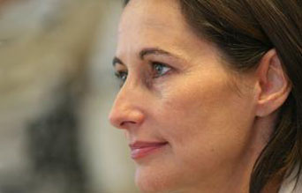

+++
title = "رويال..موناليزا فرنسا"
date = 2006-12-07
authors = ["هبة الله أحمد"]

[taxonomies]
authors = ["heba-allah-ahmed"]
sections = ["siyasa"]

[extra]
section_name = "سياسة"
share_image = "/media/admins.20at.com/do3a2/royal_08.jpg_200_-1.jpg"
summary = "إذا حاولت السيدات المناديات بحقوق المرأة والمساواة، أن يجدن العصر الذهبي لهن، فلن يجدن أفضل من هذا العصر.."
section_slug = "siyasa"
section_colour = "#9E2A2B"
thumb = "/media/admins.20at.com/do3a2/royal_08.jpg_200_-1.jpg"
n_comments = 1
original_url = "http://www.20at.com:80/20at/politics/2895.html"
archived = "20091226222850"
date_source = "byline/meta"
aliases_20at = ["/20at/politics/2895.html", "/20at/politics/2895.html?layout=default&page=&print=1&tmpl=component"]

[extra.provenance]
original_url = "http://www.20at.com:80/20at/politics/2895.html"
capture_url = "https://web.archive.org/web/20091226222850/http://www.20at.com:80/20at/politics/2895.html"
capture_label = "٢٦ ديسمبر ٢٠٠٩، ٢٢:٢٨ UTC"
date_note = "من سطر التوقيع في المقال"
other_urls = ["/20at/politics/2895.html?layout=default&page=&print=1&tmpl=component"]
comments = "١"
missing_images = ""
+++

<figure></figure>

إذا حاولت السيدات المناديات بحقوق المرأة والمساواة، أن يجدن العصر الذهبي لهن، فلن يجدن أفضل من هذا العصر..

ولن يكون الكاتب "دان براون" أسعد بأطروحاته في "شفرة دافنشي" في وقت أخر مثل هذا الوقت..

فيبدو أن قصر الاليزيه حاليا في حاجه لتنحي سيد القصر بأفكاره الذكورية، لإعطاء الفرصة لدخول سيدة بكامل أنوثتها لأول مرة..

ولتكن هذه السيدة هي "سيغولان رويال" المرشحة الفرنسية لقصر الرئاسة الفرنسي عن الحزب الاشتراكي هي صاحبة الفضل الأكبر في ذلك..

<h3>الموناليزا القادمة</h3>

ظهور هذه الموناليزا الفرنسية في مقدمة المرشحين لمنصب رئاسة الجمهورية الفرنسية، إذا أضفناه إلى صعود المستشارة الألمانية ميريكل، فإننا قد ندرك أن المعسكر النسائي يحقق تقدما على الصعيد العالمي يمكن أن يهدد النظام الاجتماعي كما عرفناه منذ بداية التاريخ.

فربما قد يكون سبقها إلي هذا المنصب في الآونة الأخيرة الكثيرات، ولكن وصولها خلال 6 أسابيع من حملتها الانتخابية إلى هذا المستوي المتقدم من المنافسة علي الوصول إلي قصر الاليزيه، خاصة بعد فوزها علي أثنين من اعتي السياسيين الفرنسيين داخل الحزب الاشتراكي- ألا وهما رئيس الوزراء الأسبق لوران فابيوس ووزير الاقتصاد الأسبق دومينيك ستروس- يأتي ليس لأنها السياسية الناجحة، أو لتحديها منافسيها السياسيين الذكور، ولكن فقط لأنها أنثي!.

<h3>الوصول إلي الاليزيه</h3>

"سأعمل خلال حملتي الانتخابية على جمع الفرنسيين إلى الحزب الاشتراكي للوصول إلى قصر الاليزيه".

بهذه الكلمات أعلنت رويال أن ترشيحها كأول امرأة في تاريخ الحزب الاشتراكي الفرنسي، سوف يشكل ثورة لها أبعاد في إحداث تغييرات في أسلوب الحياة السياسية في فرنسا.

حيث نجحت رويال، 52 عاما والتي تعتني بشكل خاص بأناقتها، في تخصيص حيز كبير لمسائل اجتماعية وأخرى تتعلق بالبيئة، واتخذت أحيانا مواقف اعتبرها منتقدوها قريبة من اليمين بشأن مواضيع تتعلق بالأمن والهجرة.

فعلى سبيل المثال، أعربت رويال عن تأييدها لتشجيع بعض الشباب الجانحين على القيام بـ"مهمات انسانية" أو تشكيل "لجان تحكيم من عامة الشعب" لتقييم عمل السياسيين، كما سعت إلى تجسيد التجدد داعية إلى "ديمقراطية مشاركة".

<h3>الفرنسية المتمردة</h3>

ولدت رويال في "داكار" بالسنغال عام 1953 لعائلة عسكرية فرنسية، ونشأت نشأة متمسكة بالشكليات العائلية، لكن ما أن بلغت التاسعة عشرة حتى رفعت دعوى قضائية على والدها العقيد السابق جاك رويال، حين رفض تطليق والدتها ودفع مصاريف الدراسة لأطفالها الثمانية.

وتلقت بعد ذلك تعليمها الابتدائي والثانوي في "شارم" باللورين شرقي فرنسا، وبعد حصولها على الباكالوريا درست في جامعة "نانسي 2" لتخرج بشهادة الليسانس في الاقتصاد، ثم بشهادة أخرى في العلوم السياسية عام 1978، كما التحقت بالمدرسة الوطنية للإدارة في باريس وتخرجت منها لتصبح قاضياً في المحكمة الإدارية.

وفيما يخص حياتها السياسية، فقد انضمت إلى "الحزب الاشتراكي" عام 1978، وتولت باسمه وظائف محلية وتنفيذية وتشريعية عديدة، إذ إانتخبت عام 1982 عضواً في المجلس المحلي لمدينة "تروفيل- سير- ماير" بإقليم "كالفادوس"، ثم عضواً بالمجلس البلدي لمدينة "مل" (ديه- سيفر) عام 1989، وفي عام 1992 أصبحت عضواً في المجلس الإقليمي لولاية "بواتو- شارانت"، ثم عضواً بالمجلس المحلي لمدينة "نوارت" في الإقليم نفسه عام 1995.

وفازت رويال بعضوية البرلمان الفرنسي أربع مرات على التوالي، نائبة عن "ديه سيفر" منذ عام 1988 وحتى الآن، لكنها استقالت من البرلمان مرتين لتتولى حقيبة البيئة في وزارة بيريغوفواي عام 1992، ثم حين أصبحت وزيراً مكلفا بالتعليم المدرسي في حكومة جوسبان عام 1997.

إلتقت رويال بفرانسوا هولاند عام 1970 فارتبطا، وكان محامياً شاباً، وهو الأمين العام لـ"الحزب الاشتراكي" حالياً، ولها منه أربعة أطفال، لكنها لم تتزوج منه مطلقاً، ورغم كونها سيدة تحترم الواجب و"الأسرة"، فقد رفضت التضحية بحياتها السياسية!

<h3>الزهرة الوحيدة</h3>

وقد استبعدت رويال النساء بشكل واضح من محيطها لتبدو كزهرة وحيدة في غابة برية، وأخبرت الناخبين أنها مثلهم، لا تعرف كل شيء، وأنها ستتعلم منهم، وستبقى لو هي انتخبت رئيسة للجمهورية تتسلم اقتراحاتهم حتى نهاية السنة المقبلة لتستلهم من هذه الاقتراحات.

وقد رأت الكاتبة ناتاشا بولوني، أن سيغولان رويال بمقدورها أن تكتسح الانتخابات بدون حتى برنامج انتخابي، لمجرد أنها تمثل التغيير والتجديد، لا لأنها أنثى ولكن لأنها أم.

وقد حرصت رويال على ارتداء الثياب البيضاء في الآونة الأخيرة، كي توحي للفرنسيين بالنقاء والحب والحماية، لكن هناك من لا يقتنع بهذا التحليل ويرى أنها استغلت أنوثتها وأمومتها معاً.

ورغم أن اتهامها باستغلال الأنوثة اعتبرته بعض النساء إهانة، إلا أن رويال لا تبالي بذلك، وحين يوجه لها سؤال لا يعجبها لا تتورع عن القول بأنها تسأل على هذا النحو لأنها امرأة، ولو كانت رجلاً لسئلت بطريقة أخرى، أما مناصرات رويال لا يجدن غضاضة في لعبها على حبال أنوثتها، ويعتبرن أن الرجال أيضا يقومون باستعراضات رجولية للوصول إلى السلطة من دون أن ينتقدوا على سلوكهم الذكوري.

<h3>انتخابات مسابقة الجمال</h3>

المرشح اليميني الأوفر حظاً، نيكولا ساركوزي، يغتاظ من منافسته الأشرس، وقد بات يعرف أنه سيكون في مواجهتها، وهو ما دعاه للتصريح "نحن في معركة انتخابات ولا نخوض مسابقة في الجمال".

لكن شاء ساركوزي أم أبى، فإن المرشحة الاشتراكية تغري الناخبين بقوة، ففي استطلاع للرأي أجري مؤخراً حول رويال، قال الفرنسيون إن الفضيلة رقم واحد لسيغولان هي أنها مرأة، أما الفضيلة الثانية فهي أنها قادرة على هزيمة اليميني القوي ساركوزي.

وبحسب الأنثروبولوجي مارك أبيل، فإن سيغولان تستخدم لغة فيها من مفردات الغزل الرقيق ما يطرب الآذان، وليس في عباراتها ألفاظ مثل قتال أودفاع أومواجهة أو تحدٍّ، ويقول أبيل: "هي حيوان سياسي بامتياز، لكنها لا تتحدث كالسياسيين الرجال..وهنا يكمن سرها".

ولكن رغم أنها محاطة بأشخاص قديرين تستعين بهم، أحدهم شريك حياتها هولاند، فإن افتقادها للتجربة في مناصب كبرى أمر لا يمكن تعويضه.

فهل ستستطيع رويال أن تتغلب علي افتقارها للتجربة السياسية الكافية لتصل في انتخابات 2007 الي قصر الاليزيه؟

