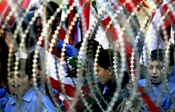

+++
title = "شباب المغرب: تعظيم سلام للبنان!"
date = 2006-12-16
authors = ["محمد أحمد"]

[taxonomies]
authors = ["mohamed-ahmed"]
sections = ["siyasa"]

[extra]
section_name = "سياسة"
share_image = "/media/admins.20at.com/marwa05/lebanon_shabab_.photo.jpg4.jpg"
summary = "الحركية السياسية التي يعيشها الشارع اللبناني حاليا يتابعها عن كثب الشباب المغربي، حيث كشف الشباب عن إعجابهم بالتجربة اللبنانية واحترامهم لشعب بلد الأرز."
section_slug = "siyasa"
section_colour = "#9E2A2B"
thumb = "/media/admins.20at.com/marwa05/lebanon_shabab_.photo.jpg4.jpg"
n_comments = 1
original_url = "http://www.20at.com:80/20at/politics/2930.html"
archived = "20100215070303"
date_source = "byline/meta"
aliases_20at = ["/20at/politics/2930.html?layout=default&page=&print=1&tmpl=component", "/20at/politics/2930.html"]

[extra.provenance]
original_url = "http://www.20at.com:80/20at/politics/2930.html"
capture_url = "https://web.archive.org/web/20100215070303/http://www.20at.com:80/20at/politics/2930.html"
capture_label = "١٥ فبراير ٢٠١٠، ٠٧:٠٣ UTC"
date_note = "من سطر التوقيع في المقال"
other_urls = ["/20at/politics/2930.html?layout=default&page=&print=1&tmpl=component"]
comments = "١"
missing_images = ""
+++

<figure></figure>

الحركية السياسية التي يعيشها الشارع اللبناني حاليا يتابعها عن كثب الشباب المغربي، حيث كشف الشباب عن إعجابهم بالتجربة اللبنانية واحترامهم لشعب بلد الأرز.

<h3>النزول للشارع .. حق</h3>

اعتبر إبراهيم فاضلي، 28 سنة، أن نزول الشعب اللبناني، أو على الأقل جزء كبير منه، إلى الشارع للتعبير عن وجهة نظره أمر مشروع وحق سياسي أصيل.

ويتساءل إبراهيم مستنكرا "ما المانع من النزول إلى الشارع للتعبير عن الرأي ما دام الأمر يتخذ شكلا سلميا؟"، وذكر بأن اللجوء إلى الشارع جاء بعد فشل جولات متعددة من الحوار بين الفرق السياسية.

فاطمة، 23 سنة، وافقت إبراهيم رأيه في حق الشعب اللبناني في تبليغ رأيه وإسماع صوته عبر الشارع، وقالت "هذا حق سياسي طبيعي ومشروع وهو منسجم مع الديمقرطية التي تعني الاحتكام إلى رأي الشعب، وهذا ما نراه في لبنان".

<h3>استثناء عربي</h3>

أما هشام برناطي،30 سنة، فذهب إلى القول أن "الحالة اللبنانية تعتبر استثناءا جميلا على المستوى الديمقراطي في العالم العربي".

وأضاف: "لم يسبق أن رأينا نموذجا مماثلا في إحدى الدول العربي والإسلامية بهذا الشكل، إنه شكل جديد أن تعتصم حشود كبيرة من تيارات مختلفة أمام مقر الحكومة رافعة أعلاما ولافتات وشعارات، مقابل موقف حكومي لا يمكنني أن أقول إلا أنه محترم رغم اختلافي مع توجهات السنيورة".

وأشار إلى التأثير الإيجابي لوجود حزب الله وقياداته في صف المعارضة بقوله: "خطاب نصر الله أو نائبه نعيم قاسم يجعل كل من حكم عقله لا أهوائه يتعاطف مع مطالبهم لأنها منطقية، ألا يطالبون بحكومة وحدة وطنية؟ أين العيب في ذلك؟".

<h3>المغرب لبنان آخر</h3>

بعض الشباب دعا إلى استنساخ التجربة اللبنانية في باقي الأوطان العربية وخاصة في المغرب، الذي يعيش في رأيهم أزمة خانقة، وذلك حتى تضطر الحكومة والمؤسسات الرسمية إلى الاستجابة للمطالب الشعبية.

يقول عبد الحميد الشتيوي،30 سنة، نعم نتمنى أن تنقل هذه التجربة إلى المغرب ونرى الشعب المغربي في الشارع يحتج وينادي بالإصلاح والتغيير لأن أزمتنا لا تقل عن لبنان.

أما هشام رغم أنه دعا إلى تحرك الشعب المغربي وكل الشعوب العربية فإنه تخوف من ذلك بحكم اختلاف المساحة الديمقراطية بين المغرب ولبنان، وقال: "أنا متأكد أنه في حال القيام بنزول أجزاء من الشعب إلى الشارع فإنها ستواجه بالقمع والعصا الغليظة، لأن السلطة عندنا قمعية بخلاف سلطات لبنان، فلبنان يعرف نوعا من اقتسام وتوازن السلط أما المغرب فلا".

