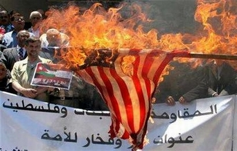

+++
title = "فلسطين و لبنان.. وجهان لعملة واحدة!"
date = 2006-12-16
authors = ["رزان المدهون"]

[taxonomies]
authors = ["razan-elmadhon"]
sections = ["siyasa"]

[extra]
section_name = "سياسة"
share_image = "/media/admins.20at.com/marwa05/lebanon_shabab_.photo.jpg2.jpg"
summary = "تسارعت الأحداث بشكل كبير على الساحة اللبنانية لتجذب كل الأنظار إليها, ولتجعل الشارع العربي يتابع أخبار لبنان باهتمام, ويترقب خطابات حسن نصر الله التي تحمل كل مر"
section_slug = "siyasa"
section_colour = "#9E2A2B"
thumb = "/media/admins.20at.com/marwa05/lebanon_shabab_.photo.jpg2.jpg"
n_comments = 3
original_url = "http://www.20at.com:80/20at/politics/2931.html"
archived = "20100215070310"
date_source = "byline/meta"
aliases_20at = ["/20at/politics/2931.html?layout=default&page=&print=1&tmpl=component", "/20at/politics/2931.html"]

[extra.provenance]
original_url = "http://www.20at.com:80/20at/politics/2931.html"
capture_url = "https://web.archive.org/web/20100215070310/http://www.20at.com:80/20at/politics/2931.html"
capture_label = "١٥ فبراير ٢٠١٠، ٠٧:٠٣ UTC"
date_note = "من سطر التوقيع في المقال"
other_urls = ["/20at/politics/2931.html?layout=default&page=&print=1&tmpl=component"]
comments = "٣"
missing_images = ""
+++

<figure></figure>

تسارعت الأحداث بشكل كبير على الساحة اللبنانية لتجذب كل الأنظار إليها, ولتجعل الشارع العربي يتابع أخبار لبنان باهتمام, ويترقب خطابات حسن نصر الله التي تحمل كل مرة رسالة سياسية جديدة.

أما على صعيد غزة, ونظرا للتشابه الكبير بين ما يحدث في لبنان وما يجري على الساحة الفلسطينية الساخنة, اهتم الشباب الفلسطيني بمتابعة الأحداث اللبنانية بل وتحليلها, ومقارنتها بالواقع الفلسطيني..

<h3>هّبة شعبية</h3>

ألاء مهد،21 سنة, تابعت أخبار لبنان باهتمام, خاصة اعتصام أهل لبنان من أجل المطالبة بتشكيل حكومة وحدة وطنية, ونظرا لأن "حكومة الوحدة" هي أهم ما يدور عليه الجدال في الساحة الفلسطينية, فقد تمنت ألاء أن تحدث هّبة شعبية مماثلة تطالب بالإسراع بتشكيل حكومة الوحدة، لأن الشعب اللبناني عرف ما يريد واتفق بمختلف فصائله على شيء واحد هو مصلحة الوطن.., ألاء تابعت خطابات حسن نصر الله باهتمام أثناء الحرب لأنها كانت حماسية وتشجع على المقاومة ضد المحتل الإسرائيلي, لكنها تعترف أن اهتمامها لم يعد كالسابق في الفترة الأخيرة وبررت ذلك بقولها: "خطاباته الآن تهيج أنصار حزب الله على الحكومة اللبنانية مما يفاقم الأزمة الداخلية اللبنانية وينذر بحرب أهلية".

<h3>احتجاج سلمي</h3>

كذلك أبدى مخلص وشاح، 20عاما، إعجابه بما وصفه بالشكل السلمي للاحتجاج الذي تميز به تحرك المعارضة في لبنان وانضباط جمهورها لتوجيهاتها, وتمنى لو انتقلت التجربة إلى فلسطين, لكن مخلص لم يعد يتابع خطابات نصر الله كما تابعها وقت الحرب والسبب كما أخبرنا: "لأنه في وقت الحرب كانت المعركة مع العدو الصهيوني ولم تكن معركة داخلية، وبالتالي كان الدافع مختلف ولكن الآن الشأن داخلي لبناني- لبناني", وأضاف: ولكني أتعاطف مع فريق المعارضة اللبنانية التي تنحاز بشكل أوضح للقضية الفلسطينية وللمقاومة خلافاً لفريق الرابع عشر من آذار صاحب الرؤية المنسجمة مع الأجندة الأمريكية في المنطقة".

<h3>بين حكومتين</h3>

المهندس محمد أبو فودة،22 سنة, تمنى أن يحدث في فلسطين كما يحدث في لبنان وتسقط الحكومة والسبب: "لأنها لم تصبح فقط عاجزة عن إدارة الشئون الداخلية والخارجية للشعب الفلسطيني وتسيير الأمور الحياتية للشعب، وإنما أيضا هي مسئولة عن انتشار أمور خطيرة جدا مثل الفلتان الأمني والعنف والفقر", وكغيره كان محمد مهتما بخطابات نصر الله وقت الحرب، يبرر ذلك بقوله: "العدو كان مشترك بيننا, فكل انتصار يحققه حزب الله كان نصر لنا ورفع لروحنا المعنوية, لكن الآن خطاباته تختص بالشأن الداخلي بلبنان".

في حين أن بدور أبو كويك، 18 سنة, رفضت أن تقارن الحكومة الفلسطينية بحكومة لبنان, قائلة: "الحكومة الفلسطينية للآن لم تأخذ حقها لكي تمارس صلاحياتها بالشكل المناسب, بل تعرضت للحصار والضغوطات الدولية, في حين أن الحكومة اللبنانية حصلت على فرصتها وفشلت لذا يجب إقالتها"، و في نفس الوقت تتمنى بدور تشكيل حكومة وحدة وطنية فلسطينية قائلة: "أريد أن أرى أبناء وطني متحدين ومتوافقين".

<h3>حكومة وحدة وطنية</h3>

أما عبد الرحيم فرج الله،20 عاما, فهو يحلم بمطالبة شعبية لتشكيل حكومة وحدة وطنية فلسطينية قائلا : "أتمنى أن يحدث عندنا مثل ما يحدث في لبنان من اعتصامات سلمية ولكن ليس لإسقاط الحكومة، وإنما للمطالبة بحكومة وحدة وطنية", و رغم أن عبد الرحيم لا يتابع خطابات حسن نصر الله كما تابعها وقت الحرب, إلا أنه يهتم بها.

و لم يكن لهيا جبر،19 سنة, اهتمام كبير بمتابعة أخبار لبنان, بسبب انشغالها بأحداث بلدها الحافلة فتقول: "أحداثنا تطغى على أحداث لبنان وتغطي عليها, وأخبارنا سابقة لأي أخبار", لكنها كانت تتابع خطابات نصر الله في وقت الحرب, وما شدها هو رغبتها لمعرفة أخبار الكيان الإسرائيلي, وتقول: "كفتاة فلسطينية لاجئة كنت مثل الغريق المتعلق بقشة الذي ينتظر أن يسمع خبرًا جيدًا بالنسبة لنا وسيئا لإسرائيل", ولم تتمن هيا سقوط الحكومة الفلسطينية, بل تمنت أن تتاح لها الفرصة بعيدا عن "التلاعب الدولي"!

