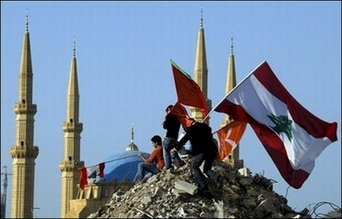

+++
title = "شباب مصر: يا ليت لنا مثل اعتصام لبنان!"
date = 2006-12-16
authors = ["مجاهد شرارة"]

[taxonomies]
authors = ["magahd-shrara"]
sections = ["siyasa"]

[extra]
section_name = "سياسة"
share_image = "/media/admins.20at.com/marwa05/lebanon_shabab_.photo.jpg6.jpg"
summary = "انفجار الوضع في لبنان ونزول المعارضة في الشارع لإسقاط الحكومة واكبه تقاسماً في آراء الشباب المصري حول الوضع في لبنان، ففريق يرى أنه مظهر حضاري وديمقراطي للتعبير"
section_slug = "siyasa"
section_colour = "#9E2A2B"
thumb = "/media/admins.20at.com/marwa05/lebanon_shabab_.photo.jpg6.jpg"
n_comments = 2
original_url = "http://www.20at.com:80/20at/politics/2932.html"
archived = "20100215070316"
date_source = "byline/meta"
aliases_20at = ["/20at/politics/2932.html?layout=default&page=&print=1&tmpl=component", "/20at/politics/2932.html"]

[extra.provenance]
original_url = "http://www.20at.com:80/20at/politics/2932.html"
capture_url = "https://web.archive.org/web/20100215070316/http://www.20at.com:80/20at/politics/2932.html"
capture_label = "١٥ فبراير ٢٠١٠، ٠٧:٠٣ UTC"
date_note = "من سطر التوقيع في المقال"
other_urls = ["/20at/politics/2932.html?layout=default&page=&print=1&tmpl=component"]
comments = "٢"
missing_images = ""
+++

<figure></figure>

انفجار الوضع في لبنان ونزول المعارضة في الشارع لإسقاط الحكومة واكبه تقاسماً في آراء الشباب المصري حول الوضع في لبنان، ففريق يرى أنه مظهر حضاري وديمقراطي للتعبير عن الرأي بحرية غير مسبوقة في أي دولة عربية، وفريق يرى أنه انقلاب على الشرعية قد يؤدي لفوضى وحرب أهلية لبنان في غنى عنها.

تقول رانيا أحمد: صمود الاعتصام بهذا الكم الهائل من البشر ولفترة طويلة من الوقت تجعلني احترم القائمين عليه، واحترم الحكومة في تعاملها مع المعارضة، لكن خوفي من أن حزب الله شيعي وربطه بما يحدث للسنّة في العراق من قتل على يد الشيعة يؤدي بالوضع لحرب أهلية.

ويؤكد مصطفى أحمد أن ما يحدث في لبنان ظاهرة صحية بكل المقاييس في منطقة عربية لا تسمح في بعض الدول للمعارضة حتى بمواقع على الانترنت، أما رضا علي فهتف قائلا: لو كنت لبنانيا لاشتركت في الاعتصام حتى لو كنت سنيا.

أسامة محمد يرى أن هناك فتنة قادمة ومؤامرة ويضيف قائلا: "هناك أياد تحرك الشباب في كلا الجانبين لتحقيق أهداف خاصة من وراء هذا الاعتصام ، فلبنان سيظل دائما ملعب يشهد بين فترة وأخري مباراة لقوى خارجية تأكل الأخضر واليابس ولا يدفع الثمن إلا لبنان فمحور إيران وسوريا يقابله محور أمريكا وإسرائيل والخاسر واحد في كل مباراة إنه لبنان.

عمرو النواوي قال: "ما يحدث صحي جدا وقد يؤثر على المنطقة، وما حدث من اعتصام العمال المصريين بالمحلة مطالبين بحقوقهم من الإدارة دليل على هذا التأثر، وأعربت أميرة بدران عن حزنها فتقول: أصبت بالإحباط جراء ما يحدث فلم نهلل للانتصار على إسرائيل في حربها على لبنان ولم نفرح بهذا النجاح والنصر مما جعلني غير متابعة للأحداث لأن ليس هناك فائدة .

<h3>حرب آه .. سلم لا</h3>

أصبح كثير من الشباب المصري لا يهتم بمتابعة خطابات السيد حسن نصر الله عكس ما حدث إبان الحرب الإسرائيلية على لبنان، لكنه مازال الزعيم المحبوب لدى الغالبية من المصريين.

تقول رانيا: "لم أعد أتابع نصر الله وأشعر أنه يوظف نصره لأغراض سياسية وهذا الأمر بالنسبة لي مقبول لكن الواضح أنه كان مخطط لهذا الأمر من البداية ولا أريد أن تكون لبنان نسخة من إيران أو سوريا".

ويتفق مصطفى مع هذه النظرة ويؤكد قائلاً: "نصر الله يتحدث عن مصالح شيعية خالصة وهذا شعرنا به أيام الحرب فكان يمثل لنا الزعيم العربي والإسلامي الشريف القادر على تحدي الصعاب وقت الخطر، ويعبر رضا عن عدم رضاه على خطاب نصر الله لأنه أيام الحرب كان يتحدث عن الجهاد ضد العدو الصهيوني والآن يتحدث بنعرة طائفية شيعية".

أما أسماء علي فقالت: "كنت أتابع وقت الحرب خطاب نصر الله لأنه كان في بؤرة الاهتمام والأحداث واستطاع أن يقدم نموذجاًً عربياً وإسلامياً مختلفا كزعيم استطاع أن يوحد مشاعر الشعوب العربية والإسلامية ولو لم أكن منشغلة هذه الأيام لتابعت كل أحاديث نصر الله، ويؤكد محمد أن احترام وتقدير السيد حسن نصر الله في زيادة لأنه الوحيد الذي واجه إسرائيل، أما دينا فتعتبره رمزاً ليس للأمة العربية والإسلامية فقط بل لكل شعب مقهور يريد الوقوف والصمود أمام غطرسة المحتل.

<h3>يارب اعتصام</h3>

تمنى بعض الشباب المصري أن ما يحدث في لبنان من اعتصام للمعارضة في وسط بيروت أن يحدث مثله في مصر لإسقاط النظام .

يقول شريف أحمد: "طبعا أتمنى أن يحدث هذا في مصر لكن حكومتنا بنت ستين ..... وما يحدث في لبنان دليل على ديمقراطية حقيقية وليست مزيفة فالآلاف في الشوارع والميادين في حراسة الشرطة والأمن الداخلي، أما عندنا في مصر فلو تجمع عشرة أشخاص فستأتي عشرة سيارات تكتظ بعساكر الأمن المركزي الذي يوسع المعتصمين ضربا، أما أسامة محمد فيتحفظ على حدوث اعتصام بمصر بهذا الشكل دون تجهيز بديل حقيقي يستطيع أن ينتشل البلد من الفساد المتفشي في كل المجالات، واعترض محمود فايز بشدة على فكرة الاعتصام قائلاً: "الحكومة المصرية لا ينفع معها مثل هذه الطريقة فهي قادرة على إخماد أي حركة من هذا النوع"، ويتفق محمد عبده مع هذا الرأي قائلا: "في مصر لو حصل اعتصام لن تجعل الحكومة العدد يصل إلى هذا الحد بل ستطلق على المعتصمين النار بمجرد تجمهرهم وفي النهاية ستخرج لنا الحكومة بياناً تول فيه أنهم خونة ومجرمين، أما مصطفى أحمد فحمّل الشعب مسئولية عدم التحرك قائلاً: "لن تستطيع المعارضة المصرية حشد مثل هذه الأعداد التي نراها عبر شاشات الفضائيات لأن الشعب أصبح سلبيا كما أن الوضع الأمني أصبح قمعيا يضرب بشدة على يد كل معارض".

