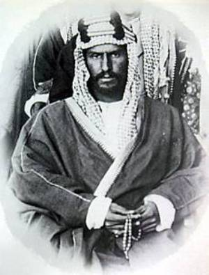

+++
title = "السعوديون: ألفنا حكم آل سعود"
date = 2006-12-17
authors = ["عبد الله الغامدي"]
aliases = ["/articles/20at-eshtbak-2933/"]

[taxonomies]
authors = ["abdallah-elghamdi"]
sections = ["eshtbak"]

[extra]
section_name = "اشتباك"
share_image = "/media/admins.20at.com/marwa05/al_saud_2.jpg"
summary = "لم يكد السعوديون يديرون ظهورهم للقنوات والمواقع الإخبارية التي طالما قبعوا أمامها لساعات طوال فترة الحرب الإسرائيلية على لبنان التي استمرت 33 يوماً، حتى جاءت ال"
section_slug = "eshtbak"
section_colour = "#E77B13"
thumb = "/media/admins.20at.com/marwa05/al_saud_2.jpg"
n_comments = 1
original_url = "http://www.20at.com:80/20at/politics/2933.html"
archived = "20100215070321"
date_source = "byline/meta"
aliases_20at = ["/20at/eshtbak/2933.html", "/20at/politics/2933.html?layout=default&page=&print=1&tmpl=component", "/20at/politics/2933.html"]

[extra.provenance]
original_url = "http://www.20at.com:80/20at/politics/2933.html"
capture_url = "https://web.archive.org/web/20100215070321/http://www.20at.com:80/20at/politics/2933.html"
capture_label = "١٥ فبراير ٢٠١٠، ٠٧:٠٣ UTC"
date_note = "من سطر التوقيع في المقال"
other_urls = ["/20at/eshtbak/2933.html", "/20at/politics/2933.html?layout=default&page=&print=1&tmpl=component"]
comments = "١"
missing_images = ""
+++

<figure></figure>

لم يكد السعوديون يديرون ظهورهم للقنوات والمواقع الإخبارية التي طالما قبعوا أمامها لساعات طوال فترة الحرب الإسرائيلية على لبنان التي استمرت 33 يوماً، حتى جاءت الاعتصامات والمظاهرات التي تشهدها لبنان حاليا لتعيد لبنان مرة أخرى لبؤرة الاهتمام.

ولكن هل مازال السعوديون يتابعون أحداث لبنان بنفس الاهتمام؟ وما هي رؤيتهم الآن لما يحدث في لبنان؟ وهل يتمنون أن يحدث في بلادهم ما يحدث في لبنان لإسقاط الحكومة؟ وهل يتابعون خطابات السيد حسن نصرالله حاليا كما هو الحال في وقت الحرب؟

وقد اتفق غالبية الشباب السعودي ممن تم استطلاع آراؤهم أن ما يحدث في لبنان الآن هو صراع طائفي وليس سياسي، معربين عن رفضهم لسلوك نفس النهج لإسقاط حكومتهم، ولكنهم تمنوا أن تكفل لهم الحكومة حق التظاهر والتعبير عن آرائهم بحرية، مع تشكيل جبهة معارضة داخل البلاد ليكون هناك هامش ديمقراطي يتم ممارسته كما يحدث في لبنان.

<h3>خلاف طائفي</h3>

يقول هاني القحطاني- موظف-"ما يحدث في لبنان هو صراع طائفي على السلطة وليس سياسي، يهيمن فيه حزب الله الشيعي على مقاليد الأمور، مستغلا النزعات السلطوية لدى بعض الطوائف (سنة أو مسيحيين) لنفي هذه الصفة عن الصراع، ولعل من يتابع خطاب نصر الله والخطاب المضاد للسنيورة يلاحظ هذا الأمر بشكل جلي".

وأعرب القحطاني عن أمنيته في "أن يكون لي حق التظاهر بحرية وأن أعبر عما أريد دون خوف من أحد، وأن يكون في بلدنا جبهة معارضة داخلية لا أن تضطر للإقامة في الخارج، ولكن هذا لا يعني أني أتمنى إسقاط الحكومة كلها".

وعن متابعته لخطابات نصرالله حاليا مقارنة بوقت الحرب قال القحطاني: "لا أتابع بنفس الدرجة لأن الخلاف الآن هو خلاف سياسي داخل بلد واحد، أما الخلاف قبل ذلك كان بين إسرائيل العدو اللدود لكل العرب، وبين دولة عربية إسلامية حتى لو كانوا شيعة".

ويتفق معه في الرأي يوسف العنزي- طالب- مشيرا إلى أن الجماعة الإسلامية في لبنان دعت كلاًّ من الشيعة والمسيحيين المنضمين لتيار المعارضة إلى احترام السنة بعدم إسقاط رئيس الوزراء في الشارع، واعتبرت ذلك "خطًّا أحمر"، وهو ما أكده أيضا مفتي الجمهورية اللبنانية الشيخ محمد رشيد قباني.

ورفض العنزي أن يتم انتهاج نفس الإسلوب لإسقاط الحكومة الحالية التي يترأسها خادم الحرمين الشريفين الملك عبد الله بن عبد العزيز، ولكنه تمنى أيضا أن تكون إمكانية إسقاط أي حكومة أخرى مكفولة للشعب.

وبين العنزي أنه لم يعد يتابع خطابات حسن نصر الله كما كان الحال وقت الحرب مشيرا إلى أنه يعتبر ما يحدث الآن في لبنان شأن داخلي، بينما كانت خطاباته وقت الحرب تأخذ طابع دولي.

وفي السياق نفسه وصف محمد عبدالله تحالف المعارضة قائلاً: "إنه تحالف نصراني بقيادة ميشيل عون ورافضي بزعامة حسن نصرالله يستهدف الحكومةِ السنية التي يرأسها فؤاد السنيورة، وكل له حساباته الخاصة فعون يريد الرئاسة، وحزب الله يريد بما يسميه الثلث الضامن ضمان حماية لسلاحه وعدم تمرير أي ما يخالف توجهاته التي هي بالأساس جزء من الإسترتيجية الإيرانية".

وتابع: "إنها حربا طائفية بكل ما تعنيه هذه الكلمة، وهذ الرجل يستغل حلاوة لسانه وقدرته على الإقناع في قلب الحقائق حتى يميل الجاهلون والبسطاء إلى صفه، مشيرا إلى أن الشيعة أشد خطراً من اليهود، وما يحدث في العراق خير مثال".

واستطرد:" يجب أن ننتنبه أن حسن نصرالله ينتسب إلى التشيع الإيراني الخميني, وحاصل على لقب "الوكيل الشرعي للمرشد الأعلى للثورة" وهذا يعني أن هذا الشخص هو المسؤول عن فرع من فروع الثورة الإيرانية في البلد الذي يقطن فيه".

وأعرب محمد عن رفضه لانتهاج أساليب مشابهة لإسقاط حكومة بلادة مشددا على أن طاعة ولي الأمر واجبة، طالما لا يأمر بمعصية.

<h3>أعشق نصر الله</h3>

ومن جهتها أعربت "حصة. أ" عن تأييدها لما تنتهجه المعارضة اللبنانية لإسقاط الحكومة، مشيرة إلى أنه إسلوب حضاري تم اتباعه قبل ذلك في عدد من الدول بينها جورجيا، ورفضت ما يقوله البعض بأنه صراع طائفي مبينة أن المعارضة تضم عدد كبير من السنة منهم رئيس الوزراء السابق عمر كرامي والداعية فتحي يكن والدكتور سليم الحص رئيس الوزراء الأسبق، فما يحدث الآن سياسي لا طائفي.

وأكدت "حصة" أنها تتابع جميع خطابات حسن نصر الله "لأني أعشق هذا الرجل وطريقة حديثه وإسلوب تفكيره ويكفي تحديه لأمريكا وإسرائيل"، متمنية أن يستطيع الشعب السعودي إسقاط حكومته بهذا الشكل، وأن يكون لديه القدرة على انتخاب من يريد شأنه شأن بقية دول العالم المتحضر.

<h3>فوبيا الشيعة</h3>

ومن جهته يقول علي – م : "نحن السعوديين لدينا فوبيا اسمها الطوفان الشيعي، وهذا ما يجعلنا متجنيين دائما على حزب الله وننظر للأمر من وجهة نظر طائفية بحتة".

وأكد أنه حريص على الاستماع لكل خطب السيد حسن نصر الله كما الحال وقت الحرب معتبرا أن العدو واحد في كل الأحوال، فوقت الحرب إسرائيل وأمريكا، والآن المستهدف من هذه الحرب السلمية هي الحكومة الأمريكية.

ومن جهتها تقول "نجلاء . ع" أن زعيم حزب الله دائما يخلط الأوراق، متناسيا أنه هو الذي بادر باختطاف الجنود الصهاينة خارج الحدود اللبنانية، مما أعطى ذريعة لإسرائيل لتدمير لبنان، وبعد هذا يدعي أن جهات لبنانية هي التي طلبت من أمريكا وإسرائيل شن الحرب على لبنان لتدمير حزب الله، متناسيا ما قاله أثناء الحرب بأنه كانت هناك مخططات لشن الحرب على لبنان وأن كل ما فعله الحزب بعمليته هو إجبار اسرائيل على تقديم موعدها شهرين.

وتابعت: كما اتهم رئيس الوزراء فؤاد السنيورة بالباطل بأنه أصدر أمراً لمصادرة سلاح المقاومة أثناء الحرب، وهو ما نفاه الجيش اللبناني، ولم يطل علينا إلى الآن ليرد، إنه يريد أن يحمل الحكومة السنية المسئولية عن الحرب التي عصفت بلبنان ويوجه تهمة لها بأنها من دعت لهذه الحرب ناسيا أنه هو من أشعل فتيلها بعملية خطف الجنديين الاسرائيليين.

وأضافت: من يتابع تحركات حزب الله يشعر أنه ينتهج نفس إسلوب جيش المهدي في العراق، والنزول إلى الشارع هي بدايات عمل جيش المهدي اللبناني.

<h3>فلسطين ولبنان</h3>

أما حسن العويس- موظف حكومي- فيقول لو أردت تفهم القضية اللبنانية قارنها بالوضع في فلسطين، بمعنى أني أرفض إجراء انتخابات أخرى في فلسطين أو إسقاط حكومة حماس، فلماذ أقبل بالمثل في لبنان طالما أنها حكومة شرعية منتخبة.

وبين حسن أن السعوديين بطبعه شعب مسالم يؤثر السلامة ولا يميل للقيام بمظاهرات أو انقلابات لتغيير نظام الحكم، كما أنهم ألفوا العيش تحت كنف حكم آل سعود.

