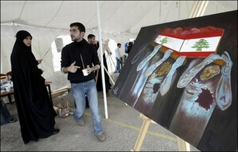

+++
title = "شباب الجزائر: لبنان الحلم الجميل!"
date = 2006-12-16
authors = ["كامل الشيرازي"]

[taxonomies]
authors = ["kaml-elshirazi"]
sections = ["siyasa"]

[extra]
section_name = "سياسة"
share_image = "/media/admins.20at.com/marwa05/lebanon_shabab_.photo.jpg"
summary = "يتفاعل قطاع واسع من الشباب الجزائري مع ما يحدث في لبنان، ويتابعون بألم تطور الأوضاع هناك، وينقسم شباب في آرائهم فهناك من يتصور أنّ أوضاع لبنان بارقة أمل، وآخرين"
section_slug = "siyasa"
section_colour = "#9E2A2B"
thumb = "/media/admins.20at.com/marwa05/lebanon_shabab_.photo.jpg"
n_comments = 2
original_url = "http://www.20at.com:80/20at/politics/2934.html"
archived = "20100215070325"
date_source = "byline/meta"
aliases_20at = ["/20at/politics/2934.html?layout=default&page=&print=1&tmpl=component", "/20at/politics/2934.html"]

[extra.provenance]
original_url = "http://www.20at.com:80/20at/politics/2934.html"
capture_url = "https://web.archive.org/web/20100215070325/http://www.20at.com:80/20at/politics/2934.html"
capture_label = "١٥ فبراير ٢٠١٠، ٠٧:٠٣ UTC"
date_note = "من سطر التوقيع في المقال"
other_urls = ["/20at/politics/2934.html?layout=default&page=&print=1&tmpl=component"]
comments = "٢"
missing_images = ""
+++

<figure></figure>

يتفاعل قطاع واسع من الشباب الجزائري مع ما يحدث في لبنان، ويتابعون بألم تطور الأوضاع هناك، وينقسم شباب في آرائهم فهناك من يتصور أنّ أوضاع لبنان بارقة أمل، وآخرين يرون بأنّ الحراك الواقع هو "بداية انزلاق".

<h3>لبنانيون على طول..</h3>

يقول رياض، 27 سنة، منذ الذي حدث إبان الحرب السادسة، وأنا شغوف بما يحدث بلبنان، تراني أقضي الساعات يوميا وأنا أتتبّع ما يحدث منذ بدء اعتصام المعارضة، ويبدي رياض تعاطفا مع نصر الله وميشال عون، لكنه يرفض ما يحدث، وبهذا الصدد يرى:" كان من الأجدر بعد أن وضعت الحرب أوزارها، وسكتت لغة المدافع، أن تحل محلها لغة البناء وإعادة الإعمار، وليس التنابز بالألقاب، وكم كان جميلا لو استكان الفرقاء إلى لغة الحوار بدل المواجهة"، وعلى الرغم من استيائه من أداء الحكومة الجزائرية، إلاّ أنّ رياض يرفض استنساخ المشهد اللبناني في بلاده، جازما:"يكفينا ما اكتوينا به".

وفي حين تقول زليخة، 20 سنة، أنّها تتابع القضية بوعي وتأثر، ومستعدة لبذل كل ما لديها من وقت وجهد للتواصل مع المعارضة الفعلية في لبنان، التي ليس لها وجود في الوطن العربي على حد تعبيرها، وتتمنى أن يصاب بلدها بعدوى المعارضة اللبنانية لعلّ وعسى تتغير الأوضاع من خلال تظاهر سلمي، يبتعد عن التشدد الذي وظّفه الإسلاميون في الجزائر فيما مضى.

<h3>من طراز خاص</h3>

من جانبه يؤكد مصطفى، 26 سنة، على حرصه عدم تفويت ولو دقيقة مما يحصل بلبنان، ويتوسم أنّ الوضع هناك صحي، طالما أنّ بيروت وباقي الحواضر تحتضن شبابا من طراز خاص يحملون هم أمتهم ويعيش قضاياها ويصرون على التغيير السلمي، يوضح: "ياليت كان للعرب شباب كهؤلاء يتخذون لبنان نموذجا لـ(تصحيح) الأوضاع في بلدانهم"، ولا يتردد مصطفى في التشديد على اعتزازه بشخص نصر الله، ويقول أنّه لا يزال يتابعه وبأكثر حدة من السابق، معلّقا:" هو من لقّن الشباب تذوق طعم المقاومة وحبّها، ومكّن المواطنين من التفاعل الايجابي مع قضايا وطنهم"، وينتهي إلى التمني لو كان هناك 23 نصر الله بعدد الدول العربية حتى يتّم تصنيع "نيولوك" جديد لشباب العرب يجيد التعامل مع الأحداث وأمهات القضايا.

أما أنيس، 29 سنة، فيرى أنّ سجال الأغلبية النيابية والمعارضة، يكتسي سمة إيجابية تدفع باتجاه التكامل والتنافس ولا ينطوي على عدائية مقيتة مثلما يتصور البعض، وإذ يؤكد على تتبعه لخطابات نصر الله كما في السابق ومناصرته تسويق السيناريو اللبناني عبر كل البلاد العربية، لأنّ ذلك سيحول دون تمرير الخطط الأمريكية المشبوهة.

<h3>خطأ</h3>

تبدي انشراح، 29 سنة، حزنها لما يعيشه لبنان، وتعلق:"مع كل لقطة أتابعها يصيبني الذعر حيال أفق لبنان، فهل كتبت البلايا على سكان هذا البلد؟، لا أعتقد أنّ هناك من يتمنى تكرار ما يحدث في لبنان بموطنه"، فعهد سقوط الحكومات بهذه الطريقة قد ولّى، كما تذهب انشراح إلى حد انتقاد نصر الله، وترى أنّه كان بإمكانه انتهاج تكتيك مغاير غير التصعيد، وتتصور أنّه شوّه جمال الصورة التي رسمها لنفسه خلال الفترة المنقضية، لذا فإنّها تقرّ أنّ انجذابها للأمين العام لحزب الله خفّت وطأته عما كان خلال خطاباته الساخنة ضد اسرائيل.

من جانبه، يلاحظ عدنان، 23 عاما، أنّ الصورة متباينة ولكل فريق حججه، إلاّ أن الحقيقة التي لا تقبل الشك أو التمحيص، لبنان ليس بحاجة إلى زوابع ينتجها أو يصدرها حتى تحل المشاكل السياسية، وتوقظ همم وإرادات الشباب والشعوب إجمالا، وإنما بلد الأرز يحتاج إلى التضامن والإخاء والجسد الواحد والاتحاد لمقاومة الأعداء الحقيقيين، وليس إسقاط الحكومة، طالما أنّ ذلك سيؤدي إلى مفسدة أكبر، ولا يتحرّج عدنان محدثنا من التعريض بشخص نصر الله، واعتباره أحد أسباب الأزمة، رغم اعترافه بأنّه كان مفتاح النصر على الكيان قبل أشهر.

