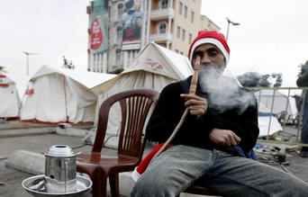

+++
title = "شباب الأردن: اعتصام لبنان شأن خاص!"
date = 2006-12-17
authors = ["طارق ديلواني"]

[taxonomies]
authors = ["tarek-dilwani"]
sections = ["siyasa"]

[extra]
section_name = "سياسة"
share_image = "/media/admins.20at.com/marwa05/lebanon_ordn.jpg"
summary = "ما أن تبادر بالسؤال لكثير من الشبان والفتيات في الأردن حول متابعتهم لما يحدث في لبنان حتى يسبقك أغلبهم مقاطعا \" لا نهتم بالسياسة\"!"
section_slug = "siyasa"
section_colour = "#9E2A2B"
thumb = "/media/admins.20at.com/marwa05/lebanon_ordn.jpg"
n_comments = 1
original_url = "http://www.20at.com:80/20at/politics/2935.html"
archived = "20100215070331"
date_source = "byline/meta"
aliases_20at = ["/20at/politics/2935.html?layout=default&page=&print=1&tmpl=component", "/20at/politics/2935.html"]

[extra.provenance]
original_url = "http://www.20at.com:80/20at/politics/2935.html"
capture_url = "https://web.archive.org/web/20100215070331/http://www.20at.com:80/20at/politics/2935.html"
capture_label = "١٥ فبراير ٢٠١٠، ٠٧:٠٣ UTC"
date_note = "من سطر التوقيع في المقال"
other_urls = ["/20at/politics/2935.html?layout=default&page=&print=1&tmpl=component"]
comments = "١"
missing_images = ""
+++

<figure></figure>

ما أن تبادر بالسؤال لكثير من الشبان والفتيات في الأردن حول متابعتهم لما يحدث في لبنان حتى يسبقك أغلبهم مقاطعا " لا نهتم بالسياسة"!

هذا هو حال أغلب الذين التقي بهم مراسل عشرينات في الأردن، حين حاول التعرف على متابعتهم للأحداث التي تمر بها الأمة العربية عموما ولبنان خصوصاًُ في سعي لإسقاط التجربة السياسية الديمقراطية في بيروت.

<h3>شأن خاص !</h3>

ما يحدث في لبنان "شأن خاص" هذا ما عبرت عنه ساندرا أبو ليل الطالبة بكلية الاقتصاد - والتي قالت" اقلب المحطات يوميا في ساعات المساء ومن باب العلم بالشيء أحاول التوقف لدقائق في المحطات الفضائية اللبنانية لمعرفة ما يدور من سجال ثم ما البث أن أغير المحطة فورا إما لقنوات المسلسلات والأفلام أو إلى محطات الأغاني والفيديو كليب".

وتضيف ساندرا "أعتقد أن السياسة هي فن الكذب ولا أثق بالسياسيين فلم ولن أضيع وقتي في متابعة خطابات حسن نصر الله أو غيره من الزعماء اللبنانيين فلدي ما هو أهم، لكنها تفصح عن السبب الحقيقي وراء عدم متابعتها لخطابات نصر الله والمتمثل في لهجته التي تتسم بالتهويل والتخوين والتلويح بالقوة".

ساندرا حالها كحال كثيرين من شباب هذه الأيام بالكاد تعرف عدد أفراد حكومتها فكيف تفكر بإسقاطها ديمقراطيا أو تتمنى أن يحدث في بلدها الأردن ما يحدث في لبنان ..لكنها رغم ذلك تقول" لا أتمنى ان يحدث في بلدي الحبيب الأردن ما يحدث في لبنان فما يحدث هناك نهايته الحرب الأهلية ..وتسترسل" قد أكون غير راضية عن حكومتي لكنني لن أصل إلى مرحلة إسقاطها بالتظاهر والفوضى"!

ندين ابو سمرة – سارعت بالإجابة بأنها لا تتابع مثل هذه الأمور وعندما سألناها عن خطابات نصر الله أجابت " من يكون"؟ ..ففضلنا عدم الاسترسال في سؤالها عن أمور من الواضح أنها تجهلها ولا تحظى لديها بأي متابعة أو اهتمام.

<h3>"ملناش" بالسياسة!</h3>

هذه العبارة هي الغالبة على ألسنة الكثيرين .. فالخوض في السياسة حتى لو كانت خارجية لا زال من المحظورات والتابوهات في العرف الشعبي الأردني .. ولذلك لا تحظى نشرات الأخبار السياسية ولا الصحف بأي متابعة تذكر من قبل جيل الشباب.

سعد علوش – موظف مبيعات في أحد محلات الملابس - يفصح عن عدم متابعته للأخبار أو قراءة الصحف بسبب أوقات عمله الطويلة وبالتالي فهو غير متابع لما يدور في لبنان من أحداث .

لكنه في المقابل يكن المحبة والإعجاب لشخصية أمين عام حزب الله السيد حسن نصر الله ويرى فيه بطلاً قوميا منذ أيام الحرب حيث كان يحرص على متابعة خطاباته حتى لو كانت مسجلة وغير مباشرة أما الآن فهو لا يتابعها لانشغاله بالعمل والثاني أنها أقل أهمية من خطابات الحرب .

ويضيف زميله محمد "لا أتمنى أن يحدث في بلدي ما يحدث في لبنان مع أنني غير راض عن الحكومات الأردنية المتعافية وليس الحالية فقط فهي برأيه جلبت الفقر والبطالة وضيق الحال للأردنيين، ويستكمل محمد كلامه: "ولا أعتقد أنه من الممكن أن يحدث في الأردن ما يحدث في لبنان فالناس هنا لم يعتادوا الممارسات الديمقراطية والنزول إلى الشارع لأبسط الحقوق المعيشية فكيف بالإمكان أن يفعلوا ذلك لإسقاط حكومة, هذا فضلاً عن عدم اعتراف الحكومة بالشارع وبالتظاهر وسيلة للتعبير عن الرأي، ويتابع: "بعد أشهر سترتفع أسعار المحروقات في الأردن بشكل خيالي، وسنرى إن كان الشارع الأردني سيتحرك حينها أم لا؟".

<h3>بروفة الحكومات العربية !</h3>

غسان مرقة- ناشط الطلابي في الجامعة الأردنية - أوضح أنه يعتبر ما يحدث في لبنان هو" بروفة " حقيقية لما يمكن أن يحدث في باقي الدول العربية إن صممت الشعوب العربية على إسقاط حكومتها.

لكن غسان يعتبر أن الحالة اللبنانية فريدة وهي نموذج ديمقراطي وحيد في المنطقة العربية وبالتالي فإن مقارنة الشعب اللبناني بنظامه السياسي القائم بغيره من الشعوب العربية وأنظمتها غير دقيق، ويتابع كما يقول كل ما يحدث في لبنان لأنه ناشط في إحدى المدونات.

ويتابع غسان جميع خطابات وكلمات نصر الله ويحرص على توثيقها وتحليل ما بين سطورها كما يقول، لكن ليس بنفس الحماس الذي كان عليه الحال أثناء الحرب، ويبرر ذلك باختلاف الدافع وراء هذا الخطاب، فالحرب كانت قضية كل العرب والمسلمين ومسألة وجود وعدم وجود بالنسبة لهم أما اليوم فالأمرلا يزيد عن خلاف سياسي .

وحول الحكومة الأردنية يعتبر غسان أن ظروف الأردن السياسية والديمغرافية تختلف كثيراً عن لبنان وبالتالي فإن الحديث عن أي رغبة بإسقاط الحكومة يظل عبثا، فلا يوجد فرقاء بالأردن أو طوائف متناحرة ولا مذاهب مختلفة ولا حتى معارضة حقيقية فاعلة برأيه

<h3>الدور علينا حق !</h3>

.وترسم لنا منتهى - طالبة جامعية – صورة قاتمة للأحداث في المنطقة عموما فهي تري من خلال متابعتها لما يدور في لبنان أنها ستكون مقدمة لانفراط عقد الحكومات والأنظمة العربية جميعها خاصة في مصر التي بدا فيها الشارع بالتحرك بجرأة .

وتقول منتهى: "لا أتابع ما يحدث في لبنان يومياً لكنني متابعة جيدة، فأنا أحب لبنان كبلد عربي وأحب اللبنانيين وأهتم بمتابعة أخبارهم خاصة أن ما يحدث هناك من اغتيالات وحروب واعتصامات وهي أمور جميعها تفرض علينا كعرب أن نتابعها وكأنها شان أردني خالص لأن "الدور علينا" على حد تعبيرها.

وتضيف منتهى " خلافا لكثير من الأردنيين لا تحظى شخصية نصر الله وخطاباته بإعجابي واهتمامي فقد ولى زمن الخطابات القومية الرنانة".

أما بلال الشيخ المتابع كما يقول لما يحدث باستغراب فيحمل وجهة نظر أخرى وهي أن كل ما يقال عن الديمقراطية والوحدة الوطنية في لبنان هراء وكذب معتبرا أن أكثر الشعوب العربية انقساما هو الشعب اللبناني.

وبعيدا عن وجهة النظر هذه يتمنى بلال بشدة إسقاط الحكومة الأردنية الحالية لكن ليس على حساب اختلاف الأردنيين وانقسامهم مضيفا "بإمكان البرلمان إسقاط الحكومة لدينا وعدم منحها الثقة، لكن للأسف البرلمان لدينا لا يقوم بدوره".

