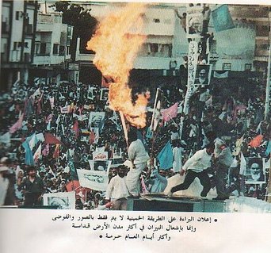

+++
title = "ترقب .. مظاهرة إيرانية بمكة!"
date = 2006-12-27
authors = ["عبد الله الغامدي"]
aliases = ["/articles/20at-eshtbak-2978/"]

[taxonomies]
authors = ["abdallah-elghamdi"]
sections = ["eshtbak"]

[extra]
section_name = "اشتباك"
share_image = "/media/admins.20at.com/marwa05/mozahra.jpg"
summary = "يسود الشارع السعودي حالة ترقب وحذر، تحسبا لأي محاولات لخلق اضطراب طائفي من قبل الحجاج الإيرانيين خلال موسم الحج الحالي، الأمر الذي أدى إلى مطالبة البعض بمنع الإ"
section_slug = "eshtbak"
section_colour = "#E77B13"
thumb = "/media/admins.20at.com/marwa05/mozahra.jpg"
n_comments = 5
original_url = "http://www.20at.com:80/20at/politics/2978.html"
archived = "20100301225303"
date_source = "byline/meta"
aliases_20at = ["/20at/eshtbak/2978.html", "/20at/politics/2978.html?layout=default&page=&print=1&tmpl=component", "/20at/politics/2978.html"]

[extra.provenance]
original_url = "http://www.20at.com:80/20at/politics/2978.html"
capture_url = "https://web.archive.org/web/20100301225303/http://www.20at.com:80/20at/politics/2978.html"
capture_label = "١ مارس ٢٠١٠، ٢٢:٥٣ UTC"
date_note = "من سطر التوقيع في المقال"
other_urls = ["/20at/eshtbak/2978.html", "/20at/politics/2978.html?layout=default&page=&print=1&tmpl=component"]
comments = "٥"
missing_images = ""
+++

<figure></figure>

يسود الشارع السعودي حالة ترقب وحذر، تحسبا لأي محاولات لخلق اضطراب طائفي من قبل الحجاج الإيرانيين خلال موسم الحج الحالي، الأمر الذي أدى إلى مطالبة البعض بمنع الإيرانيين من الحج، وخاصة بعد تصريحات قادة إيرانيين تدعو الحجاج لإحياء مراسم (البراءة من المشتركين) بشكل "أكثر روعة".

وهو ما قد ينذر بصدامات تعيد للأذهان اشتباكات مماثلة حدثت قبل 19 عاما بين الحجاج الإيراينيين ورجال الأمن السعوديين، وراح ضحيتها أكثر من 400 شخص.

وقبل الخوض في الحديث، لا بد أن نعرف أولا ما هي مراسم البراءة من المشركين؟ ولماذا يتخوف منها السعوديين؟ ولماذا يدعو إليها الإيرانيين؟

<h3>إعلان البراءة</h3>

"البراءة من المشركين" هو شعار ألزم الخميني حجاج بيت اللّه الحرام برفعه وترديده في مواسم الحج، من خلال مسيرات أو مظاهرات تتبرأ من المشركين من خلال ترديد هتافات بهذا المعنى، من قبيل "الموت لأمريكا الموت لإسرائيل"، باعتبار أن الحج يجب أن يتحول من مجرد فريضة دينية عبادية تقليدية الى فريضة عبادية و سياسية.

ولم يكن الإيرانيين يؤدون هذه المراسم قبل الثمانينات، لكنهم بدءوا في ممارستها بعد دعوة الخميني لهم برفع هذا الشعار، والاصرار على ترديده في مواسم الحج، ايمانا منهم بان الفقيه حين يصدر أمرا معينا يلزم الناس بالعمل بموجبه.

فإعلان البراءة من المشركين عند الخميني واجب عبادي سياسي، ولا اختصاص له بزمان معين، وانه من أركان فريضة الحج التوحيدية وواجباتها السياسية التي بدونه لا يكون الحج حجا.

وقد طلب الخميني من الحجّاج - الإيرانيين وغير الإيرانيين - المشاركة فيها، وإطلاق صرخة البراءة من المشركين والملحدين في جوار بيت التوحيد.. حيث إنّ إعلان البراءة هو المرحلة الأولى من الجهاد.

<h3>حساسية سعودية</h3>

وقد أثار رفع الشعار المذكور حساسية السلطات السعودية واعتبرته أمرا منافيا للمظهر العبادي لفريضة الحج، ففي عام 1987 قام الحجاج الإيرانيين بتسيير مظاهرات حاشدة خلال أداء هذه المراسم، مما أدى الى حدوث مصادمات شديدة بين قوات الأمن السعودي وجموع المتظاهرين تسببت في سقوط 402 قتيلا.

والمتابع لوسائل الإعلام السعودية في الأسابيع القليلة الماضية يلاحظ أن هناك اهتماما مكثفا بما يسمى "الخطر الإيراني الشيعي"، حتى ذهب البعض إلى اعتباره أكثر من الخطر اليهودي، ولاسيما بعد التدخلات الإيرانية في كل من العراق ولبنان.

وقاطعت إيران مواسم الحج في أعوام 88و89 و1990 على خلفية تلك الأحداث، غير أن الحجاج الإيرانيين قصدوا الحج ثانية في موسم الحج 1991.

ولم تتراجع القيادات الدينية والسياسية في ايران عن موقفها، وأصرت على احياء هذا الشعار وترديده في مواسم الحج المختلفة الى وقتنا الحاضر، ولكن لم يعد يتم إحياؤه على نطاق واسع كما حدث عام 1987.

ولكن إذا كانت الأمور تسير بشكل طبيعي من حينها فما الذي جد في الموضوع حتى يسود هذا التوجس؟

<h3>تصريحات إيرانية</h3>

في ظل هذه الأجواء صدر عدد من التصريحات الإيرانية بشأن مراسم البراءة من المشركين اعتبرها السعوديون غير مطمئنة، فآية الله السيد على خامنئي قال لدى استقباله القائمين على الحج لهذا العام: "في الظروف التي يظهر فيها الاستكبار العالمي حقده على المسلمين بأشكال مختلفه وحتى بأساليب عنيفة وقاسية فان البراء‌ة من المشركين واعلان المسلمين موقفهم تجاه هذا السلوك يعد احدى المسائل المهمة في مراسم الحج".

ورغم أنه حذر من أن "بعض العناصر العميلة للاستعمار مكلفة بطرح قضايا خلافية في موسم الحج، ويجب على الحجاج الايرانيين سواء الشيعة او السنة منهم ان يراقبوا عدم الوقوع في هذا الفخ الخطير، ونصيحتنا للحكومة السعودية ايضا ان تمنع نشاط هذه العناصر المثيرة للفتنة".

وهو الأمر الذي اعتبره البعض تحريض غير مباشر، خاصة أن الخميني وجهه نصحه للحكومة السعودية قائلا: يجب على الحكومة السعودية، باعتبارها مضيفة المسلمين في مناسك الحج، أن تكون في الطليعة في البراءة من المشركين، واذا لم يتمكنوا من القيام بهذا الواجب لسبب من الاسباب، فاننا سنؤدي واجبنا وسنتخذ موقفا منطقيا ومستدلا.

وفي السياق نفسه أكد الرئيس الإيراني أحمدي نجاد لدى ترأسه اجتماعاً للمجلس الاعلى للحج على اقامة مراسم البراءة من المشركين هذا العام "بروعة اكثر من العام السابق".

وكذلك أعرب رئيس بعثة الحج الايراني الشيخ محمدي ري شهري عن امله في اقامة مراسم البراءة من المشركين هذا العام في صحراء عرفات بصورة افضل من السنوات الماضية.

كل هذه التصريحات فسرتها جريدة الجمهورية المصرية في عدد الصادر 22-12-2006، حيث نقلت عن مصادر عربية تحذيرانها من أن تصريحات خامنئي تعد ضوءا أخضر للآطراف الايرانية والعراقية المكلفة بتنفيذ هذه التظاهرات وذلك للانتصارات التي حققها حزب الله اللبناني في حربه مع اسرائيل.

ونقلت الجريدة عن مصادر عراقية مقربة من أوساط المجلس الأعلى للثورة الاسلامية أن ايران أوعزت لكل من عبد العزيز الحكيم ومقتدى الصدر ضرورة اخيتار أفضل عناصر مليشياتها الأكثر قدرة على خوض المواجهات الدامية ودسهم ضمن قوافل الحجاج ليلتقوا في الحرمين الشريفين مع عناصر الحرس الثوري الإيراني.

<h3>على أهبة الاستعداد</h3>

من جهته أعلن وزير الداخلية السعودي الأمير نايف بن عبد العزيز ال سعود ان السعودية مستعدة للتعامل مع اندلاع أي اضطراب طائفي خلال موسم الحج.

وقال وزير الداخلية السعودي خلال تصريحات نقلتها وسائل الاعلام الرسمية "لا يوجد هذا القلق- بشأن أي اضطرابات طائفية- لأن الجميع أتوا لاداء فريضة الحج وأعتقد ان الايمان بالله والخوف منه سيكون رادعا لهذا الامر".

واستطرد: "اضافة الى هذا فنحن اتخذنا كل الاحتياطات، وكقاعدة أمنية لا نستبعد أي حدث، ونحن على كامل الاستعداد ونرجو ألا نحتاج لاستعمال قدراتنا في هذا".

<h3>تسييس الحج</h3>

بدورهم حذر مجموعة من العلماء من مختلف الطوائف من تسييس الحج وتهيئته لخدمة أغراض سياسية أو تحقيق مآرب لا علاقة لها بمقاصد الحج الشرعية التي فرضها الله سبحانه وتعالى..واعتبر العلماء في حديث لجريدة "الوطن السعودية" أن تسييس الحج هو عبارة عن تعطيل مبطن للحج ومحاولة للتشفي أو خدمة مصالح لا علاقة لها بالدين.

حيث قال المستشار القضائي الشيخ "عبدالمحسن العبيكان" إن الحج من أعظم شعائر الدين، واتخاذ هذه الفريضة لإثارة الفتن الطائفية أو حمل شعارات سياسية فإن ذلك إخراج لهذه الشعيرة عن مقاصدها التي هي من أجلها فرضت، فيجب أن يتأدب الحجاج بآداب الحج، فالحج عبادة محضة ولا يمكن أن يعتبر مناسبة سياسية أبداً أو أن يستغل لإثارة الفتن أو لتصفية حسابات طائفية أو عرقية.

ومن جهته أشار السيد "طاهر الشميمي" من علماء الطائفة الشيعية في السعودية: " هناك من يدعون إلى شعارات سياسية أو مظاهرات، وأنا أقول إنها في حال إخلالها بالعملية الأمنية أو الهدف الديني للحج، فهي فتنة والفتنة نائمة لعن الله من أيقظها، كما أنه لا ينبغي إثارة المصطلحات السياسية أو المظاهرات البشرية أو عناوين الشغب في الحج أو استغلال المناسبات الدينية كالحج لتحقيق أهداف ومآرب إقليمية وعرقية."

وعلق الداعية بوزارة الشؤون الإسلامية والأوقاف والدعوة والإرشاد الشيخ "ماجد المرسال" على الموضوع بقوله: أن تسييس الحج هو النواة الأولى لهدم الصف الإسلامي وتفريق وحدة المسلمين، ومن ثم لن تكون هناك وحدة وسيكون هناك اختلاف

فهل يلتزم الحجاج الإيرانيون؟ أم سنشهد كارثة جديدة كما حدث في عام 1987؟ هذا ما ستثبه الأيام القادمة!!

