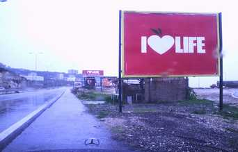

+++
title = "في لبنان..السياسة بالألوان"
date = 2007-01-27
authors = ["فخر الدين أيوبي"]

[taxonomies]
authors = ["fakhr-eldin-aiobi"]
sections = ["eshtbak"]

[extra]
section_name = "اشتباك"
share_image = "/media/admins.20at.com/aly/i_love_live.jpg"
summary = "صادر السياسيون في لبنان ألوان الحياة وتقاسموها فيما بينهم، فأصبح اللون البرتقالي حقاً حصرياً للتيار الوطني الحر، والأصفر ملكاً لحزب الله، والأخضر لتيار المردة، "
section_slug = "eshtbak"
section_colour = "#E77B13"
thumb = "/media/admins.20at.com/aly/i_love_live.jpg"
n_comments = 0
original_url = "http://20at.com/20at/politics/3115.html"
archived = "20100105200141"
date_source = "byline/meta"
aliases_20at = ["/20at/politics/3115.html"]

[extra.provenance]
original_url = "http://20at.com/20at/politics/3115.html"
capture_url = "https://web.archive.org/web/20100105200141/http://20at.com/20at/politics/3115.html"
capture_label = "٥ يناير ٢٠١٠، ٢٠:٠١ UTC"
date_note = "من سطر التوقيع في المقال"
other_urls = []
comments = ""
missing_images = "٤"
+++

<figure></figure>

صادر السياسيون في لبنان ألوان الحياة وتقاسموها فيما بينهم، فأصبح اللون البرتقالي حقاً حصرياً للتيار الوطني الحر، والأصفر ملكاً لحزب الله، والأخضر لتيار المردة، أما تيار المستقبل فلونه "الأزرق الفاتح".

ليصبح المواطن اللبناني محروماً من التمتع بهذه الألوان، إن أراد العيش مرتاح البال بعيداً عما يجري من سجالات ومهاترات سياسية.

<h3>لافتات سياسية</h3>

لم تكتف الأحزاب والتيارات اللبنانية بمصادرة الألوان فقط، بل عمدوا أيضاً الى مصادرة الشاشات والطرقات والشعارات، وأخيراً وليس آخراً صادروا "اللافتات"، نعم اللافتات الإعلانية التي أصبحت مسرحاً جديداً لحرب السجال السياسي الدائر بين فريقي الصراع في لبنان "الحكومة والمعارضة".

تحاول الحكومة اللبنانية من خلال هذه اللافتات الإعلانية المنتشرة على جانب الطرقات وبأحجام مختلفة الترويج لسياساتها الاقتصادية، لاسيما الورقة الإصلاحية التي تسعى لتقديمها خلال الأيام القادمة لمؤتمر الدول المانحة والداعمة للبنان (باريس 3)، وتقول الحكومة في إعلاناتها عن الورقة الإصلاحية أن "الإصلاح ليس بالكلام ... إنما بالأرقام".

<h3>المعارضة ترد</h3>

فترد المعارضة بعشرات التصاميم لها وفي لوحات مقابلة وأيضاً "بالأرقام، نسبة الدين العام في مؤتمر باريس(1) كانت 26 مليار دولار، وفي باريس(2) 32 مليار دولار وبلغت في مؤتمر باريس(3) 45 مليار دولار"، وبالأرقام تقول لافتات اخرى للمعارضة أن "83% من المهجرين لم يعودوا الى منازلهم" و"42% من الشباب هاجروا" و "7 انتهاكات دستورية حتى الآن".

<h3>بدنا نعيش!</h3>

لم ينته الأمر هنا، فقد واصلت المعارضة اللبنانية هجومها على الحكومة وعلى قوى الأكثرية الموالية لها، حيث قامت بمصادرة شعارين -لطالما رفعتهما قوى الأكثرية- من خلال لافتات إعلانية حمراء كتب عليها باللون الأبيض "أنا أحب الحياة" و"بدنا نعيش"، فأصبح الشعارين عند المعارضة والتي اختارت ذات اللون والخط "أنا أحب الحياة ... بكل ألوانها" و"بدنا نعيش ... بلبنان، بكرامة، بشرف، بلا ديون ...".

وفيما تستمر هواية نشر غسيل السياسة اللبنانية على جنبات الطرقات العامة من جانب الموالين للحكومة والمعارضين لها، يتفنن المواطنون في كتابة تعليقاتهم الساخرة من الحال التي وصل إليها البلد، فيضيفون على شعار "بدنا نعيش"، جملة باللون الأسود هي جزء من مثل لبناني كتبت باللهجة العامية اللبنانية "لينبت الحشيش" وتعني "حتى ينبت العشب"، فيحاول كاتبها لفت نظر الجمهور الى أن الشعب اللبناني أصبح بقيادة هؤلاء السياسيين الحاليين كالأنعام بل أضل سبيلا، لكن المضحك في الأمر هو استغلال إحدى القنوات الغنائية العربية شعارات الموالاة والمعارضة في الترويج للقناة والدعوة للغناء "بدنا نغني".

ولعل السائح القادم الى لبنان في موسم 2007 سيحتاج بالإضافة الى الدليل السياحي، دليل السياسة اللبنانية وشعاراتها، حتى يتمكن من فهم فوضى الشعارات المتداخلة.. وفك شفرة الألوان!!

ـــــــــــــــ

اقرأ أيضا:

لبنان ... نار الفتنة من جديد؟؟!!

 لبنان الذي لا يهدأ 

