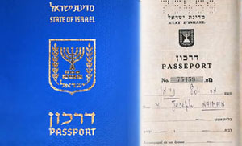

+++
title = "أخويا إسرائيلي!"
date = 2007-02-01
authors = ["محمد الكسيح"]

[taxonomies]
authors = ["mohamed-elkasih"]
sections = ["eshtbak"]

[extra]
section_name = "اشتباك"
share_image = "/media/admins.20at.com/do3a2/passport.jpg"
summary = "\"أيوه يا محمد أنا في تل أبيب..ساعات وأكون عندكم إن شاء الله..انتظروني عند شيراتون القاهرة هأتصل بك لما أوصل..\"."
section_slug = "eshtbak"
section_colour = "#E77B13"
thumb = "/media/admins.20at.com/do3a2/passport.jpg"
n_comments = 5
original_url = "http://20at.com/20at/politics/3158.html"
archived = "20100105200249"
date_source = "byline/meta"
aliases_20at = ["/20at/politics/3158.html"]

[extra.provenance]
original_url = "http://20at.com/20at/politics/3158.html"
capture_url = "https://web.archive.org/web/20100105200249/http://20at.com/20at/politics/3158.html"
capture_label = "٥ يناير ٢٠١٠، ٢٠:٠٢ UTC"
date_note = "من سطر التوقيع في المقال"
other_urls = []
comments = "٥"
missing_images = ""
+++

<figure></figure>

"أيوه يا محمد أنا في تل أبيب..ساعات وأكون عندكم إن شاء الله..انتظروني عند شيراتون القاهرة هأتصل بك لما أوصل..".

كانت هذه كلمات أخي القادم من تل أبيب، وبالمناسبة أخي إسرائيلي، ويحمل جواز سفر إسرائيلي، وهذا يعنى أنه سيتم استقباله على الحدود بمنتهى الأدب والاحترام ولا ينتظر نفس المدة الطويلة التي تنتظرها الجنسيات الأخرى ومن بينها الجنسية المصرية بالطبع!

<h3>ذكريات البسبور الأزرق</h3>

ولدت في حي الأزبكية في العمارة المقابلة لقسم الشرطة تماما، الذي يجاور "سور الأزبكية"، الذي قضيت طفولتي متنزها بينه وبين حديقة الأزبكية وميدان الأوبرا، ولكن كل شيء تغير الآن، فلم يعد السور ولا الميدان ولا الحديقة كما هي، ولا أدرى هل تغيروا للأسوأ أم للأحسن، ما أدركه فقط أنني أفتقد للشكل القديم للسور والحديقة والميدان حتى شكل العمارة وقسم الشرطة كثيرا.

الشيء الوحيد الذي لم يتغير شكله منذ ولدت "البسبور الأزرق" (جواز السفر)، وكل فلسطيني في مصر يعرف جيدا البسبور الأزرق والذي يعنى أنك فلسطيني مقيم في القاهرة، وعليه مكتوب كلمة "لاجئ" بالعربية والفرنسية.

المهم أننا تربينا على حقيقة ثابتة ألا وهي حمل البسبور الأزرق والذي يعنى الكثير من المشاكل أو على الأقل الكثير من الحرمان، وأبسط تلك الأمور هو أنك لا تستطيع السفر خارج مصر لأكثر من 6 شهور وإلا تسقط الإقامة ولا يسمح لك بالعودة مرة أخرى.

وخلال حياتي وعلى مدار ثلاثين عاما تنقلت بين مصر وليبيا وغزة..عانيت الكثير لأنني احمل ذلك البسبور الأزرق، الأمر أحيانا لا يتعلق بكوني فلسطيني أم لا، ولكن لكوني أحمل ذلك البسبور الأزرق، فالمصريين لا يسمحون لي بالسفر خارج البلاد لأكثر من 6 شهور، أما الليبيين فلا يسمحوا لي بالخروج إلا إذا كانت مغادرة نهائية، أما الفلسطينيين فلا يسمحوا لي إلا بزيارة 7 شهور من خلال تصريح تمنحه دولة إسرائيل، إلى غير ذلك من القصص التي لا تنتهي على مدار 30 عاما لي ولأخوتي، الذين عانوا بدورهم من قصص أخرى هنا أو هناك على مدار سنوات الدراسة والعمل.

لذا كان التخلص من البسبور الأزرق أمنية يسعى لها الجميع بأي طريقة ممكنة، بالنسبة لأختي كانت المسالة سهلة فأمي مصرية من المحلة وكانت تصر على زواجها من زوج مصري، وعندما حدث ذلك حصلت على الجنسية المصرية بعد عامين من الزواج وبإجراء بسيط وسهل جدا من خلال مجمع التحرير.

<h3>صاحب الجنسية الإسرائيلية</h3>

أما بالنسبة لأخي فقد جاءته الفرصة للتخلص من البسبور الأزرق عندما اتصلت بنا أسرتنا من حيفا بالأرض المحتلة وعرفنا أن لنا أقارب في زيارة للقاهرة وحدث التعارف وتزوج أخي من بنت عمه المقيمة بالأرض المحتلة ثم تقدم بطلب إلى السفارة الإسرائيلية بمصر لعمل "لم شمل" كما يسمونه في إسرائيل.

وبالفعل سافر إلى هناك وحصل على الجنسية الإسرائيلية بعد إقامة استمرت 7 سنين كاملة متعبة لم يكن مسموح له بالخروج نهائيا من إسرائيل وإلا خسر الفرصة في الحصول على الجنسية الإسرائيلية، والحصول عليها يعنى أنك يمكنك فعل الكثير ففي الداخل مستوى المعيشة عالي جدا فيمكنك الحصول على منزل 500 أو 600 متر بسيارة، ولكنك تبقى مديونا للحكومة طوال عمرك وربما يمتد الأمر للورثة بعد ذلك.

وهكذا أصبح لي أخت مصرية، وأخ إسرائيلي، أما أنا فبقيت فلسطيني ومحاصرا بالبسبور الأزرق، وأحصل على إقامة داخل مصر كل 5 سنوات، وأخيرا عرفت بوجود قانون يسمح لأولادي بالحصول على الجنسية المصرية في حال كانت الأم مصرية وهذا متحقق فأنا متزوج من مصرية من المحلة.

وبينما أنا أقف في انتظار أخي القادم من إسرائيل، كنت أتذكر المرات القليلة التي مررت بها من مطار القاهرة والحدود البرية سواء الليبية أو الفلسطينية والمشاهد التي عشتها خلال ذلك، حتى حضر أخي وكان أول سؤالي له "أيه الأخبار على الحدود" وكان الرد "احترامات على الآخر"!!.

_____________________________________

* محمد الكسيح، شاب فلسطيني مقيم بمصر، وقد أرسل لنا هذه التجربة الشخصية التي تعبر عن رأيه فقط، ولا تعبر عن رأي الموقع بالضرورة، وندعوكم بأن ترسلوا لنا مشاركاتكم وتجاربكم الشخصية على البريد الإلكتروني:

هذا البريد الالكتروني محمى من المتطفلين , يجب عليك تفعيل الجافا سكر يبت لرؤيته

