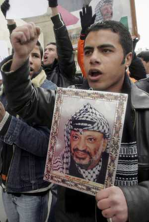

+++
title = "الشباب .. شماعة الصراع الفلسطيني!"
date = 2007-02-04
authors = ["عاطف دغلس"]

[taxonomies]
authors = ["atef-deghles"]
sections = ["siyasa"]

[extra]
section_name = "سياسة"
share_image = "/media/admins.20at.com/aly/internal_fighting.jpg3.jpg"
summary = "تصاعد عمليات الاقتتال الداخلي في الساحة الفلسطينية وتكراره بعد يومين من الهدنة التي تم التوصل إليها بين فتح وحماس ومحاصرة الجامعة الإسلامية بغزة.. لم يكن محض صد"
section_slug = "siyasa"
section_colour = "#9E2A2B"
thumb = "/media/admins.20at.com/aly/internal_fighting.jpg3.jpg"
n_comments = 0
original_url = "http://20at.com/20at/politics/3167.html"
archived = "20100105200035"
date_source = "byline/meta"
aliases_20at = ["/20at/politics/3167.html"]

[extra.provenance]
original_url = "http://20at.com/20at/politics/3167.html"
capture_url = "https://web.archive.org/web/20100105200035/http://20at.com/20at/politics/3167.html"
capture_label = "٥ يناير ٢٠١٠، ٢٠:٠٠ UTC"
date_note = "من سطر التوقيع في المقال"
other_urls = []
comments = ""
missing_images = ""
+++

<figure></figure>

تصاعد عمليات الاقتتال الداخلي في الساحة الفلسطينية وتكراره بعد يومين من الهدنة التي تم التوصل إليها بين فتح وحماس ومحاصرة الجامعة الإسلامية بغزة.. لم يكن محض صدفة، أو طيش شبابي أو غيره..مما يطرح تساؤلا مهما حول أسباب هذا الاقتتال، ومن الذي يقف خلفه، فهل بالفعل أن هناك أشخاصا ينفذون هذه الأعمال وفق ما تمليه عليهم قياداتهم أم أنهم يقومون بها بتصرف منهم ووفق طيش شبابي متهور؟.

في حديثنا لـ "إسلام شهوان"، الناطق باسم القوة التنفيذية لحركة حماس، والتي معظم قياداتها من فئة الشباب، أكد أن الغالب على الطابع الفلسطيني أن معظم قياداتهم شابة، وهذا يلاحظ على العمل الميداني.

وقال شهوان لـ"عشرينات": "هناك أمور سلبية وأخرى ايجابية بهذا الموضوع، فجميل أن يكون قيادات شابة، ولكن يجب أن يكون للقيادات الشابة والكوادر مرجعية وقيادات سياسية تمثلها وتعطيها أوامرها، لأنها تكون صاحبة خبرة أكبر بالعمل السياسي.

<h3>لنا مرجعيتنا</h3>

ورأى شهوان أن هذه القيادات الشابة تتفاوت من فصيل لآخر، "وإن كان معظمنا قيادات شابة، ولكن لا يعني أننا أصحاب قرار لوحدنا، ولا يعني انه لا يكون لنا مرجعية سياسية، فمعظم القيادات بالتنفيذية شابة، ولكنا نأتمر بأوامر قادتنا، وبالتالي يكون هناك قوة لقرارنا".

وأضاف شهوان "نحن في القوة التنفيذية لنا مرجعية بآلية اتخاذا القرار، وإذا ما أردنا أن نقوم بعمل هناك مجلس قيادة للقوة هو الذي يقرر، فليس هناك أي شخص يتصرف بمفرده أو بناء على قراره لوحده، ومن يقوم بعمل مخالف لأوامر القوة يتم محاسبته بالقانون العسكري، بصفته موظف عسكري بالجهاز".

<h3>الشباب يستغلون</h3>

وأوضح شهوان أن القيادات الشابة تختلف من تنظيم لآخر، حسب أيدلوجية وفكر التنظيم، "فالتنظيمات الإسلامية مثلا تتآمر بأوامر قياداتها، ولكن مثلا بعض الفصائل وللأسف لا تأتمر قياداتها الشابة بمرجعياتها وقادتها السياسيين، وهذا ينعكس سلبا على علاقة التنظيم الداخلية بين بعضه البعض، وعلى علاقته بالمجتمع من حوله".

وأكد شهوان أن هناك استغلال لفئة الشباب من قبل القيادات الكبرى، فهناك تيار عندنا مثلا لا يروق له السلام ولا المودة السائدة بين أفراد الشعب، وبالتالي يدفع بشبابه وهم عادة ما يتصرفون بطيش وقلة وعي وغوغائية إلى الهاوية، وذلك بناء على خطط مبرمجة، يدفعون الشباب الطائش والمدفوع له أن يقوم بمثل تلك الأعمال، وهذا ما يقوم به التيار الانقلابي داخل فتح، وبالتالي هؤلاء الشبان ضائعون تحت إمرة أصحاب مصالح وفئويين في فتح"!!

ويقول شهوان أن للقوة التنفيذية علاقة جيدة وطيبة بالقيادات الشابة من حركة فتح، وهذه القيادات مغلوبة على أمرها، لأنها لا تستطيع لجم من يريدون أن يوصلوها للهاوية.

<h3>هناك تصرفي فردي</h3>

من جهته أكد "توفيق أبو خوصة"، الناطق باسم حركة فتح في غزة، أن جيل الشباب هو الجيل المؤثر في كل الحركات السياسي وهو الذي يرسم المستقبل لها.

ولم ينكر أبو خوصة أن هناك أفرادا في حركة فتح يقوم بمثل هذه الأعمال من وازع فردي وذلك دون الرجوع لقيادة سياسية، ولا يأتمرون بأوامر من هم أعلى منهم، وذلك "لأنهم لا يحتملون عواقب الاعتداء عليهم، ولذلك هم يقومون بردة الفعل".

وقال أبو خوصة في حديثه لـ"عشرينات": "نحن في حركة فتح نسعى لتجنيب الشعب الفلسطيني وخاصة فئة الشباب مغارم ما يجري على الساحة، وذلك عبر تعميم مواقف الانضباط وضبط النفس لدى شباب وحركة فتح انطلاقا من المسئولية الوطنية والتنظيمية، لأن هؤلاء الشباب ليس هذا موقعهم لإبراز كفاءاتهم وإمكانياتهم التي يجب أن تدخر لبناء الواقع الفلسطيني بشكل ايجابي".

ولام أبو خوصة التصعيد في هذه الأوضاع، مؤكدا أن حركة فتح لا تبادر إلى مثل تلك الأعمال، وأن ذلك نتيجة للفشل السياسي الذي وصلت إليه حركة حماس.

وتبقى الحقيقة ضائعة بين الشارع الفلسطيني، فيمن يعتدي على الآخرين، وبين من يتحمل المسئولية، وهذا ما يهدد حياة الشباب الفلسطيني الذين زادت هجرتهم بشكل كبير من الأراضي الفلسطينية، فمستقبلهم أصبح معدوما وحياتهم مهددة بالمخاطر.

