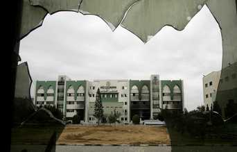

+++
title = "الدراسة بغزة .. حتي إشعار آخر!"
date = 2007-02-03
authors = ["رزان المدهون"]

[taxonomies]
authors = ["razan-elmadhon"]
sections = ["siyasa"]

[extra]
section_name = "سياسة"
share_image = "/media/admins.20at.com/aly/internal_fighting.jpg6.jpg"
summary = "امتدت الاشتباكات المحتدمة على الساحة الفلسطينية لتطال حرم الجامعة الإسلامية التي اقتحمها المسلحون فقاموا بتدمير ما طالته أيديهم من أجهزة ومعدات ومكاتب، كما قامو"
section_slug = "siyasa"
section_colour = "#9E2A2B"
thumb = "/media/admins.20at.com/aly/internal_fighting.jpg6.jpg"
n_comments = 0
original_url = "http://20at.com/20at/politics/3168.html"
archived = "20100105200406"
date_source = "byline/meta"
aliases_20at = ["/20at/politics/3168.html"]

[extra.provenance]
original_url = "http://20at.com/20at/politics/3168.html"
capture_url = "https://web.archive.org/web/20100105200406/http://20at.com/20at/politics/3168.html"
capture_label = "٥ يناير ٢٠١٠، ٢٠:٠٤ UTC"
date_note = "من سطر التوقيع في المقال"
other_urls = []
comments = ""
missing_images = ""
+++

<figure></figure>

امتدت الاشتباكات المحتدمة على الساحة الفلسطينية لتطال حرم الجامعة الإسلامية التي اقتحمها المسلحون فقاموا بتدمير ما طالته أيديهم من أجهزة ومعدات ومكاتب، كما قاموا بإحراق أغلب مباني الجامعة التي تحتضن أكثر من 20 ألف طالب وطالبة فلسطينية .

وفي تصريح لرئيس الجامعة الإسلامية الدكتور "كمالين شعت" لإحدى الإذاعات المحلية استنكر هذا الاعتداء على الجهات الأكاديمية، وأعلن تعليق الدراسة الجامعية – والتي كان من المفترض أن تبدأ اليوم السبت – حتى إشعار آخر، وحتى يتم تقدير حجم الخسائر المادية.

<h3>مخزن سلاح ؟!</h3>

المسلحون برروا اعتداءهم على الجامعة بوجود أسلحة ومتفجرات داخل الجامعة الإسلامية تستخدمها القوة التنفيذية التابعة لوزير الداخلية..

هذا التبرير كان مقنعًا لمحمد أبو عزيز، 24 سنة، الذي قال: "الجامعة الإسلامية ما هي إلا ثكنة عسكرية لحماس..جامعة بها ذخائر وأسلحة ومتفجرات تستحق أن تدمر! "، واعتبر محمد ما حدث من اعتداء هو ردة فعل طبيعية وتصرف صحيح من قبل حرس الرئاسة.

لكن آلاء عماد، 21 سنة، والتي وصفت الحادث بالمخزي استهجنت اتهامات وجود الأسلحة قائلة: "كذبة وجود الأسلحة لا تصدق، ومن المستحيل أن يكون داخل الجامعة أي نوع من السلاح"، وقالت بحرقة: "لا يوجد مبرر لاقتحام الجامعة وتدميرها، ما الفائدة التي ستعود من تعطيل المسيرة التعليمية؟!".

<h3>قضيتكم .. فلسطين</h3>

هذا الاعتداء على الجامعة الإسلامية انتقل إلى جامعة القدس المفتوحة التي تعرضت بدورها لضرب القذائف، حيث توجهت أصابع الاتهام نحو القوة التنفيذية التي أعلنت عدم تورطها في الأمر وأعلنت أن من وصفتهم بـ "التيار الانقلابي" هم وراء الاعتداء.

تبادل الاتهامات بين الطرفين جعل فايزة الجوجو، 22 سنة، تقول: "نحن نتبادل الاتهامات ونشتبك في الشوارع ونسينا القضية الأسمى وهي فلسطين"، وأضافت بألم: " هذه الأحزاب التي يفترض بها أن تحسن أوضاعنا باتت هي سبب مأساتنا!".

<h3>مسرح اشتباكات!</h3>

عمر فارس، 20 سنة, طالب في جامعة الأزهر، وصف منطقة الجامعات بأنها "مسرح الاشتباكات" حيث تقع كل من جامعة الأزهر والإسلامية والأقصى في نفس المنطقة، واصفا أحد مواقف الاشتباكات التي عاشها أمام جامعته قائلا: "انطلقت الرصاصات فجأة وبشكل مباشر ما عرض الجميع ومنهم الطلاب للخطر.. الأمر المؤسف أن أغلب المسلحين هم من طلبة الجامعات!".

هذا الخطر المحدق جعل جامعة عمر تخلي ساحتها من الطلاب وتعلن تعليق الدراسة حتى إشعار آخر!

هذه الاشتباكات بدورها جعلت أداء إبراهيم قديح، 20 سنة، في أحد امتحاناته غير موفق، يصف إبراهيم الموقف فيقول: "كانت هناك بوادر للاشتباك مما أربكني، وبعد أن أنهيت امتحاني بأداء غير موفق وجدت الاشتباك قد احتدم على باب الجامعة"، و ما زاد هول الموقف أمام إبراهيم دعوة أحد أطراف الصراع لمن حوله بضرب "الهاونات" على الطرف الآخر!

وفي موقف آخر داخل جامعته الإسلامية، حدثت مناوشات على بعض الصور والبيانات الحزبية التي تم تعليقها على "المنبر الحر" الذي يتيح للأطر الطلابية أن تنشر ما تريده عليه، الأمر الذي أدى إلى تعليق الدراسة الجامعية!

هذان الموقفان جعلا إبراهيم يقول بغضب: " في الشارع أحزاب وفي السيارات أحزاب, وفي المسجد أحزاب حتى بالجامعات , لقد سئم الطالب حياته ! "

وأنت..ما رأيك في هذا الإعتداء؟

