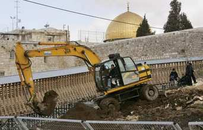

+++
title = "شاهد وثائقي: ما لا نعرفه عن الأقصى!"
date = 2007-02-08
authors = ["مجاهد شرارة"]
aliases = ["/articles/20at-eshtbak-3209/"]

[taxonomies]
authors = ["magahd-shrara"]
sections = ["eshtbak"]

[extra]
section_name = "اشتباك"
share_image = "/media/admins.20at.com/aly/the_al-aqsa_mosque.jpg2.jpg"
summary = "ليس هو المسجد صاحب القبة الذهبية، ولا ذو القبة الخضراء، فهو حرم وحرام بالكامل، أما القبة الذهبية، فهي قبة الصخرة الموجودة بنفس الحرم، والقبة الخضراء هي الجامع ا"
section_slug = "eshtbak"
section_colour = "#E77B13"
thumb = "/media/admins.20at.com/aly/the_al-aqsa_mosque.jpg2.jpg"
n_comments = 5
original_url = "http://www.20at.com:80/20at/politics/3209.html"
archived = "20091202205345"
date_source = "byline/meta"
aliases_20at = ["/20at/eshtbak/3209.html", "/20at/politics/3209.html"]

[extra.provenance]
original_url = "http://www.20at.com:80/20at/politics/3209.html"
capture_url = "https://web.archive.org/web/20091202205345/http://www.20at.com:80/20at/politics/3209.html"
capture_label = "٢ ديسمبر ٢٠٠٩، ٢٠:٥٣ UTC"
date_note = "من سطر التوقيع في المقال"
other_urls = ["/20at/eshtbak/3209.html"]
comments = "٥"
missing_images = ""
+++

<figure></figure>

ليس هو المسجد صاحب القبة الذهبية، ولا ذو القبة الخضراء، فهو حرم وحرام بالكامل، أما القبة الذهبية، فهي قبة الصخرة الموجودة بنفس الحرم، والقبة الخضراء هي الجامع القبلي، ويسمى مجازا المسجد الأقصى..

هذا جزء من المعلومات التي كنا نعتقد جميعا أننا نعرفها أو بالأحرى لا نعرفها عن الأقصى، لذلك قمنا بتصميم هذه الفلاش الوثائقي حتى نتعرف سويا على بعض المعلومات التاريخية والسياسية عن أول القبلتين، وثاني المسجدين، وثالث الحرمين..

*** شاهده معنا.. وإذا كانت لديك معلومات إضافية ضعها في التعليق.

