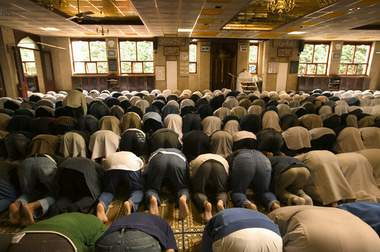

+++
title = "في رمضان.. مساجد تقاطع الخشوع!"
date = 2008-09-07
authors = ["تامر الصمادي"]

[taxonomies]
authors = ["tamer-elsamadi"]
sections = ["deen"]

[extra]
section_name = "دين"
share_image = "/media/currentarticleassets/images/4ooo.jpg"
summary = "قرر الشاب أحمد عدم الذهاب لأداء التراويح في مسجد الحي الذي يعيش فيه معللا ذلك بأن \"الوضع لا يطاق.. نحن ومساجدنا مقهورين في رمضان، فإمام المسجد الذي أذهب إليه لا"
section_slug = "deen"
section_colour = "#2D6A4F"
thumb = "/media/currentarticleassets/images/4ooo.jpg"
n_comments = 0
original_url = "http://20at.com/20at/religious/10024.html"
archived = "20100105185140"
date_source = "byline/meta"
aliases_20at = ["/20at/religious/10024.html"]

[extra.provenance]
original_url = "http://20at.com/20at/religious/10024.html"
capture_url = "https://web.archive.org/web/20100105185140/http://20at.com/20at/religious/10024.html"
capture_label = "٥ يناير ٢٠١٠، ١٨:٥١ UTC"
date_note = "من سطر التوقيع في المقال"
other_urls = []
comments = ""
missing_images = ""
+++

<figure></figure>

قرر الشاب أحمد عدم الذهاب لأداء التراويح في مسجد الحي الذي يعيش فيه معللا ذلك بأن "الوضع لا يطاق.. نحن ومساجدنا مقهورين في رمضان، فإمام المسجد الذي أذهب إليه لا يتقن قراءة القرآن الكريم، فهو يتلعثم وهو يقرأ سورة الفاتحة، أما عن صوته فحدث ولا حرج وكأنك تستمع إلى جاروشة الطحين، هدفي من الذهاب إلى المسجد هو تحصيل الأجر من خلال الخشوع، لكن للأسف فإن هذا الشرط لا يتحقق، لذلك قررت مقاطعة المسجد والاعتكاف في منزلي محاولا عمل المستحيل لأحقق الخشوع في الصلاة".

حال أحمد هو حال كثير من الصائمين الأردنيين والذين يتهافتون إلى المساجد في الشهر الفضيل لأداء صلاة التراويح، لكنهم يواجهون "معاناة" في هذه المساجد التي تفتقر للإمام المناسب وللمؤذن المناسب وأيضا لخادم المسجد الذي من المفترض أن يقوم بواجبه على أكمل وجه، مما يصيب الشباب بخيبة الأمل في الوصول إلى الخشوع وأداء الصلاة بصورة تامة يرضى الله عنها.

<h3>الإمام مدخن</h3>

قصة أخرى مع الشاب عوض محمد، 25 سنة، فمسجد الحي الذي يسكن فيه يصف معاناته داخله أنها ذات لون ورائحة، حيث يقول: "إمام المسجد مدخن وأخلاقه ليست بالحميدة وهذا الكلام يشهد عليه القاصي والداني في الحي، إلى جانب عدم إجادته لأحكام التجويد، ولا يملك صوت جميل ينقلنا إلى عالم الخشوع".

ويضيف: "في رمضان الكل يسعى إلى تحصيل الأجر العظيم والتقرب من الله سبحانه وتعالى بالنوافل والطاعات والعبادات، والخشوع هو الكنز الرئيسي الذي نبحث عنه، أقولها وبمرارة هذا الخشوع لا أحصل عليه في مسجد الحي، لذلك قررت أن أبحث عن مسجد آخر في حي آخر لأتعبد لله تعالى على أكمل وجه".

قصة غريبة عجيبة حدثت مع الشاب وائل أبو الرقب، يقول: "إمام المسجد القريب من منزلي لا يخاف الله، لا صوت ولا خشوع ولا قراءة مثل الناس، قلت له في بداية رمضان يا شيخ أعفنا من صوتك في رمضان، فقال لي شو رأيكم أجيبلكم السديس أو الشريم عشان يصلي فيكم..!!".

معاناة أخرى من وجهة نظر عقاب علي، 22 سنة، وهي "الروائح الكريهة التي تخرج من دورات المياه، والمنبعثة أيضا من سجاد المسجد الذي يرتاده".

<h3>الفتيات.. بره</h3>

ويزداد الأمر سوء حينما يتأكد لك بأن هناك مساجد يمنع فيها الإمام الفتيات والنساء من أداء صلاة التراويح في المكان المخصص لهن.. هبة أحمد، 20 سنة، تؤكد على ذلك بالقول: "محاولات كثيرة يقوم بها الإمام كي يحرم النساء من صلاة التراويح في المسجد، فتارة يفصل مكبرات الصوت عن مصلى النساء، وتارة أخرى يغلق المصلى بالمفتاح، كما أننا لا نسلم من شتائمه وصياحه وهو يقول لنا النسوان صلاتهم في البيت أحسن، صياح الولاد ما بخلينا نعرف نخشع، يلا اطلعوا بره ما بدنا إياكم".

أما رقية محمد، فتؤكد أن مؤذن المسجد الذي تؤدي فيه صلاة التراويح يوميا، عمد في إحدى الليالي إلى خزانة الأحذية الخاصة بالمصليات وأخذ أحذيتهن ليلقيها في الشارع العام، في محاولة منه لحرمانهن من أداء الصلاة في شهر رمضان داخل المساجد!.

<h3>مساجد مظلومة</h3>

ويرى الشاب هاني خالد، أن هناك مساجد مظلومة في رمضان على وجه الخصوص، قائلا: "هذه المساجد مظلومة طوال العام، لكن في شهر رمضان يكون الأمر سيئا للغاية فهناك تائبون جدد من الشباب، وهناك من يسعى لطلب الرحمة والمغفرة، وهناك من يبحث عن لحظات الخشوع وللأسف لا يجدها".

ويطالب زياد علي، 28 سنة، وزارة الأوقاف أن تفّعل دورها الرقابي على المساجد في شهر رمضان، وأن تسمح للأئمة المتمكنين فقط من الصلاة بالناس، حتى وإن لم يكونوا موظفين رسميا في الوزارة.

أما حلم نسرين راكز، والذي لم يتحقق على مدى رمضانات متتالية، فهو أن تصلي وراء إمام يقربها من الله بصوته العذب، قائلة: "يعني حرام لو الواحد صلى وراء شيخ يكون صوته حلو ويشعره بالخشوع".

