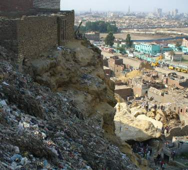

+++
title = "الدويقة: القادم أسوأ !"
date = 2008-09-08
authors = ["خباب عبد المقصود"]
aliases = ["/articles/masr-n17509/"]

[taxonomies]
authors = ["khbab-abdel-elmaksod"]
sections = ["masr"]

[extra]
section_name = "ولاد البلد"
share_image = "/media/currentarticleassets/images/diwaqa1.jpg"
summary = "\"أنا مستنية ولاد أختي الثلاثة.. هما هنا.. أنا عارفة أنهم هنا.. أنا مش همشي من هنا\" .. كلمات لسيدة عجوز تجلس تحت صخرة المقطم المنهارة في الدويقة، تحجرت الدموع في"
section_slug = "masr"
section_colour = "#666666"
thumb = "/media/currentarticleassets/images/diwaqa1.jpg"
n_comments = 19
original_url = "http://20at.com/20at/religious/10029.html"
archived = "20100105185313"
date_source = "byline/meta"
aliases_20at = ["//masr.20at.com/newarticle.php?sid=17509", "/20at/religious/10029.html"]

[extra.provenance]
original_url = "http://20at.com/20at/religious/10029.html"
capture_url = "https://web.archive.org/web/20100105185313/http://20at.com/20at/religious/10029.html"
capture_label = "٥ يناير ٢٠١٠، ١٨:٥٣ UTC"
date_note = "من سطر التوقيع في المقال"
other_urls = ["//masr.20at.com/newarticle.php?sid=17509"]
comments = "١٩"
missing_images = ""
+++

<figure></figure>

"أنا مستنية ولاد أختي الثلاثة.. هما هنا.. أنا عارفة أنهم هنا.. أنا مش همشي من هنا" .. كلمات لسيدة عجوز تجلس تحت صخرة المقطم المنهارة في الدويقة، تحجرت الدموع في عينيها، بعد نجاة أختها وزوجها واثنين من أبنائهم وما زالت تنتظر من هم تحت الأنقاض.

أما تلك الفتاة صاحبة الـ 18 ربيعا فتتحدث والدموع تخنق كلماتها عن صديقتها التي رأتها بأم عينها تخرج من تحت الأنقاض عبارة عن قطعتين منفصلتين.

والسيدة التي كانت في تمام 8 الساعة صباحا، نزلت للحارة لتشتري لابنها إفطارا، ولم تظهر حتى الآن.

حالات كثيرة تتكشف ساعة بعد أخرى في كارثة سقوط جزء من المقطم على سكان المنطقة الشعبية "الدويقة"، فما يزيد عن 60 منزلا تهدم على رؤوس ساكنيه، كانوا ينتظرون الانتقال لعمارات إسكان الشباب الممنوحة إليهم، لكن القدر لم يمهلهم، وانشق الصخر وسقط الجبل لتصبح الكارثة.

الغريب أن من بقى من سكان الدويقة لا يرون أن ما حدث كارثة؛ فالقادم هو الأسوأ، فأجزاء عديدة من الجبل متصدعة وقابلة للانهيار في أي وقت، ولم يتحرك أحد حتى الآن لتسكينهم في إسكان الشباب المخصص لهم، مؤكدين فساد الإدارة المحلية التي تنتظر الرشاوي حتى يحصلوا على حقوقهم!.

أهالي منطقة الدويقة يتحدثون عن الكارثة

<a href="https://web.archive.org/web/20100105185313/http://masr.20at.com/CurrentArticleAssets/galleries/08Sep08/disaster.htm">شاهد جاليري صور الكارثة</a>

<a href="https://web.archive.org/web/20100105185313/http://masr.20at.com/CurrentArticleAssets/galleries/08Sep08/nextDisaster.htm">شاهد جاليري التصدعات الموجودة حاليا</a>

<a href="https://web.archive.org/web/20100105185313/http://masr.20at.com/CurrentArticleAssets/galleries/08Sep08/rescue.htm">شاهد عمليات الانقاذ</a>

<a href="https://web.archive.org/web/20100105185313/http://masr.20at.com/CurrentArticleAssets/galleries/08Sep08/homes.htm">شاهد صور شقق إسكان الشباب الغير المسكونة</a>

