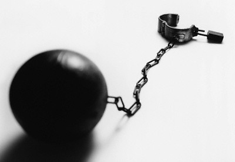

+++
title = "هل تصفد الشياطين في رمضان؟"
date = 2008-09-14

[taxonomies]
authors = []
sections = ["deen"]

[extra]
section_name = "دين"
share_image = "/media/currentarticleassets/images/shackles.jpg"
summary = "\"إذا جاء رمضان فُتحت أبواب الجنة، وغلقت أبواب النار، وصُفدت الشياطين\" ولكن ما زال الناس يقعون في الذنوب والمعاصي، فلماذا ؟!"
section_slug = "deen"
section_colour = "#2D6A4F"
thumb = "/media/currentarticleassets/images/shackles.jpg"
n_comments = 1
original_url = "http://20at.com/20at/religious/10071.html"
archived = "20100105185104"
date_source = "byline/meta"
aliases_20at = ["/20at/religious/10071.html"]

[extra.provenance]
original_url = "http://20at.com/20at/religious/10071.html"
capture_url = "https://web.archive.org/web/20100105185104/http://20at.com/20at/religious/10071.html"
capture_label = "٥ يناير ٢٠١٠، ١٨:٥١ UTC"
date_note = "من سطر التوقيع في المقال"
other_urls = []
comments = "١"
missing_images = ""
+++

<figure></figure>

"إذا جاء رمضان فُتحت أبواب الجنة، وغلقت أبواب النار، وصُفدت الشياطين" ولكن ما زال الناس يقعون في الذنوب والمعاصي، فلماذا ؟!

إذا كانت الشياطين قد صفدت في رمضان فإن هناك أسبابا أخرى لوقوع المعاصي مثل: النفس الأمارة بالسوء التي تطيع الهوى المذموم، وشياطين الإنس.

يقول الشيخ ابن عثيمين أن المعاصي التي تقع في رمضان لا تنافي ما ثبت من أن الشياطين تصفد في رمضان، لأن تصفيدها لا يمنع من حركتها، ولذلك جاء في الحديث : ( وَيُصَفَّدُ فِيهِ مَرَدَةُ الشَّيَاطِينِ، فَلَا يَخْلُصُوا إِلَى مَا كَانُوا يَخْلُصُونَ إِلَيْهِ فِي غَيْرِهِ ) رواه أحمد.

وليس المراد أن الشياطين لا تتحرك أبدا بل هي تتحرك، وتضل من تضل، ولكن عملها في رمضان ليس كعملها في غيره.

<h3>الشياطين الجبارة</h3>

ويشير شراح الأحاديث إلى أن المراد بتقييدها هو عدم تسلطها على من يصومون صومًا صحيحا كاملا، روعيت فيه كل الأسباب التي منها عفة اللسان والنظر والجوارح استجابة لقول الرسول، صلى الله عليه وسلم، في الحديث الصحيح "من لم يدع قول الزور والعمل به فليس لله حاجة فى أن يدع طعامه وشرابه " رواه البخاري .

أو المراد أن الشياطين المصفدة هي المردة والجبابرة، وأما غيرهم فلا يقيدون، ولذلك تقع من الناس بعض المعاصي وأكثرها غير خطير، وهذا ما نصت عليه رواية الترمذي "صفدت الشياطين مردة الجن " أو المراد أن الشياطين كلها تقيد بمعنى يضعف نشاطها ولا يكون بالقوة التي يكون عليها فى رمضان .

<h3>النفس الأمارة بالسوء</h3>

ولكن يرى الشيخ عطية صقر، رئيس لجنة الفتوى بالأزهر سابقا، أن كبائر المعاصي وأخطرها ترتكب فى شهر رمضان من الصائمين ، ولهذا قال بعض العلماء : إذا كانت الشياطين تقيد فى رمضان فإن هناك بواعث أخرى على المعصية غير الشيطان، ومنها النفس الأمارة بالسوء، أو العادات والأعراف القبيحة التي تدفع إلى الشر أو شياطين الإنس من الجبابرة المزهوين بقوتهم، وهذه الدوافع موجودة في كل وقت، وهى كافية لارتكاب المعاصي في الوقت الذي تقيد فيه الشياطين.

ودور النفس البشرية الأمارة بالسوء لا يقل خطرا عن دور الشياطين، ونرى ذلك واضحا في إقرار الشيطان يوم القيامة كما قال رب العزة : &#123;وَقَالَ الشَّيْطَانُ لَمَّا قُضِيَ الأَمْرُ إِنَّ اللّهَ وَعَدَكُمْ وَعْدَ الْحَقِّ وَوَعَدتُّكُمْ فَأَخْلَفْتُكُمْ وَمَا كَانَ لِيَ عَلَيْكُم مِّن سُلْطَانٍ إِلاَّ أَن دَعَوْتُكُمْ فَاسْتَجَبْتُمْ لِي فَلاَ تَلُومُونِي وَلُومُواْ أَنفُسَكُم .[سورة إبراهيم]

