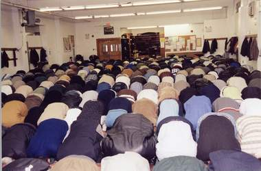

+++
title = "مسجد البكائين .. هيا نشد الِرحال"
date = 2008-09-21
authors = ["تامر الصمادي"]

[taxonomies]
authors = ["tamer-elsamadi"]
sections = ["deen"]

[extra]
section_name = "دين"
share_image = "/media/currentarticleassets/images/00011.jpg"
summary = "قطرات الدمع تُذرف من عينك لأسباب عديدة.. قد تكون لمرض ما، ومنها ما يتعلق بحزن أو بفرح، ومنها ما يتساقط من خشية الله مثلما يحدث في مسجد \"البكائين\".."
section_slug = "deen"
section_colour = "#2D6A4F"
thumb = "/media/currentarticleassets/images/00011.jpg"
n_comments = 1
original_url = "http://20at.com/20at/religious/10118.html"
archived = "20100105184851"
date_source = "byline/meta"
aliases_20at = ["/20at/religious/10118.html"]

[extra.provenance]
original_url = "http://20at.com/20at/religious/10118.html"
capture_url = "https://web.archive.org/web/20100105184851/http://20at.com/20at/religious/10118.html"
capture_label = "٥ يناير ٢٠١٠، ١٨:٤٨ UTC"
date_note = "من سطر التوقيع في المقال"
other_urls = []
comments = "١"
missing_images = ""
+++

<figure></figure>

قطرات الدمع تُذرف من عينك لأسباب عديدة.. قد تكون لمرض ما، ومنها ما يتعلق بحزن أو بفرح، ومنها ما يتساقط من خشية الله مثلما يحدث في مسجد "البكائين"..

وهو المسجد الذي أطلق عليه شباب الجامعات في الأردن هذا المسمى في شهر رمضان الفضيل لهذا العام، والذي كان يحمل اسم مسجد "الروضة المباركة"، بعد أن وجدوا ضالتهم فيه، فهم وعلى مدار سنوات طويلة - كما يؤكد الكثير منهم- كانوا ينشدون المساجد التي تشعرهم بالخشوع وقوة الإيمان والعودة إلى الله، وهو ما لم يكن يتحقق، لكنهم وجدوا مبتغاهم أخيرا عندما عثروا على مسجد "البكائين" الذي يشتهر بالأصوات الجميلة للعديد من الأئمة، بالإضافة إلى خشوع المصلين الذين يأتون من مختلف مناطق العاصمة عمّان لقيام الليل والبكاء والنحيب والتضرع إلى الله تعالى.

ومع أن المكان يكتظ بالمصلين لكنك لا تسمع صراخ طفل، أو شجار نساء، أو صوت موجات سماعة المسجد أو صوت المكيفات المعطلة أو التي تحتاج للصيانة، لذا تشعر لحظة دخولك ذلك المسجد أنك تنتقل إلى عالم آخر غير العالم الذي تعيشه المساجد الأخرى، وربما انتقلت إلى عالم الروح والملائكية!.

<h3>هدوء وروية</h3>

نسرين، تقول: "سمعت عن المسجد من صديقاتي.. وبصراحة الأمر يستحق البحث، أريد أن أستمع لتلاوة مميزة، وأن أعيش لحظات من الخشوع والصلاة الهادئة، وسبحان الله .. وجدت ما أردت وسعدت كثيرا بالصلاة هناك، إذ أنني لم أجد هذه الراحة في مساجد منطقتي، لأن الضجيج يغلب على الخشوع ورمضان مرة واحدة في السنة".

وتضيف أخرى: "صلاة التراويح تستحق أن نذهب لها كما نذهب للأسواق بحثا عن أجمل الثياب من محل معين، فأجر البحث عن الخشوع والطمأنينة عظيم .. ويعجبني إمام مسجد البكائين الشيخ أحمد الصوي الذي يقوم بتحضير مسابقة يومية للمصلين واستراحة لشرح حديث من صلب حياتنا، إضافة إلى أننا نصلي 20 ركعة تنتهي الساعة 12 إلا ربع بهدوء وروية، وهذه أمور قلما نجدها في مساجدنا".

أما أحمد، 20 سنة، فقد قرر هو وأصحابه في الحي أن يشّدوا الرحال إلى مسجد "البكائين" في ليلة القدر، قائلا: "حينما سمعت باسم المسجد ارتعدت أوصالي وتمنيت أن أعتكف في هذا المسجد طيلة الشهر الفضيل، فالمعاصي والتقصير في جنب الله لا يشفع لها سوى الخشوع والبكاء المرير والتوبة إلى الله تعالى".

<h3>بكاء وإغماء</h3>

أما مصطفى، 25 سنة، فيقول: "قررت أنا وأهلي أن نعتكف العشر الأواخر بأكملها في مسجد البكائين، أملا في أن ينظر إلينا الله بنظرة الصفح والعفو على ما اقترفنا وقصرنا".

زهور، تعرضت للعديد من حالات الإغماء في صلاة التراويح لشدة تأثرها بتلاوة إمام ذلك المسجد لآيات القرآن، تقول: "خشوع شديد ينتابني كلما قرأت آيات العذاب في الصلاة فأستحضر ذنوبي وتقصيري وكأنها تدفعني للعذاب فتنزل دموعي، وأشعر بالاختناق خوفاً من ربي، ويضيق صدري ولا أشعر بشيء بعدها إلا والمصليات حولي يوقظونني".

أما ياسمين، فتختار مكانا لها في المسجد تخلو فيه بنفسها لتصلي قيام الليل، وما أن تبدأ بترتيل آيات القرآن بصوت مرتفع وجميل حتى تسري قشعريرة في جسدها تدفعها للبكاء، وما أن تنتهي من أداء الصلاة حتى تشعر بإشراقة في روحها تضفي الطمأنينة عليها.

أما ما حدث مع سمر فهو أمر غريب، حيث تحكي: "بعد أن تلوت عدة أجزاء من القرآن في ذلك المسجد، شعرت بشوق شديد لربي فأغمضت عيني ورحت أناجيه سبحانه، فسالت دموعي رغماً عني، ونزل جزء من دموعي على خشبة القرآن فإذا بالدموع قد كتبت - يا الله-!! وما أن رأيت ذلك حتى ازددت بكاء وخشوعاً".

