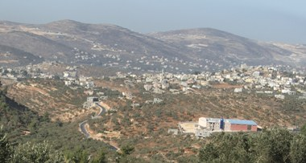

+++
title = "محاولة إغتيال لمعارض الاستيطان"
date = 2008-09-25
authors = ["رويترز"]

[taxonomies]
authors = ["reuters"]
sections = ["nashrat-9"]

[extra]
section_name = "نشرة 9"
share_image = "/media/currentarticleassets/images/beit20087.jpg"
summary = "أصيب أستاذ جامعة إسرائيلي شهير ومعارض شرس لبناء المستوطنات في الضفة الغربية المحتلة في هجوم بقنبلة أنبوبية اليوم الخميس تشتبه الشرطة الإسرائيلية أن منفذيه إسرائ"
section_slug = "nashrat-9"
section_colour = "#004B80"
thumb = "/media/currentarticleassets/images/beit20087.jpg"
n_comments = 0
original_url = "http://20at.com/20at/religious/10150.html"
archived = "20100105184745"
date_source = "byline/meta"
aliases_20at = ["/20at/religious/10150.html"]

[extra.provenance]
original_url = "http://20at.com/20at/religious/10150.html"
capture_url = "https://web.archive.org/web/20100105184745/http://20at.com/20at/religious/10150.html"
capture_label = "٥ يناير ٢٠١٠، ١٨:٤٧ UTC"
date_note = "من سطر التوقيع في المقال"
other_urls = []
comments = ""
missing_images = ""
+++

<figure></figure>

أصيب أستاذ جامعة إسرائيلي شهير ومعارض شرس لبناء المستوطنات في الضفة الغربية المحتلة في هجوم بقنبلة أنبوبية اليوم الخميس تشتبه الشرطة الإسرائيلية أن منفذيه إسرائيليون قوميون متشددون.

وأصيب زئيف شتيرنهال أستاذ العلوم السياسية بالجامعة العبرية في القدس بجروح طفيفة في الانفجار الذي وقع عند البوابة الأمامية لمنزله.

وقال ميكي روزنفيلد المتحدث باسم الشرطة الإسرائيلية "بعد التحقيق الأولي تعتقد الشرطة أنه استهدف بسبب أفكاره." ولم يقدم تفاصيل أخرى.

وقالت إذاعة الجيش الإسرائيلي إن منشورات تركت في مكان الانفجار تعرض جائزة قيمتها مليون شيقل (294 ألف دولار) لمن يقتل أي عضو في حركة السلام الآن التي تعارض بناء المستوطنات اليهودية في الأراضي التي احتلتها إسرائيل في حرب 1967 .

ويلقي شتيرنهال محاضرات في الفعاليات التي تنظمها حركة السلام الآن وينشر مقالا ضد بناء المستوطنات في موقع الحركة على شبكة الانترنت ويعارض منذ وقت طويل بناء الجيوب الإسرائيلية في الضفة الغربية.

جدير بالذكر أن المستوطنات اليهودية تحرم الفلسطينيين من إقامة دولة قابلة للحياة متصلة جغرافيا في الضفة الغربية وقطاع غزة.

