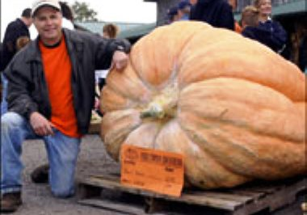

+++
title = "ثمرة يقطين وزنها 697 كلغ"
date = 2008-10-06

[taxonomies]
authors = []
sections = ["nashrat-9"]

[extra]
section_name = "نشرة 9"
share_image = "/media/currentarticleassets/images/1_852517_1_23.jpg"
summary = "نجح مزارع كندي أمس السبت في انتزاع لقب مسابقة سنوية وذلك بعد أن زرع ثمرة يقطين عملاقة بلغ وزنها 697 كيلوغراما، مسجلا رقما قياسيا جديدا في المهرجان الذي يقام بول"
section_slug = "nashrat-9"
section_colour = "#004B80"
thumb = "/media/currentarticleassets/images/1_852517_1_23.jpg"
n_comments = 1
original_url = "http://20at.com/20at/religious/10204.html"
archived = "20100105184518"
date_source = "byline/meta"
aliases_20at = ["/20at/religious/10204.html"]

[extra.provenance]
original_url = "http://20at.com/20at/religious/10204.html"
capture_url = "https://web.archive.org/web/20100105184518/http://20at.com/20at/religious/10204.html"
capture_label = "٥ يناير ٢٠١٠، ١٨:٤٥ UTC"
date_note = "من سطر التوقيع في المقال"
other_urls = []
comments = "١"
missing_images = ""
+++

<figure></figure>

نجح مزارع كندي أمس السبت في انتزاع لقب مسابقة سنوية وذلك بعد أن زرع ثمرة يقطين عملاقة بلغ وزنها 697 كيلوغراما، مسجلا رقما قياسيا جديدا في المهرجان الذي يقام بولاية كاليفورنيا الأميركية.

وقالت شبكة "أيه بي سي" التليفزيونية الإخبارية إن ثمرة اليقطين وصلت من بورت ألبيرني في كندا وشاركت في المسابقة وفاز صاحبها المزارع الكندي جاك فان كوتن بجائزة مالية قدرها 9219 دولارا أميركي في "مهرجان ثمر اليقطين العملاق والحصاد" بمنطقة إلك جروف بولاية كاليفورنيا.

وزرع كوتن ثمرة اليقطين ونقلها من الجزيرة الكندية إلى كاليفورنيا بواسطة عبارة للمشاركة في المهرجان الذي يجري تنظيمه منذ 14 عاما.

وقال المتحدث باسم المهرجان ستيف كابس إن ثمرة اليقطين العملاقة التي شارك بها كوتن سجلت رقما قياسيا جديدا متجاوزة الرقم السابق المسجل العام الماضي في كاليفورنيا بـ450 غراما.

ــــــــــــــــــ

نقلا عن الجزيرة نت

