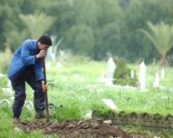

+++
title = "قبور الأردن.. وحدوووووه!"
date = 2008-10-12
authors = ["تامر الصمادي"]

[taxonomies]
authors = ["tamer-elsamadi"]
sections = ["deen"]

[extra]
section_name = "دين"
share_image = "/media/currentarticleassets/images/www1.jpg"
summary = "مهنة يصفها الكثيرون بالمخيفة والمرعبة، والعاملون فيها يقولون أن من يريد العمل بها لابد وأن يمتلك قلب حديد، وفي حين لا يتقاضى عاملون فيها أي أجر مادي، ستجد فئة أ"
section_slug = "deen"
section_colour = "#2D6A4F"
thumb = "/media/currentarticleassets/images/www1.jpg"
n_comments = 2
original_url = "http://20at.com/20at/religious/10247.html"
archived = "20100105184420"
date_source = "byline/meta"
aliases_20at = ["/20at/religious/10247.html"]

[extra.provenance]
original_url = "http://20at.com/20at/religious/10247.html"
capture_url = "https://web.archive.org/web/20100105184420/http://20at.com/20at/religious/10247.html"
capture_label = "٥ يناير ٢٠١٠، ١٨:٤٤ UTC"
date_note = "من سطر التوقيع في المقال"
other_urls = []
comments = "٢"
missing_images = ""
+++

<figure></figure>

مهنة يصفها الكثيرون بالمخيفة والمرعبة، والعاملون فيها يقولون أن من يريد العمل بها لابد وأن يمتلك قلب حديد، وفي حين لا يتقاضى عاملون فيها أي أجر مادي، ستجد فئة أخرى تجني من ورائها ما تسد به رمق من تعيل.

"حفر القبور" حرفة في غالب الأحيان يورّثها الأجداد للآباء لتصل إلى الأبناء، ومع أنها مهنة يقدم من خلالها الخير للآخرين، فإن هناك من ينتقص من قدر العاملين فيها ويبتعد عن مخالطتهم خوفا منهم، معتقدا أنهم مجردين من أية عواطف أو مشاعر.

<h3>قصتي مع القبر</h3>

أحمد، شاب يعمل حفارا للقبور منذ عشرة سنوات في إحدى محافظات الأردن، يقول: "حفر القبور مهنة ورثتها عن والدي رحمه الله، في الحقيقة أنا لا أتقاضى عليها أجرا ماديا وإنما أطلب وأنشد أجري من الله سبحانه وتعالى".

ويضيف: "كنت أذهب مع والدي حينما يتوفى الله سبحانه وتعالى أحد معارفنا في الحي إلى المقبرة كي يجهز له القبر، وكنت أرى كيف يجهز وكيف يحفر وما هو الحجم المناسب، وكان والدي يرفض أن يتقاضى أجرا ماديا على صنيعه مكتفيا بدعاء أهل المتوفى له، ورغم أن أهل الفقيد وآخرين من أهالي الحي كانوا ينظرون بعين الاحترام والتقدير لوالدي، لكن أناس كثر كانوا يخافون منه ويبتعدون عن مخالطته باعتباره حفارا لقبور الموتى".

خوف الناس ورثه الشاب أحمد عن والده أيضا كما يقول، فنظرات الحذر يشاهدها على الدوام، ويتابع: "لا أبالي بنظرات الخوف والترقب هدفي الوحيد أن يرضى الله سبحانه وتعالى عني، وأملي أن أسعد والدي في قبره".

<h3>أسرار القبور</h3>

إبراهيم سمعان، شاب في العشرينات يساعد والده هو الآخر في تجهيز القبور لموتى المنطقة التي يسكن فيها دون مقابل، ويقول: "في بداية الأمر كنت أخاف كثيرا، فمكان الأموات الأخير يجعلني أشعر بالتقصير في جنب الله سبحانه، لكن ومع الفترة اعتادت نفسي على هذه المهنة وأصبحت أشعر بالسعادة كونها تقربني من ربي وتشعرني بالخوف من عقابه".

وعن حكايا القبور، يضيف: "في بعض الأحيان يتأكد لي بأن المتوفى رجل صالح ونحن نحفر القبر، نلمس هذا الأمر من خلال السرعة والسهولة في العمل فالفأس والمجرفة يعملان بكل سهولة والأرض تكون خالية من الصخر والحجارة، وفي بعض الأحيان نشعر شعورا آخر تجاه الميت حيث نجد صعوبة بالغة في تنفيذ المهمة ويستغرق معنا حفر القبر ساعات طويلة، وكأن الأرض لا تريد احتضانه".

ويتابع حدثه قائلا: "مفارقات غريبة تحدث معنا ونحن نسجي الجسد داخل القبر، فمرات تكون الجثة خفيفة ورشيقة كالريشة، ومرات أخرى تكون ثقيلة لا نستطيع حملها مع أن وزنها الحقيقي ليس مرتفعا".

<h3>احفر قبرك بمقابل</h3>

تحدثنا عمن يحفرون القبور ويرفضون أي مقابل مادي، في المقابل هناك شركات ومؤسسات في الأردن تهدف إلى تقديم الخدمات للموتى بأسعار منافسة، تبدأ تلك الخدمات بتغسيل الميت وإحضار مواد التكفين لتغسيله وحفر القبر الخاص به، ومن ثم نقله إلى مثواه الأخير.

وستشاهد في الأردن شباب يمتهنون حفر القبور باعتبارها مصدر رزق وحيد لهم ولعوائلهم، فهذا محمد عبد الصمد، يعمل في حفر القبور منذ 6 سنوات كمصدر ثانوي للرزق حيث تصل مكافئته من 10 إلى 15 دينار، وهذا علي السلمان، صاحب بقالة متواضعة، يعمل هو الآخر في حفر القبور مقابل مبالغ زهيدة تقيه سؤال الناس..!!

