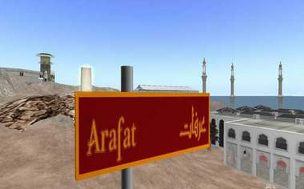

+++
title = "شعائر الحج تبدأ في (سكند لايف)"
date = 2008-11-29
authors = ["أحمد فتحي"]

[taxonomies]
authors = ["ahmed-fathy"]
sections = ["deen"]

[extra]
section_name = "دين"
share_image = "/media/masr.20at.com/currentarticleassets/marwah/00-05.jpg"
summary = "وفي أولى الجوالات الارشادية بعالم سكند لايف بدأ المشاركون شعائر الحج فأرتدوا ملابس الإحرام، وجميعهم قبل الحجر الأسود ، ثم أدوا الطواف سبعاُ ، ثم إرتوا جميعا من "
section_slug = "deen"
section_colour = "#2D6A4F"
thumb = "/media/masr.20at.com/currentarticleassets/marwah/00-05.jpg"
n_comments = 0
original_url = "http://20at.com/20at/religious/10627.html"
archived = "20100105184339"
date_source = "byline/meta"
aliases_20at = ["/20at/religious/10627.html"]

[extra.provenance]
original_url = "http://20at.com/20at/religious/10627.html"
capture_url = "https://web.archive.org/web/20100105184339/http://20at.com/20at/religious/10627.html"
capture_label = "٥ يناير ٢٠١٠، ١٨:٤٣ UTC"
date_note = "من سطر التوقيع في المقال"
other_urls = []
comments = ""
missing_images = ""
+++

<figure></figure>

وفي أولى الجوالات الارشادية بعالم سكند لايف بدأ المشاركون شعائر الحج فأرتدوا ملابس الإحرام، وجميعهم قبل الحجر الأسود ، ثم أدوا الطواف سبعاُ ، ثم إرتوا جميعا من زمزم ، ومضوا للسعى بين الصفا والمروة، وزاروا منى ، ووقفوا بجبل عرفات، ورموا الجمرات.. وحرصوا جميعا على أداء المناسك وفهم المعاني من وراء كل منسك.

ففي إصدار جديد أكثر تطورا، يحاكي الواقع طرحت شبكة "إسلام أون لاين.نت" داخل عالم "سكند لايف" الإلكتروني الشهير إصدارها الجديد "الحج خطوة بخطوة"؛ بهدف تدريب المسلمين على أداء المناسك على الوجه الأمثل، وكذلك تعريف غير المسلمين به.

وللعام الثاني على التوالي يقدم مشروع الحج التفاعلي خدماته للزوار ليقلل الأخطاء الشائعة التي يقع فيها الحاج والتي ترهق السلطات السعودية المعنية بتنظيم شئون الحج.

ويماثل الـ"سكند لايف" -عدد المسجلين به حاليا نحو 18 مليون شخص- في بنائه شكل الألعاب ثلاثية الأبعاد، ولكن يميزه عنها إمكانيات التفاعل والتعارف بين رواده، والبيئة المصممة للتعايش، وإلقاء المحاضرات والتعليم بجانب الترفيه.

وبلغ انتشار فكرة سكند لايف "الحياة الثانية" حدًّا جعل وكالة "رويترز" للأنباء تفتتح مكتبا افتراضيًّا في هذا العالم، كما سعت دول للحصول على تمثيل سياسي أو رسمي داخل "سكند لايف" كانت أولها جزر المالديف ثم السويد اللتين افتتحتا سفارتين لهما داخل هذا العالم الافتراضي.

وشمل تطوير مناسك الحج في "سكند لايف" هذا العام، إعادة تصميم وبناء شبه كامل لجميع المناسك مع مراعاة أن تكون أقرب للواقع، فتم توسعة الحرم المكي الافتراضي، وإعادة تصميمه باستخدام صور واقعية ذات جودة عالية، وتوسعة المسعى بين الصفا والمروة، وأصبح جسر الجمرات شبيها بالجسر الحقيقي وموازيا له في أبعاده، إضافة إلى إعادة بناء كامل لمسجدي نمرة والخيف، وانتهاء بتجهيز أماكن للحلق والتقصير وذبح الأضحية.

وشمل التطوير أيضا إعادة بناء كل من الميقات، ومركز المعلومات والاستقبال الذي صمم ليكون على هيئة مطار، ويحتوي على صور تعريفية بجزيرة الحج، وأهم الإرشادات.

ويقول محمد يحي منسق وحدة سكند لايف بشبكة إسلام اون لاين.نت أن هذا المشروع أفضل دليل لمن يريد تعلم الحج , سواء من المسلمين أم من غير المسلمين "

واستغرق تطوير المناسك 150 ساعة من العمل المتواصل لثلاثة مصممين من مصر , البحرين و السعودية. واستعان فريق العمل بمجموعة من الأقراص المدمجة تحتوي على صور وتفاصيل دقيقة للمناسك، ومجموعة من الكتب المصورة في مقدمتها موسوعة "الكعبة المعظمة والحرمان الشريفان.. عمارة وتاريخا" المصورة لعبد الله محمد أمين كردي.

<h3>أهم مشاريع سيكند لايف</h3>

ويشير " على العسيري " مصمم جرافيك من السعودية إلى أن " هذا المشروع من أهم المشاريع التي عملت عليها في السكندلايف , والقيمة الحقيقة لي أكبر من مجرد المكافأة المادية .. انه شيئ أفخر به".

أما خولة ماسالا مصممة جرافيك من البحرين فعلقت على أعمال التطوير بالقول": "إن مكة أصبحت أجمل؛ لأن التطوير تم باحترافية أكبر مقارنة بالعام الماضي نظرا لتدرب الفريق خلال هذه الفترة على البناء واكتسابهم مهاراتٍ جعلتهم أكثر تمكنا".

وفي الواقع لا يستطيع غير المسلمين زيارة الأماكن المقدسة للتعرف على فريضة الحج؛ لذا يقبل الكثيرون على المحاكاة الافتراضية كي يعيشوا تجربة الحج قبل تأديتها.

<h3>دورات تدريبية</h3>

وستتيح جزيرة تعليم الحج خطوة بخطوة محاضرات ودورات تدريبية إرشادية مجانية باللغتين العربية والإنجليزية بالتوازي مع موسم الحج، تحت إشراف متخصصين شرعيين.

وستسمح هذه الدورات بالتفاعل المباشر بين المحاضر أو المرشد والحضور، كما ستستخدم تقنية الصوت.

ويشرف على مشروع الحج عبر سكند لايف من الناحية الشرعية د.علي القره داغي، عضو المجلس الأوروبي للبحوث والإفتاء، ود.علي بادحدح الداعية الإسلامي السعودي الشهير.

<h3>محاولات تخريب</h3>

وحاول بعض المخربين تكرار محاولات الإيذاء والتخريب لمشروع الحج؛ حيث تعرض المشروع في الأسبوع الماضي فقط لثلاث محاولات تخريبية من قبل مجهولين.

أشكال هذا الهجوم عادة ما تكون بإغراق جزيرة الحج بصور إباحية، ونشر صور تحمل عبارات بذيئة، وأخرى تحمل سبا للإسلام والمسلمين.

وفي أولى الجوالات الارشادية حرص المشاركون على إرتداء ملابس الإحرام، وجميعهم قبل الحجر الأسود ، ثم أدوا الطواف سبعاُ ، ثم إرتوا جميعا من زمزم ، ومضوا للسعى بين الصفا والمروة، وزاروا منى ، ووقفوا بجبل عرفات، ورموا الجمرات.. وحرصوا جميعا على أداء المناسك وفهم المعاني من وراء كل منسك".شاهد الحج في سيكندلايف

