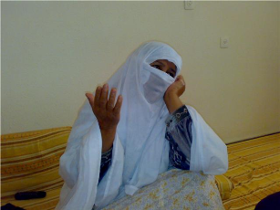

+++
title = "من يعيد لهذه المسنة فرحتها؟"
date = 2008-11-29
authors = ["نجلاء عبد ربه"]

[taxonomies]
authors = ["naglaa-abdel-rabh"]
sections = ["deen"]

[extra]
section_name = "دين"
share_image = "/media/currentarticleassets/haga.jpg"
summary = "لم تدر المسنة أم فوزي أن اليوم الذي كانت تحلم به، وقد إقتربت أمنيتها بزيارة بيت الله الحرام لأداء مناسك الحج، قد ينقلب إلى حيرة وشد أعصاب وإرهاق."
section_slug = "deen"
section_colour = "#2D6A4F"
thumb = "/media/currentarticleassets/haga.jpg"
n_comments = 0
original_url = "http://20at.com/20at/religious/10636.html"
archived = "20100105184456"
date_source = "byline/meta"
aliases_20at = ["/20at/religious/10636.html"]

[extra.provenance]
original_url = "http://20at.com/20at/religious/10636.html"
capture_url = "https://web.archive.org/web/20100105184456/http://20at.com/20at/religious/10636.html"
capture_label = "٥ يناير ٢٠١٠، ١٨:٤٤ UTC"
date_note = "من سطر التوقيع في المقال"
other_urls = []
comments = ""
missing_images = ""
+++

<figure></figure>

لم تدر المسنة أم فوزي أن اليوم الذي كانت تحلم به، وقد إقتربت أمنيتها بزيارة بيت الله الحرام لأداء مناسك الحج، قد ينقلب إلى حيرة وشد أعصاب وإرهاق.

فالحاجة أم فوزي كانت تدخر كلما سنحت لها الظروف بعضاً من المال، إلى أن جمّعت المبلغ المطلوب للذهاب إلى مكة المكرمة، وسرعان ما دخلت أول مكتب للسفر وشؤون الحج وسط جباليا، شمال مدينة غزة، وقدمت جواز سفرها التي بالكاد دفعت رسومه التي تتجاوز الـ 50 دولار، وسجلت كما غيرها، على أمل أن تتم الموافقة على إسمها.

<h3>فرحة لم تسبقها فرحة</h3>

وكاد قلبها يقف من الفرحة عندما سمعت أن إسمها كان من بين الأسماء التي تم السحب عليهم لخروج الحجاج هذا العام، وأنها بإذن الله ستحج.

لم تسعها الدنيا فرحاً وسروراً، فعلامات الشقاء التي كانت مرسومة على وجهها، وكأن تلك التقاسيم والتقاطعات تحكي حكاية شعب أجهدته الحروب وويلات الإحتلال الإسرائيلي والتهجير اختفت مع فرحة الحج.

تقول أم فوزي لـ عشرينات "في اليوم التالي ذهبت إلى السوق واشتريت ملابس ومستلزمات رحلتي إلى مكة، وبدأت أعيش حياتي وكأنني سأسافر إلى الجنة، فحلمي الوحيد بعد وفاة زوجي قبل أكثر من 14 سنة، هو أن أحج هذا العام، والحمد الله لقد تحقق حلمي وإسمي كان من بين الذين سُمح لهم هذا العام".

وسرعان ما إستدركت أم فوزي حلمها هذا، وقد تغيرت ملامح وجهها. وقالت "لكن حتى اللحظة لم أعلم إذا ما كنت سأسافر أم لأ، ولا أعلم ما هي المشكلة التي تمنعني من السفر وتحقق أمنيتي قبل أن يأخذ الله وديعته وأموت".

وتضيف المسنة التي يبدو عليها عدم درايتها الكافية بالوضع والسجالات بين حركتي فتح وحماس، "وأنا شو دخلني بالطوشة بين فتح وحماس، وشو دخل مكة والحجاج اللي بدهم يروحوا على مكة في المشاكل!!؟ إحنا مالنا فيهم، يروحوا يعملوا مشاكل بعيدة عنا، ويخلونا نسافر بيت الله الحرام".

كلمات بسيطة تحمل معاني أكبر من حركتين متناحرتين، خرجت من هذه الحاجة، أو التي ستكون حاجة .. أملها في الحياة هو زيارة البيت المعمور، لكن هذا الأمل قد لا يتحقق لها في ظل لغة الإنقسام التي لا زالت تسيطر على حجيج غزة هذا العام.

<h3>أنتظر هذا اليوم من سنوات</h3>

وتحكي هذه المسنة لـ عشرينات محاولتها منذ ثلاثة سنوات للسفر وأداء مناسك الحج، إلا أن كل عام لم يحالفها الحظ، إلى أن جاء دورها هذا الموسم، لكن ما حصل أفسد عليها فرحتها.

وقالت "لا أحد يشعر بالفرحة والسعادة غير الذي سيحج، أما الباقين فلا احد يشعر بذلك، إنها سعادة لا تقاس بأي ثمن، وحرام عليهم يحرمونا من السفر والحج لأي سبب كان، نحن لن نذهب إلى بلد للسياحة، نحن سنسافر إلى مكة وأداء فريضة الله، والله العظيم حرام عليهم".

وأضافت أم فوزي بينما كان نساء حارتها وبناتها حولها يودعونها لأكثر من أسبوع على أمل أن نخرج غداً أو بعد غدٍ "أنا الآن محتارة مو عارفة إذا راح أسافر أو ما أسافر، والله أعصابي تعبت شو أحكي غير إني بقول، حسبي الله ونعم الوكيل على أي إنسان بمنعنا من السفر إلى مكة".

جاءت إحدى بنات أم فوزي وفي يدها حقيبة متوسطة. وقالت "الشنطة جاهزة منذ أسبوع، في أي لحظة قد تسافر أمي، لكن هذا الأمر محير جدا ومقلق لنا ولها وللجميع، لقد أتلفوا أعصابنا وأعصاب الحجيج هذا العام".

وتقول هذه الفتاة "طوال الليل نجلس مع أمي لنخفف عنها، لكن الراديو كل شوية بجيب خبر عن الحجاج، مرة بقول المعبر انتفح ، ومرة بقول ما بدو يفتح، ومرة بقول بكرة يسافروا، ومرة بقول بعد بكرة.. ومش عارفين إنهم بكلامهم هذا بحطموا آمال الحجاج وأحلامهم".

أم فوزي التي أجهدها الحديث مع عشرينات، فوضعت يدها على خدها، وكأنها ستستعد لأن تندب حظها في أداء الشعيرة الإسلامية الخامسة التي فرضها الله على المسلمين، قالت "بصراحة والله فرحتي راحت، كنت أول الأمر فرحانة كتير جدا، لكن الآن بسبب خلافاتهم راحت فرحتنا وسعادتنا، كأنهم سرقوها منا هذه الفرحة وهذا الأمل".

<h3>تبادل الاتهامات</h3>

وتبادل وزيرا الأوقاف في الحكومة الفلسطينية المقالة وحكومة تصريف الأعمال في رام الله الاتهامات بشأن أزمة الحجاج العالقين في قطاع غزة.

وقال وزير الأوقاف في الحكومة المقالة طالب أبو شعر إن حكومته ستسمح للحجاج بالعبور "من دون تمييز لمنع حدوث فتنة طائفية في المجتمع الفلسطيني" واتهم في اتصال مع الجزيرة حكومة تصريف الأعمال بالانتقائية في تسجيل الحجاج.

من جهته نفى وزير الأوقاف في حكومة تصريف الأعمال جمال بواطنة هذه الاتهامات وقال إن حكومته راعت توزيعا عادلا لفرص الحج بين الضفة وغزة عند توقيعها لبروتوكول الحج مع السلطات السعودية، واتهم الحكومة المقالة بطرد وسجن الذين قاموا بالتسجيل عن طريق السلطة في رام الله

ونقل عن بعض حجاج قطاع غزة قولهم إن الشرطة التابعة للحكومة الفلسطينية المقالة في القطاع منعتهم بالقوة من الوصول إلى معبر رفح في طريقهم إلى الديار المقدسة.

وذكر بعض الحجاج أنهم أجبروا على العودة من حيث أتوا كما منعت عناصر الأمن التابعة للحكومة المقالة الصحفيين من التقاط أي صور أو نقل أنباء ما جرى.

من جهته قال مصدر مصري مسؤول للجزيرة إن معبر رفح مفتوح لعبور الحجاج بدءا من اليوم ولثلاثة أيام وأن لا علاقة للجانب المصري بمسألة التأشيرات.

ورغم أن مصر أعلنت فتح معبر رفح أمام الحجاج الحاصلين على تأشيرة إلا أن أم فوزي حتى اللحظة تخشى أن يغلق المعبر و تضيع خلافات فتح وحماس حلمها.

