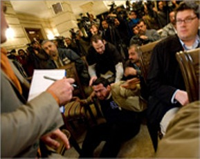

+++
title = "تحية لـ(بوش) بالـ(حذاء)!"
date = 2008-12-14
authors = ["وكالات"]
aliases = ["/articles/masr-n18811/"]

[taxonomies]
authors = ["wakalat"]
sections = ["masr"]

[extra]
section_name = "ولاد البلد"
share_image = "/media/currentarticleassets/sahafy.jpg"
summary = "\"هذه قبلة الوداع يا كلب\"، هكذا صاح صحفي عراقي في وجه الرئيس الامريكي جورج بوش في مؤتمر صحفي بالعراق اليوم، ولم يكتف الصحفي بالصياح بل صوب حذائه ناحية الرئيس الا"
section_slug = "masr"
section_colour = "#666666"
thumb = "/media/currentarticleassets/sahafy.jpg"
n_comments = 4
original_url = "http://20at.com/20at/religious/10719.html"
archived = "20100105183924"
date_source = "byline/meta"
aliases_20at = ["//masr.20at.com/newarticle.php?sid=18811", "/20at/religious/10719.html"]

[extra.provenance]
original_url = "http://20at.com/20at/religious/10719.html"
capture_url = "https://web.archive.org/web/20100105183924/http://20at.com/20at/religious/10719.html"
capture_label = "٥ يناير ٢٠١٠، ١٨:٣٩ UTC"
date_note = "من سطر التوقيع في المقال"
other_urls = ["//masr.20at.com/newarticle.php?sid=18811"]
comments = "٤"
missing_images = ""
+++

<figure></figure>

"هذه قبلة الوداع يا كلب"، هكذا صاح صحفي عراقي في وجه الرئيس الامريكي جورج بوش في مؤتمر صحفي بالعراق اليوم، ولم يكتف الصحفي بالصياح بل صوب حذائه ناحية الرئيس الامريكي بكل قوه ولكن الحذاء لم يصب هدفه.

وبالطبع تكاثر الحراس على الصحفي منتظر الزيدي لتكيل له اللكمات والضربات ويصرخ هو بكل قوة "هذا من اجل شهداء العراق يا كلب"..

وبرغم أن المشهد لم يطل كثيراً، إلا أننا شاهدنا الموقف الذي عرضته قنوات عدة فور حدوثه وسمعنا ورأينا الحرس يضربون الصحفي ويطلبون إطفاء الكاميرات وجورج بوش يبتسم بخبث وخوف في آن واحد.

وذكرت مصادر متطابقة أن الحذاء أخطأ رأس بوش بنحو 4.5 أمتار وأصاب جدارا خلفه.

وأضافت المصادر أن بوش ابتسم بامتعاض فيما بدا رئيس الوزراء العراقي نوري المالكي الذي كان يشاركه مؤتمرا صحفيا بجانبه متوترا بعد أن حاول صد الحذاء عن بوش.

وسيطر مسؤولون أمنيون عراقيون وضباط أميركيون بزي مدني -حسب المصادر- على الصحفي واقتادوه خارج الغرفة وهو يقاوم ويصرخ.

وقلل بوش في مؤتمره الصحفي المشترك مع المالكي من شأن الحادث قائلا "لم أشعر بأدنى تهديد" ممازحا "كل ما ذكره أنه (الحذاء) يحمل قياس 10".

وأشارت أسوشيتد برس أن الصحفي يدعى المنتظر الزيدي ويشتغل مراسلا لقناة البغدادية العراقية. وذكرت رويترز أن صحفيين عراقيين آخرين اعتذرا نيابة عن زميلهما.

* شاهد اللقطة الطريفة:

* شاهد تقرير قناة الجزيرة حول الحادث

.. والآن قل لنا رأيك، هل يعتبر هذا الحادث بمثابة قولة حق في وجه سلطان جائر، أم أنه فعل أحمق يسيء لسمعة الشعب العراقي في أمام ضيفه الذي آتى بموجب دعوة من الحكومة العراقية المنتخبة.. وماذا لو كنت مكان هذا الصحفي العراقي، هل ستفعل مثلما فعل؟

