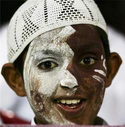

+++
title = "الدوحة.. فضائية اليوم الواحد!"
date = 2008-12-22
authors = ["أحمد يوسف"]

[taxonomies]
authors = ["ahmed-youssef"]
sections = ["deen"]

[extra]
section_name = "دين"
share_image = "/media/currentarticleassets/getattachmen_1_.jpg"
summary = "\"الدوحة\".. اسم لقناة فضائية تليفزيونية لم تر النور إلا مرتان فقط!، فهي لا تُبث إلا لتغطية أحداث بعينها، كانت المرة الأولى لتغطية فعاليات المهرجان الثقافي، والمر"
section_slug = "deen"
section_colour = "#2D6A4F"
thumb = "/media/currentarticleassets/getattachmen_1_.jpg"
n_comments = 0
original_url = "http://20at.com/20at/religious/10773.html"
archived = "20100105184059"
date_source = "byline/meta"
aliases_20at = ["/20at/religious/10773.html"]

[extra.provenance]
original_url = "http://20at.com/20at/religious/10773.html"
capture_url = "https://web.archive.org/web/20100105184059/http://20at.com/20at/religious/10773.html"
capture_label = "٥ يناير ٢٠١٠، ١٨:٤٠ UTC"
date_note = "من سطر التوقيع في المقال"
other_urls = []
comments = ""
missing_images = ""
+++

<figure></figure>

"الدوحة".. اسم لقناة فضائية تليفزيونية لم تر النور إلا مرتان فقط!، فهي لا تُبث إلا لتغطية أحداث بعينها، كانت المرة الأولى لتغطية فعاليات المهرجان الثقافي، والمرة الثانية كانت منذ أيام قليلة حيث انطلقت ذات الفضائية لتغطية احتفالات اليوم الوطني القطري من خلال 5 أيام بث غلب عليهم البث المباشر.

حيث خرجت القناة بـ 3 استوديوهات ضخمة و7 أفلام وثائقية وعشرات التقارير الخارجية و23 مذيع لتسلط الضوء على فعاليات هذا الحدث، وبطاقة إنتاجية تتعدى مئات الآلاف من الدولارات.

واليوم الوطني لدولة قطر حتى العام الماضي كان الثاني عشر من سبتمبر وهو نسبة إلى استقلال قطر إلا أنه بموجب قرار أميري تم تعديله إلى الثامن عشر من ديسمبر احتفالا بتأسيس دولة قطر على يد الشيخ جاسم بن محمد بن ثاني عام 1878 م ، لذا جاء احتفال هذا العام مغايرا عن ذي قبل ، فأضواء الليزر انطلقت إلى السماء لتغطي سماء تلك البقعة الصغيرة على ضفاف الخليج أما الجمال فقد خاضت بين السيارات إلى قلعة الوجبة لتؤدي فرض الولاء للأمير ، كما سادت سباقات الخيول في أرجاء قطر، وهو ما أبرزته قناة الدوحة.

<h3>مئات الملايين</h3>

حول القناة التي تطلق من حين لآخر في المناسبات، يقول مهند أحمد: "قطر أصبحت دولة غنية بفوائضها المالية، وهي تهتم كثيرا بكل ما يتعلق باسمها وتاريخها.. وقد رأينا جميعا ما فعلته عند تنظيم أوليمبياد آسيا فقد أنفقت مئات الملايين على حفل الافتتاح، فهي تعتني بكل شيء قد يساعد في رفع اسمها .. وموضوع القناة الفضائية هذا أمر جيد لجعل الجميع يتابع الفعاليات داخل قطر وكيف أصبحت في فترة وجيزة".

أما أحمد الرميحي، فيقول: "أنا أشجع إطلاق قناة لتغطية جميع المناسبات داخل الدولة ، لو نظرت ستجد أن الأندية الرياضية لديها قنوات فضائية ورجال الأعمال لديهم أيضا قنوات وأغلبهم يدفعون من جيوبهم ومنهم من يستثمر بها، فلم لا تكون هناك قناة يتم توظيفها فقط للمناسبات التي تمر على دولة قطر فمن الرائع أن نعرض للآخرين ما وصلنا إليه ونسوق لدولتنا عالميا".

في حين يرى محمد الأنصاري: "التسويق للدولة هو جزء من التنمية وجذب للاستثمارات الأجنبية، وأعتقد أن مثل هذه الفعاليات هي دعاية سياحية واقتصادية ممتازة".

<h3>210 يوما</h3>

حول القناة يقول المشرف على الإنتاج والبرامج، حبيب حمود: "حاول فريق القناة خلال هذه الأيام فتح نوافذ على مختلف القطاعات الرياضية والصناعية والتكنولوجية، وإعادة رؤية قطر السياحية من خلال البيئة والآثار وسياحة المؤتمرات ثم الملف التعليمي الذي يعتبر قفزة نوعية من الماضي نحو المستقبل، والملف التاريخي الذي تم من خلاله تسليط الضوء على علاقة العثمانيين والإنجليز بقطر من خلال الشيخ المؤسس".

وأضاف حبيب أن الأفلام التي بثت على قناة "الدوحة" قد استغرق إنتاجها 15 يوماً وتم إنجازها من طرف سبعة فرق، فيما استغرقت عملية المونتاج 15 يوماً أخرى، واستهلكت عملية الإنتاج في مجملها مدة تصل إلى 210 يوماً.

