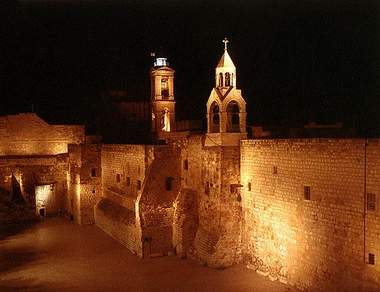

+++
title = "في فلسطين..christmas  بدون حج"
date = 2008-12-24
authors = ["رنا خموس"]

[taxonomies]
authors = ["rana-khmos"]
sections = ["deen"]

[extra]
section_name = "دين"
share_image = "/media/masr.20at.com/currentarticleassets/marwah/nativity_church2_600po.jpg"
summary = "كما حُرم المسلمون في قطاع غزة من الحج قبل أيام من جانب الاحتلال، يتكرر المشهد مع إخوانهم المسيحيين، فهناك 3 آلاف مسيحي فلسطيني في القطاع سيحرمون من الحج هذا الع"
section_slug = "deen"
section_colour = "#2D6A4F"
thumb = "/media/masr.20at.com/currentarticleassets/marwah/nativity_church2_600po.jpg"
n_comments = 1
original_url = "http://20at.com/20at/religious/10793.html"
archived = "20100105183722"
date_source = "byline/meta"
aliases_20at = ["/20at/religious/10793.html"]

[extra.provenance]
original_url = "http://20at.com/20at/religious/10793.html"
capture_url = "https://web.archive.org/web/20100105183722/http://20at.com/20at/religious/10793.html"
capture_label = "٥ يناير ٢٠١٠، ١٨:٣٧ UTC"
date_note = "من سطر التوقيع في المقال"
other_urls = []
comments = "١"
missing_images = ""
+++

<figure></figure>

كما حُرم المسلمون في قطاع غزة من الحج قبل أيام من جانب الاحتلال، يتكرر المشهد مع إخوانهم المسيحيين، فهناك 3 آلاف مسيحي فلسطيني في القطاع سيحرمون من الحج هذا العام إضافة لحجاج الضفة، ليصبح الجميع – مسلمين ومسيحيين- في خندق واحد يرثون لحال بعضهم البعض تحت نيران الاحتلال..

<h3>محبة وإخاء</h3>

على وقع أجراس تراتيل الصلاة، قال مجدي هريمات، 35 سنة، من سكان مدينة نابلس: "نحن محرومون من أداء الحج منذ سنوات، ولا نستطيع الوصول إلى القدس للصلاة بكنيسة القيامة إلا بتصريح، وقد تقدمت وللمرة الثالثة على التوالي للحصول على تصريح مع والدتي التي تبلغ من العمر 75 عاما ولكنهم رفضوني بادعاء أمني، فأي أمن يتحدثون عنه ونحن حجاج أردنا فقط أن نجح، وهل أمي العجوز تعد خطيرة عليهم أمنيا".

وأضاف هريمات: "إسرائيل تمنع الفلسطينيون بشكل عام سواء كانوا مسلمين أو مسيحيين من الوصول إلى الأماكن المقدسة في القدس الشريف ومدينة الناصرة، حتى مهد المسيح مدينة بيت لحم هناك صعوبة كبيرة للذهاب إليها بسبب انتشار الحواجز وعمليات التفتيش التي نتعرض لها نحن الشباب على الحواجز بالذات".

أما صوفي إبراهيم، كانت تشعل شمعة حول شجرة الميلاد متضرعة إلى الله أمل الحصول على الحرية والاستقلال، وقالت: "لا نستطيع الوصول إلى بيت لحم في العيد المجيد، ومحرومون من زيارة أقاربنا والاحتفال معهم بسبب الحواجز، فالطريق صعبة جدا وتحتاج إلى مجهود، فمن نابلس أو رام الله إلى بيت لحم وحدها تحتاج إلى 5 ساعات وهي كانت تستغرق فقط ساعة، وحول المدينة وحدها أربعة حواجز ثابتة واثنين حواجز طيارة ويتم حساب عشرات الحواجز الموجودة على طول الطريق".

<h3>محرومون من الحج</h3>

مع تعنت الاحتلال أُعلن إلغاء قداس منتصف الليل في كنيسة اللاتين في القطاع احتجاجا على حرمان الحجاج من الحصول على تصاريح للوصول إلى المدينة المقدسة.

وبدوره، أكد الأب إبراهيم نيروز، راعي الكنيسة الأسقفية في نابلس، أن الاحتلال يحرم آلاف من المسيحيين من أداء مناسك الحج كل عام، فمنذ بداية الانتفاضة والحجيج محرومون من الوصول إلى الأماكن المقدسة وتأدية مناسك حجهم.

وأوضح نيروز، أن الاحتلال يمارس عملية إقصاؤنا عن مقدساتنا، فنحن محرومون من الحج والوصول إلى مرتكزات حجنا الثلاث وهي كنيسة البشارة في الناصرة وكنيسة المهد في بيت لحم وكنيسة القيامة في القدس الشريف، فالمسيحي الفلسطيني غير قادر على تأدية الحج بسبب ممارسات الاحتلال التعسفية، فمن يريد الوصول إلى بيت لحم عليه أن يمر من عشرات الحواجز والطرق الالتفافية حتى يصل، وعند وصوله تكون احتفالات أعياد الميلاد قد انتهت بصلواتها، ناهيك عن ساعات الانتظار والتعب الجسدي والنفسي التي سترهق الحاج المسيحي، فنحن نعاني من عرقلة في حركة التنقل في هذه الأيام المجيدة.

يضيف: "الحاج الغربي يأتي من آخر بلدان العالم ويؤدي الحج ويعود إلى وطنه ونحن القابعين على هذه الأرض والمواطنين فيها محرومون من تأديتها، فأي شريعة سماوية تقبل ما يحصل، فهناك حوالي 50 ألف مسيحي في فلسطين، وليس المسحيين في فلسطين فقط بل المسيحيين العرب الذين يشكلون ما نسبته 15-18% من العرب، ممنوعون من الحج، وهذا أمر لا تقبله التشريعات الدولية، فحقنا في حرية الاعتقاد والدين محرومون منها أيضا".

<h3>"مع بعضنا البعض"</h3>

صورة التضامن والتعاطف بين المسلمين والمسيحيين تتضح من خلال كلمات الشيخ أحمد مصطفى، إمام مسجد الجامع الكبير بمدينة نابلس، الذي يشير إلى أن معاناة الشعب الفلسطيني واحدة، والاحتلال لا يفرق بين أي مواطن فعنده جميعنا سواء، وكنا ومازلنا شعب واحد، وفي نابلس بالذات نعيش بثلاثة طوائف بأديان مختلفة وما زلنا نحتفل مع بعضنا البعض، وكما حرم العشرات من الحج في قطاع غزة جراء الحصار، حرم الآلف من المسيحيين من الحج في الأراضي المقدسة بسبب التعنت الإسرائيلي.

بينما يقول عبد الرحيم مصلح، 25 عاما، مسلم من سكان نابلس: "نحن وإخوتنا المسيحيون والسامريون في خندق واحد ونتعرض كل يوم لنفس المهانة، حتى في العيد تبقى الفرحة منقوصة والبهجة مخطوفة، واذكر ونحن صغار كيف كنا نحتفل مع جيراننا المسيحيين بالعيد ونذهب معهم إلى بيت لحم أو نتلقى الهدايا من بابا نويل، وما زلنا معهم في السراء والضراء لأننا شعب واحد، ولا يستطيع الاحتلال أن يفرقنا".

