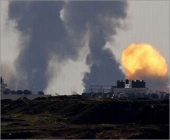
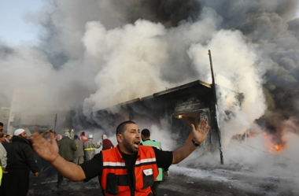

+++
title = "الغارات تلاحق الحكومة والجامعة والمساجد"
date = 2008-12-29

[taxonomies]
authors = []
sections = ["nashrat-9"]

[extra]
section_name = "نشرة 9"
share_image = "/media/currentarticleassets/images/1_881029_1_34.jpg"
summary = "ارتفع عدد شهداء العدوان الإسرائيلي المتواصل على قطاع غزة إلى 330 شهيدا، فضلا عن سقوط 1450 جريح، مع استمرار الغارات على غزة طيلة الليل وفجر اليوم الأثنين؛ وسط تع"
section_slug = "nashrat-9"
section_colour = "#004B80"
thumb = "/media/currentarticleassets/images/1_881029_1_34.jpg"
n_comments = 2
original_url = "http://20at.com/20at/religious/10822.html"
archived = "20100105184038"
date_source = "byline/meta"
aliases_20at = ["/20at/religious/10822.html"]

[extra.provenance]
original_url = "http://20at.com/20at/religious/10822.html"
capture_url = "https://web.archive.org/web/20100105184038/http://20at.com/20at/religious/10822.html"
capture_label = "٥ يناير ٢٠١٠، ١٨:٤٠ UTC"
date_note = "من سطر التوقيع في المقال"
other_urls = []
comments = "٢"
missing_images = ""
+++

<figure></figure>

ارتفع عدد شهداء العدوان الإسرائيلي المتواصل على قطاع غزة إلى 330 شهيدا، فضلا عن سقوط 1450 جريح، مع استمرار الغارات على غزة طيلة الليل وفجر اليوم الأثنين؛ وسط تعهدات من جانب القادة العسكريين الإسرائيليين باستمرار الغارات.

شنت الطائرات الحربية الإسرائيلية صباح اليوم غارتين جويتين على قطاع غزة وذلك مع دخول الحملة العسكرية المكثفة التي تنفذها قوات الاحتلال ضد قطاع غزة لليوم الثالث على التوالي.

وافاد مراسل الجزيرة في غزة، إن الغارة الأولى استهدفت منزلا يستخدم مقرا للحكومة الفلسطينية المقالة في مدينة غزة، بينما استهدفت الغارة الثانية مقر تل الهوى (الأمن الوقائي سابقا).

ولم ترد تفاصيل عن حجم الخسائر البشرية أو المادية الناتجة عن هاتين الغارتين بعد أن أسفرت غارات اليومين الماضيين عن استشهاد أكثر من ثلاثمائة فلسطيني وجرح ثمانمائة آخرين.

ومن أبرز نتائج القصف الإسرائيلي فجر اليوم استشهاد أم وأطفالها الأربعة في قصف لمسجد الشهيد عماد عقل في جباليا شمال قطاع غزة. كما استشهد في الغارات ثلاثة أطفال في قصف إسرائيلي على منزل للقيادي في كتائب القسام رائد العطار في رفح جنوب القطاع.

وسبق ذلك قصف من قبل زوارق وطائرات استهدف مرفأ الصيادين وسط القطاع.

واستهدف قصف آخر الجامعة الإسلامية في مدينة غزة ليلة أمس الأحد مقر الجامعة الإسلامية بغزة، حيث تم تدمير مجموعة من المباني بينها مبنى مبيت الطالبات. وقالت مراسلة الجزيرة في رام الله إن حكومة الاحتلال بررت قصف الجامعة بأن مختبراتها تستخدم لتصنيع وتطوير الصواريخ وأن قاعاتها تستخدم لعقد اجتماعات لقيادة حماس في غزة.

كما دمر قصف آخر مقر قصر الحاكم الذي تجري فيه الحكومة المقالة استقبالاتها الرسمية.

وسقط شهيدان ونحو عشرين جريحا عندما قصفت إسرائيل أنفاقا على الحدود مع مصر تستخدم لتهريب السلع إلى غزة. كما أغارت الطائرات الإسرائيلية على ورشة حدادة في بيت لاهيا مما خلف أضرارا مادية جسيمة بحسب مراسل الجزيرة.

وكان جيش الاحتلال الإسرائيلي قد استدعى آلاف الجنود من قواته الاحتياطية استعدادا لاحتمال شن عملية عسكرية برية في قطاع غزة، في حين قال رئيس الوزراء إيهود أولمرت إن هذه العملية ستأخذ وقتا طويلا.

وقال مراسل الجزيرة بالقدس وليد العمري إن حكومة تل أبيب خولت وزير الدفاع إيهود باراك استدعاء قوات الاحتياط، وإن هناك حشودا عسكرية بدأت في الوصول إلى مشارف القطاع.

<h3>تخطيط طويل</h3>

وعن تفاصيل الإعداد للعملية الإسرائيلية ضد غزة، قالت مراسلة الجزيرة في رام الله إن قادة الجيش والأجهزة الأمنية الإسرائيلية قدموا صباح الأحد في اجتماع الحكومة الإسرائيلية في القدس عروضا مفصلة عن العملية العسكرية في غزة، مضيفة أن الأنباء التي تتسرب حتى الآن تشير إلى احتمال توسيع العملية عبر شن هجوم بري.

وقالت المراسلة إن وسائل الإعلام الإسرائيلي كشفت أن العملية أعد لها المسؤولون منذ نحو ستة أشهر، وإن وزارة الدفاع بدأت جمع المعلومات عن البنية التحتية لحركة المقاومة الإسلامية (حماس) منذ أشهر.

<figure></figure>

كما أوضحت أن الإعلام الإسرائيلي كشف أيضا أن هذه العملية العسكرية صادق عليها بشكل نهائي كل من باراك وأولمرت ووزيرة الخارجية تسيبي ليفني وأطلع عليها المجلس الوزاري الأربعاء الماضي وقادة أحزاب المعارضة الجمعة.

وكان باراك قد قال إن إسرائيل لن تقبل بوقف غاراتها على غزة، مؤكدا في مقابلة مع شبكة فوكس نيوز الأميركية السبت أن العملية العسكرية تهدف إلى "تغيير قواعد اللعبة".

وقد نفذت قوات الاحتلال منذ صباح الأحد نحو ثلاثمائة غارة استهدفت عشرات المباني السكنية والمساجد، إضافة إلى عدد من المقرات الأمنية منها السراي الحكومي الذي يضم جميع الأجهزة الأمنية للحكومة المقالة، كما دمر القصف أيضا مقر قناة الأقصى الفضائية التابعة لحركة حماس.

<h3>صواريخ فلسطينية</h3>

وقد ردت المقاومة الفلسطينية على الغارات بقصف المستوطنات بعشرات الصواريخ المحلية الصنع. وقال مراسل الجزيرة في القدس وليد العمري إن صاروخين سقطا أمس الأحد في مستوطنة غاف يافني الواقعة على مشارف بلدة أشدود، مضيفا أن هذه أبعد نقطة تصل إليها الصواريخ الفلسطينية حتى الآن.

ومن جهتها أعلنت كتائب القسام الجناح العسكري لحماس مسؤوليتها عن إطلاق صاروخين من طراز غراد صوب أشدود، كما تبنت ألوية الناصر صلاح الدين الجناح المسلح للجان المقاومة الشعبية إطلاق ثلاثة صواريخ من طراز ناصر 3 على موقع زيكيم العسكري وبلدة سديروت شمال القطاع ردا على الغارات الإسرائيلية.

وقد اعترف الجيش الإسرائيلي بأن المقاومة أطلقت صباح الأحد 24 صاروخا بينها صاروخ "غراد" على جنوب إسرائيل.

وقررت السلطات الإسرائيلية إغلاق مجمع تجاري في مدينة عسقلان بعد سقوط صاروخ من نوع غراد، في حين طلب الجيش من السكان البقاء في البيوت المحصنة.

وقد أكدت حماس تصميمها على مواجهة العدوان المتواصل، مضيفة أنها ستقدم نموذجا بطوليا في التصدي للعدوان الإسرائيلي وأوعزت لجناحها العسكري بالرد بكافة الوسائل الممكنة.

وفي السياق نفسه، ذكر متحدث باسم جيش الاحتلال الأحد أن حماس "ما زالت قادرة على الرد بكثافة" على الهجمات الإسرائيلية، وأن بإمكانها استخدام وسائل عدة في ذلك.

** نقلا عن الجزيرة نت

