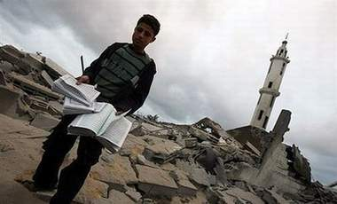

+++
title = "14 مسجدا بغزة.. دَمروهم تدميرا"
date = 2009-01-08
authors = ["نجلاء عبد ربه"]

[taxonomies]
authors = ["naglaa-abdel-rabh"]
sections = ["deen"]

[extra]
section_name = "دين"
share_image = "/media/currentarticleassets/mosqugazaa.jpg"
summary = "لم تسلم مساجد قطاع غزة من التدمير الإسرائيلي لكافة مناحي الحياة في القطاع، ففي الوقت الذي تمنع فيه كافة القوانين الدولية التعدي على الأماكن الدينية في حالة الحر"
section_slug = "deen"
section_colour = "#2D6A4F"
thumb = "/media/currentarticleassets/mosqugazaa.jpg"
n_comments = 3
original_url = "http://20at.com/20at/religious/10909.html"
archived = "20100105184110"
date_source = "byline/meta"
aliases_20at = ["/20at/religious/10909.html"]

[extra.provenance]
original_url = "http://20at.com/20at/religious/10909.html"
capture_url = "https://web.archive.org/web/20100105184110/http://20at.com/20at/religious/10909.html"
capture_label = "٥ يناير ٢٠١٠، ١٨:٤١ UTC"
date_note = "من سطر التوقيع في المقال"
other_urls = []
comments = "٣"
missing_images = ""
+++

<figure></figure>

لم تسلم مساجد قطاع غزة من التدمير الإسرائيلي لكافة مناحي الحياة في القطاع، ففي الوقت الذي تمنع فيه كافة القوانين الدولية التعدي على الأماكن الدينية في حالة الحروب، قرر الاحتلال الإسرائيلي أن يضرب بعرض الحائط كافة القوانين، وحتى التشريعات السماوية.

فلا تزال آلة الحرب العنجهية الإسرائيلية تدمر المسجد تلو الآخر، ليصل عدد المساجد التي دمرت فوق رؤوس المصلين إلى 14 مسجداً من مختلف مناطق قطاع غزة، ليستشهد عشرات المصلين الفلسطينيين خلال قصف الطائرات الحربية الإسرائيلية للمساجد التي كانوا يصلون فيها، فيما أصيب مئات آخرين نتيجة القصف ذاته.

<h3>إفلاس عسكري</h3>

الموطن أكرم علوان، يسكن بيت مخيم جباليا الذي دمرت طائرات الاحتلال الإسرائيلية مسجدين هناك، يرى أن استهداف المساجد هو نوع من الإفلاس العسكري الإسرائيلي، "لم تجد القيادة العسكرية الإسرائيلية أية أهداف حقيقية تقصفها، فتقوم بقصف منازل ومساجد الناس، وتدعي أنها أماكن تخزن فيها حماس السلاح".

الحاج أبو عدنان شبات، من نفس المنطقة، يقول: "استهداف المساجد والبيوت هو أقبح الأعمال التي تقوم بها إسرائيل في حربها ضدنا، قد نصبر على الحصار ونأكل الحصى والرمل، لكن أن يقصفوا المنازل والمساجد فوق رؤوسنا، فهذا أمر غاية في الصعوبة".

<h3>جمع الصلاة</h3>

إمام مسجد "المحسنين" في غزة الشيخ عيسى عبد الله، أوضح أنه أضطر لأن يجمع صلاة الظهر والعصر في صلاة واحدة، وأن يجمع صلاة المغرب والعشاء في صلاة واحدة أيضاً خوفا من قصف المسجد في أية لحظة.

وأضاف: "الحقيقية أن خوف المواطنين أصبح غير عادي، فطائرات إف 16 تقصف دون رحمه في كل الأماكن، حتى صلاة الفجر فإن عدد المصليين أصبح قليل جدا، بسبب خوفهم الشديد من القصف فجراً وبسبب انقطاع التيار الكهربائي عن الشوارع والمنازل، وخوفهم من وحدات إسرائيلية خاصة تعتلي أسطح منازل المواطنين وتطلق الرصاص عليهم".ً

أما الشيخ أبو أسامة، إمام مسجد أبو حنيفة في حي تل الإسلامي جنوب غرب مدينة غزة، فيحكي أنه أضطر للصلاة في مسجد آخر بنفس الحي بعدما دمرت قوات الاحتلال الصهيونية المسجد الذي كان يؤم فيه بالمصلين، مضيفا: "أحمد الله أنه لم يكن أحد متواجد داخل المسجد وقت قصفه، لكن بيوتاً كثيرة تضررت بفعل الغارة الصهيونية، خاصة القريبة من المسجد".

<h3>صلاة غير آمنة</h3>

الشيخ عبد الحليم جابر، من سكان بيت لاهيا، أن الصلاة في المسجد أصبحت غير آمنة بتاتاً، وأضاف: "الاحتلال الصهيوني لن يتوان عن قتل المصلين على الرغم من معرفته التامة بان دور العبادة هي للصلاة فقط، ويدعي أنها مخازن للأسلحة".

الحاج أبو علي شراب، من سكان غزة، أضطر لأن يصلي الفجر في بيته بعد إلحاح زوجته عليه، وقال: "زوجتي ألحت عليّ بأن أصلي الفجر في بيتي، مع أنني أذهب يومياً إلى المسجد القريب من منطقة سكناي، لكنها خافت كثيراً بسبب شدة القصف الهمجي الصهيوني على بيوت الناس وعلى المساجد".

وأضاف: "لعل من أقبح ما تفعله الطائرات الحربية الصهيونية هو تدمير المساجد والمنازل فوق رؤوس الأطفال والنساء والشيوخ العزل، فهم لا يملكون قوة ولا سلاح، لكن الاحتلال معني بتدمير الإنسان الفلسطيني، حتى لو كان طفلا أو فتاة أو كهل".

الحاج أبو سعيد ، يقول: "لقد كان مسجد عماد عقل قريبا من بيتي ومن السهل عليّ الوصول إليه، وكنت أصلي كافة صلواتي داخله، ها هو الآن قد دُمر عن بكرة أبيه، ولكي أصلي في مسجد آخر يجب أن أسير تحت القصف لحوالي كيلو متر، وهذا خطر شديد جداً عليّ وعلى أبناء الحي، فاضطررنا لأن نصلي جماعة في أحد البيوت الواسعة هنا شمال غزة".

<h3>تجاوز للقانون الدولي</h3>

عبد الكريم أبو سمرة، من مركز حقوق الإنسان، يوضح أن استهداف الطيران الحربي الإسرائيلي للمساجد هو تجاوز للقانون الدولي المتعارف عليه.

وأضاف: "كافة القوانين والأعراف الدولية نهت عن استهداف أماكن العبادة خلال الحروب واحتلال المدن، إلا أن تضرب بعرض الحائط دوماً لتلك القرارات والقوانين، فهي لم تجد أي رادع يمنعها من مواصلة قصفها للمساجد في قطاع غزة".

