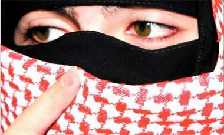

+++
title = "سعوديات ينافسن الرجال على (الشماغ) !"
date = 2009-01-25
authors = ["رشا أحمد"]

[taxonomies]
authors = ["rasha-ahmed"]
sections = ["deen"]

[extra]
section_name = "دين"
share_image = "/media/currentarticleassets/shema.jpg"
summary = "\"ارتداء الفتيات الخليجات للشماغ ، بدأ كموضة ، وانتهى بتغيير طبيعة بعضهن إلى (مسترجلات)\".. بهذه العبارة ،عبرت داليا عن أسفها الشديد ، لإرتداء الفتيات الخليجيات ل"
section_slug = "deen"
section_colour = "#2D6A4F"
thumb = "/media/currentarticleassets/shema.jpg"
n_comments = 3
original_url = "http://20at.com/20at/religious/11031.html"
archived = "20100105184140"
date_source = "byline/meta"
aliases_20at = ["/20at/religious/11031.html"]

[extra.provenance]
original_url = "http://20at.com/20at/religious/11031.html"
capture_url = "https://web.archive.org/web/20100105184140/http://20at.com/20at/religious/11031.html"
capture_label = "٥ يناير ٢٠١٠، ١٨:٤١ UTC"
date_note = "من سطر التوقيع في المقال"
other_urls = []
comments = "٣"
missing_images = ""
+++

<figure></figure>

"ارتداء الفتيات الخليجات للشماغ ، بدأ كموضة ، وانتهى بتغيير طبيعة بعضهن إلى (مسترجلات)".. بهذه العبارة ،عبرت داليا عن أسفها الشديد ، لإرتداء الفتيات الخليجيات لـ" الشماغ النسائي".

فداليا(20 عاما) أكدت أن الأمر لم يتوقف على ارتدائهن للشماغ ، بل تعداه إلى محاولاتهن تقليد الرجال في كل شئ ، كأن يقمن بتغيير نبرة أصواتهن ، وطريقة الحوار فيما بينهن.

<h3>منافسة</h3>

وعلى الرغم من كون الشماغ جزء لا يتجزأ من هوية الرجل السعودي، يتم ارتدائه عادة في المناسبات الإجتماعية والرسمية ، إلا أن المرأة السعودية نافست الرجل في ارتدائها للشماغ في الآونة الأخيرة ، ليصبح الشماغ أهم صيحات موضة الفتيات في الجامعة، والاختلاف فقط ، في طريقة التزين به .

"عشرينات" التقطت ببعض السعوديات ، للتعرف على أسباب ارتدائهن للشماغ، وتقول انتصار (23 عاما) فتؤكد أنها ترتدي الشماغ هي ومجموعة من صديقاتها من باب المزاح والتسلية ، بعد مشاهدتها للعديد من الفتيات بالجامعة، يرتدين الشماغ ، وتضيف:"لفت نظرنا ألوانه الصارخة، والجميلة، وبعد ذلك لاحظنا انتشار ارتدائه بين فتيات الجامعة بشكل واسع، بعد أن كان ارتدائه مقتصرا فقط على الحفلات ومناسبات الزواج".

أما ريهام ع فتؤكد على أن ارتدائها للشماغ كان من قبيل الصدفة ، وتابعت عندما رأيت العديد من الفتيات يرتدين الشماغ بجده ، لفت نظري ألوانه الجميلة ، ورغم ذلك لم أفكر في ارتدائه ، ولكنى عندما ذهبت إلى تبوك ،وجدت العديد من الأجانب يرتدونه ، وهذا ما جعلنى أفكر في ارتدائه ،وبالفعل ارتديته ، ولكني أرى أن تقليعة لبس الشماغ ، لن تدم طويلا ،فهى فقط مصاحبة لفصل الشتاء .

<h3>رجال الدين يختلفون</h3>

وبعد انتشار ظاهرة ارتداء الفتيات السعوديات للأشمغة ،وانتشارها بالأسواق الخليجية بكافة ألوانها من الصارخ إلى الهادئ ، تباينت أراء العلماء حول شرعية ارتداء النساء للشماغ الرجالي ، فهناك من وقف ضد ذلك، لأن فيه تشبها بالرجال ، وهناك من أجازة لأن الأصل في اللباس الحل.

وكانت اللجنة الدائمة للإفتاء في السعودية ، قد أصدرت فتوى تعترض فيها على موضة الشماغات التي ترتديها النساء ،وقال عضو هيئة كبار العلماء الشيخ عبدالله المطلق ، إن أعضاء اللجنة الدائمة منعوا ارتداء "شماغات الفتيات" لأن "فيها تشبها بالرجال ".

فى حين اجاز الشيخ خالد بن عبد الله المصلح الأستاذ المساعد في قسم الفقه بكلية الشريعة في جامعة القصيم عبر موقعه الإلكتروني ارتداء الفتيات للشماغ قائلا"هذا النوع من الشالات التي بلون الشماغ، لا يظهر لي أن فيها حرجاً؛ لأن الأصل في اللباس الحل، إلا ما ورد النص بتحريمه، وليس في هذا النوع ما يوجب التحريم والمنع".

وأشار إلى أن ما يحرم من تشبه النساء بالرجال أو العكس، يراعى فيه أمران" إن "التشبه المنهي هو أن يلبس الرجل ما يختص بالمرأة، أو أن تلبس المرأة ما يختص بالرجل، وأن التشبه يختلف الحكم فيه باختلاف البلدان".

وتابع بالنظر إلى هذين الأمرين، يتبين أن "لبس هذه الشالات الشماغية ليس من التشبه المحرم؛ لأنها ليست مما يختص بالرجال، ولا يلبس على هيئة لبسة الرجل، كما أنه لباس معتاد في بعض البلدان، وموافقة لباس المرأة لباس الرجل في اللون ليس مسوغاً للمنع، إذا كانت تلبسه المرأة على وجه لا يختص بالرجل، وكذا العكس".

<h3>مجرد زي</h3>

وأبدت د. حسناء القنيعير الكاتبة بجريدة الرياض اتفاقها مع فتوى الشيخ المصلح ، فيما يتعلق بجواز ارتداء هذا النوع من الشالات ، معللة ذلك بكونه "مجرد زي"، مؤكدة على أن المرأة لا ترتديه كما يرتديه الرجال.

وقالت إن "النص الديني حين تحدث عن قضية التشبه ، تحدث عنها على نحو كبير من العمق ، فهو لا يعني مجرد اللباس، ولا يجوز لنا أن نقف على معناه الحرفي ، بل على روحه ، وما يعنيه بهذا التشبه ، وهو أن يظهر الرجل كالمرأة في مشيته ، ومظهره ، وتصرفاته، أو العكس بالنسبة للمرأة".

