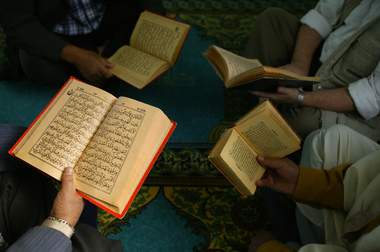

+++
title = "عطلة نصف السنة.. عودة لحفظ القرآن"
date = 2009-01-27
authors = ["راما أحمد"]

[taxonomies]
authors = ["rama-ahmed"]
sections = ["deen"]

[extra]
section_name = "دين"
share_image = "/media/currentarticleassets/42-17594114.jpg"
summary = "ما أن تبدأ عطلة نصف السنة الدراسية حتى يتهافت الكثير من الفتيات على معاهد تحفيظ القرآن الكريم الموجودة في العاصمة دمشق وأطرافها لمواصلة حفظ أجزاء القرآن والتي ا"
section_slug = "deen"
section_colour = "#2D6A4F"
thumb = "/media/currentarticleassets/42-17594114.jpg"
n_comments = 0
original_url = "http://20at.com/20at/religious/11086.html"
archived = "20100105184329"
date_source = "byline/meta"
aliases_20at = ["/20at/religious/11086.html"]

[extra.provenance]
original_url = "http://20at.com/20at/religious/11086.html"
capture_url = "https://web.archive.org/web/20100105184329/http://20at.com/20at/religious/11086.html"
capture_label = "٥ يناير ٢٠١٠، ١٨:٤٣ UTC"
date_note = "من سطر التوقيع في المقال"
other_urls = []
comments = ""
missing_images = ""
+++

<figure></figure>

ما أن تبدأ عطلة نصف السنة الدراسية حتى يتهافت الكثير من الفتيات على معاهد تحفيظ القرآن الكريم الموجودة في العاصمة دمشق وأطرافها لمواصلة حفظ أجزاء القرآن والتي اعتادوا عليها خلال شهور عطلة الصيف، وكنوع من الارتقاء بالنفس إيمانيا قبل استكمال الدراسة في النصف الثاني من العام.

هذا الإقبال لا يكون من جانب الفتيات فقط بل هناك المُدرسات والمُحفظات أيضا، واللاتي يكن مشغولات أيضا أثناء الدراسة في عملهن الوظيفي وعملهن المنزلي، لذا ينتظرن العطلة ليقبلن على الحفظ والتحفيظ كعمل تطوعي وخيري.

<h3>يومي في المسجد</h3>

سلوى أمام، 21 سنة ، طالبة جامعية، تقول: "الحمد لله منذ سنوات وعندما كنت بعمر 10 سنوات دخلت في دورات المعاهد الخاصة بتحفيظ القرآن الكريم والمنتشرة في أغلب مساجد سوريا، والحمد لله وحفظت الكثير من أجزاء القرآن الكريم، وأثناء عطلات نهاية الأسبوع وفي إجازة نصف العام نأتي للمعهد الموجود بمسجد حارتنا لأجل مراجعة ما تم حفظه من سور القرآن الكريم، وبنفس الوقت بعد أن أنهي المراجعة أقوم بالجلوس مع البنات الصغيرات من عمر 8 سنوات إلى عمر 12 سنة لتحفيظهن".

ريم إبراهيم، 15 سنة ، طالبة في المدرسة الدينية، تقول أن أمنيتها أن تحفظ القرآن الكريم كاملا عندما يصل عمرها 20 ، موضحة أن بدايتها كانت من عمر 7 سنوات عندما شجعها والدها على حفظ القرآن الكريم في مقابل أن يشتري لها حلق ذهب عندما تحفظ جزء عم، وتضيف: "أقضى أغلب يومي في نصف السنة في المسجد أحفظ القرآن كما أشجع البنات الصغيرات اللواتي نراهن في المسجد على أهمية بداية الحفظ من عمر صغير لأن التعلم في الصغر كالنقش على الحجر".

<h3>انتهاز العطلة</h3>

سمية العلبي، مُدرسة، تقول: "رغم انشغالنا بوظائفنا ومسئوليات البيت إلا أن ذلك لا يمنعنا من أن نلتقي مرة في الأسبوع كالاثنين أو الخميس لتلاوة وحفظ القرآن الكريم، ولكوني أعمل مدرسة ثانوية فانتهز عطلة نصف الدراسة للحضور أنا وبناتي للمسجد لأجل حفظ وتحفيظ القرآن الكريم".

أما رشا الملا، 19 سنة، تقول: "بتشجيع من رفيقاتي في الجامعة ورفيقات حارتنا وبعد أن لمست لهفتهن على هذه الدورات؛ قلت لأذهب وأشاهد هذه الدورات، وقتها انبهرت بهذا الجو الإيماني الجميل وتمنيت لو أني التحقت بهذه الدورات من سنوات خلت، ولكن الحمد لله أنني التحقت الآن وسأحول أن أعوض ما فاتني، فأنا أخجل من نفسي عندما أجد صبايا في مقتبل العمر أصغر مني سنا ولكنهن حافظات لأكثر من 15 جزء من القرآن الكريم".

<h3>الأطفال يحفظون</h3>

هبة أحمد المفتي، 20 سنة خريجة بكلوريا، تقول: "زواجي لم يمنعني عن حضور هذه الدروس وحفظ القرآن الكريم، بل إنني أحضر معي ابني الصغير وأثناء سماعه للصبايا وهن يسمعن القرآن الكريم حفظ نصف سورة النبأ، أنا حريصة على الاستمرار في هذه الدورات التي تنتعش أثناء العطل الرسمية وخاصة نصف العام".

أما نوال الحلبي ، 6 سنوات، فتحفظ جزء عم كاملا، تقول أنها تحضر مع والدتها التي تحضر درس الفقه في المسجد إضافة إلى درس الحفظ والتلاوة، ولأن والدتها مدرسة لمادة الديانة فإنها تأتي كل خميس مع والدتها لهذه الدورات، ومع قدوم العطلة النصفية تحضر إلى الدورة يوميا وتراجع ما حفظته من سور جزء عم وتتمنى أن تحفظ القرآن الكريم كاملا قبل أن تكمل 15 من عمرها .

