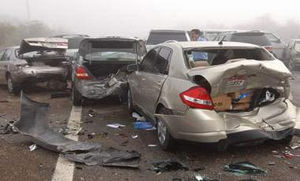

+++
title = "تقبل العوض على نفسك؟"
date = 2009-01-31
authors = ["مسعود صبري"]

[taxonomies]
authors = ["masaod-sabri"]
sections = ["deen"]

[extra]
section_name = "دين"
share_image = "/media/currentarticleassets/image5.jpg"
summary = "يحدث كثيرا أن يستعير زميلك منك شيئا، ولكن للأسف، لا يرده إليك ، وغالبا ما يتلف المستعار، وترى من العيب أن يعطي لك شيئا مكانه، لأن هذا – حسب السائد- حرام، لأنه م"
section_slug = "deen"
section_colour = "#2D6A4F"
thumb = "/media/currentarticleassets/image5.jpg"
n_comments = 1
original_url = "http://20at.com/20at/religious/11129.html"
archived = "20100105184218"
date_source = "byline/meta"
aliases_20at = ["/20at/religious/11129.html"]

[extra.provenance]
original_url = "http://20at.com/20at/religious/11129.html"
capture_url = "https://web.archive.org/web/20100105184218/http://20at.com/20at/religious/11129.html"
capture_label = "٥ يناير ٢٠١٠، ١٨:٤٢ UTC"
date_note = "من سطر التوقيع في المقال"
other_urls = []
comments = "١"
missing_images = ""
+++

<figure></figure>

يحدث كثيرا أن يستعير زميلك منك شيئا، ولكن للأسف، لا يرده إليك ، وغالبا ما يتلف المستعار، وترى من العيب أن يعطي لك شيئا مكانه، لأن هذا – حسب السائد- حرام، لأنه من العوض، وقبول العوض حرام!

ربما يكون الشيء الذي استعاره زميلك عزيزا عليك، أو ثمينا في قيمته، وأنت بحاجة إليه، ولكن ماذا تفعل، هل تظل مغتاظا في نفسك، وتتحسر على حاجتك، أما تظهر بصورة سيئة أمام أصحابك، فيقال عنك:" فلان قبل العوض"، وتتهم بالبخل والشح، وربما ضاع " برستيجك" أمامهم، وكلاهما عندك مر.

عدد من الشباب يحتار في قبول ( العوض)، فـ "علي" أسلف زميلا له سماعة كمبيوتر من النوع الغالي، ولكن عمر السماعة انتهى على يد زميلة.. فهل لو وافق على يشتري له زميلة سماعة أخرى، سيكون بذلك قبل العوض.

وربما كانت ( سماعة علي) أخف حدة، فهناك من الناس من لا يقبل العوض في اصطدام سيارته، أو ( دعمها على ما يقول الإخوة بالكويت)، فالشاب عائض يحكي عما حدث له، فيقول: أمس وأنا في أمان الله راكن سيارتي في مكان جيد، وشاحنة كبيرة تسير بالخلف وتحطم سيارتي الصغيرة وتخبطها في السلم من الناحية الاخري لتتخبط السيارة من الجانبين".

ويضيف:"الشاحنة كانت محملة وتعطلت فراملها فجاة وهي علي مطلع فنزلت حتي وصلت لسيارتي وحطمتها.

الحمد لله علي كل شيء. ولكن تم عمل محضر في الشرطة، والناس مستعدون لتصليح السيارة، وأنا في حيرة، هل أقبل العوض وأجعلهم يصلحون سيارتي أم لا؟

<h3>العوض حلال أم حرام ؟؟</h3>

واختلف الشباب الكويتى يالنسبة لموقف (عائض) ، فيقول فيصل السلوم:"إذا كان على شركة تأمين خذها وأنت مغمض، أما اذا كانت من جيوبهم، الله يعينك ويعينهم يكفيهم مصيبتهم ، راح تزيد عليهم باصلاح سيارتك

أنا أذكر واحد أخذ مني عوض في سيارته 15000 ريال ، وبعدما طلع سيارته بأسبوع من الورشة قدر الله أن السيارة تتقلب وباعها (تشليح) في الأخير فأنا أقول سامحهم والله بعوضك".

أما فيصل الشريف من السعودية فيرى أن "العوض بالنسبه للحوادث مو حرام لكن يقولون إن العوض مو زين عشان كذا إذا كانت سيارتك ما تكلف كثير صلحها وربي يعوضك إن شاء الله".

وتقول إيناس:" لو العامل يقدر يعوضك اطلب منه ولو على قد الحال ومستورة وتعرف أنه ما صدمها عمداً ممكن يأخذ دين ويعطيك يعني يمكن أموره ما تسمح له.. ما أعرف الصراحة بس بيكون حقك".

الشاب سحاب يؤكد قائلا:"هذا حقك وأنت أولي به.

ولكن في بعض الأوقات مثل هذه الأمور قد تخرب بيت السائق لأن هو السبب في هذه الحادثة وهنا يكون لك الحرية".

<h3>بشروط</h3>

وإذا كانت هذه آراء بعض الشباب حول قبول العوض، فمن المهم أن نعرف رأي الفقه فيها. وإذا كان لنا أن نلخص الحكم حتى يكون معروفا لدى الشباب، فهو من استعار شيئا، أو أتلف شيئا، فإما أن يكون هذا التلف نتيجة تقصير من الشخص ، أو يكون قد تلف رغما عنه.

ففي الحالة الثانية التي يكون رغما عنه أو لم يكن هو متسببا فيها؛ فلا يؤخذ منه العوض، إلا أن يكون هناك اشتراط قبل أن يستعير الشيء فتقول له: خذها أمانة، وهي مردودة كما هي، فإن قبل فيجب عليه أن يردها إليك كما هي حتى لو لم يقصر، بسبب الشرط.

أما إن كان هو الذي تسبب في التلف حتى دون اشتراط، فيجوز أخذ الدية لمن شاء، أما من أراد تركها، وأخذ الأجر من الله ، فهذا شيء يرجع إليه.

وربما يتساءل بعض الشباب: لقد تربينا على عدم أخذ العوض وأنه حرام، فما الدليل على جواز أن نأخذ العوض؟

والإجابة على هذا موجودة في القرآن الكريم والسنة النبوية، أما القرآن الكريم فقد جعل للمقتول خطأ الدية لأهله كما قال تعالى ( وَدِيَةٌ مُسَلَّمَةٌ إِلَى أَهْلِهِ ) سورة النساء الآية 92 .

وقال تعالى: (وَإِنْ عَاقَبْتُمْ فَعَاقِبُوا بِمِثْلِ مَا عُوقِبْتُمْ بِهِ ) سورة النحل الآية 126.

<h3>حكم سليمان عليه السلام</h3>

وقد نص القرآن على جواز التعويض المالي، وذلك أن رجلا كان عنده زرع، ورجل آخر كان عنده غنم، فنزلت الغنم على الزرع فأفسدته، فتحاكموا إلى سيدنا داود عليه السلام، فقضى أن يأخذ صاحب الزرع الغنم، وجاء ابنه سليمان – عليه السلام- واستأذن أباه في حكم غير الذي قاله داود، وحكم أن على صاحب الغنم أن يصلح الزرع، وأن يأخذ صاحب الزرع الغنم مؤقتا يستفيد منها حتى يصلح صاحب الغنم زرعه، فيرد إليه صاحب الزرع الغنم. فذلك معنى قوله تعالى : (وَدَاوُدَ وَسُلَيْمَانَ إِذْ يَحْكُمَانِ فِي الْحَرْثِ إِذْ نَفَشَتْ فِيهِ غَنَمُ الْقَوْمِ وَكُنَّا لِحُكْمِهِمْ شَاهِدِينَ فَفَهَّمْنَاهَا سُلَيْمَانَ وَكُلًّا ءَاتَيْنَا حُكْمًا وَعِلْمًا) سورة الأنبياء الآيات 78-79.

وجاء في السنة أن النبي صلى الله عليه وسلم شرع لأمته أن على أهل الماشية حفظها بالليل وعلى أصحاب البساتين حفظها بالنهار وأن ما أفسدت المواشي بالليل مضمون على أهلها وهذا الضمان هو مقدار الذاهب عيناً أو قيمته.

ومن جميل ما يروى أن النبي صلى الله عليه وسلم كان عند السيدة عائشة – رضي الله عنها، فأرسلت إحدى زوجاته له طعاما في غرفتها، فأخذت السيدة عائشة القصعة فضربتها بيدها، فوقع ما فيها من الطعام، وكانت السيدة عائشة قد وضعت له قصعة أخرى بها طعام، فلما انتهى من الطعام أرسل القصعة السليمة وأبقى المكسورة لعائشة وقال :"طعامٌ بطعامٍ وإناءٌ بإناءٍ ).

ومع أنه يجوز أخذ العوض برد نفس الشيء التالف، أو إصلاحه أو قيمته، فإن من أراد ألا يقبله، فإن ذلك من مكارم الأخلاق، فلا حرج على من أخذ العوض، وليس بحرام، ولا حرج على من تركه لله.

فهل تقبل العوض أم لا؟

