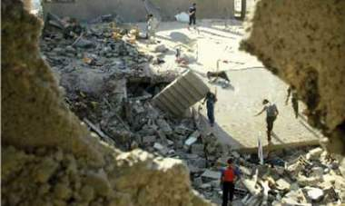

+++
title = "بأي ذنب أصابعها بُترت؟"
date = 2009-02-05
authors = ["خباب عبد المقصود"]

[taxonomies]
authors = ["khbab-abdel-elmaksod"]
sections = ["deen"]

[extra]
section_name = "دين"
share_image = "/media/currentarticleassets/p22_20060817_international1.full.jpg"
summary = "شهادة تسيل معها دموع حارقة، على إنسانية أبت أن تعترف بحق ملايين في العيش بسلام داخل قطاع غزة.. صاحبتها \"ميساء فوزي السموني\".. أم فلسطينية تبلغ من العمر 19 عاما،"
section_slug = "deen"
section_colour = "#2D6A4F"
thumb = "/media/currentarticleassets/p22_20060817_international1.full.jpg"
n_comments = 0
original_url = "http://20at.com/20at/religious/11208.html"
archived = "20100105183108"
date_source = "byline/meta"
aliases_20at = ["/20at/religious/11208.html"]

[extra.provenance]
original_url = "http://20at.com/20at/religious/11208.html"
capture_url = "https://web.archive.org/web/20100105183108/http://20at.com/20at/religious/11208.html"
capture_label = "٥ يناير ٢٠١٠، ١٨:٣١ UTC"
date_note = "من سطر التوقيع في المقال"
other_urls = []
comments = ""
missing_images = ""
+++

<figure></figure>

شهادة تسيل معها دموع حارقة، على إنسانية أبت أن تعترف بحق ملايين في العيش بسلام داخل قطاع غزة.. صاحبتها "ميساء فوزي السموني".. أم فلسطينية تبلغ من العمر 19 عاما، من سكان حي الزيتون..

فبعد أيام من العدوان الإسرائيلي على القطاع وتحديدا في الرابع من يناير اقتاد جنود الاحتلال ميساء مع ابنتها البالغة من العمر 9 أشهر ونحو 30 آخرين من أفراد العائلة إلى منزل أحد أقربائهم بحي الزيتون..

تقول ميساء: "أمرنا الجنود بمرافقتهم إلى منزل وائل السموني البالغ من العمر (40 عاما)، ومنزله عبارة عن عنبر إسمنتي تقارب مساحته 200 متر مربع، كنا أساسا 30 ثم أصبح مجموعنا 70، مكثنا حتى اليوم التالي بدون ماء ولا طعام".

في صباح اليوم التالي قرابة الساعة 6 بتوقيت غزة أطلق جنود الاحتلال النار على أشخاص حاولوا مغادرة المكان لجلب أقرباء آخرين، وبعد لحظات أطلقت الدبابات قذيفة على المنزل..

هذا ما تتذكره ميساء، ثم تضيف والدموع تنهمر من عينيها: "حين سقطت القذيفة ارتميت أرضا على ابنتي، انتشر الدخان والغبار وسمعت صراخا وبكاء، وحين تبدد الدخان بعض الشيء نظرت حولي وشاهدت 20 إلى 30 شخصا شهيدا ونحو 20 جريحا"..

فقدت ميساء في هذه الضربة الغادرة زوجها ووالديه و7 من أقربائها المباشرين، أما ابنتها الرضيعة ففد فقدت 3 من أصابعها .. "فبأي ذنب أصابعها بترت؟!".

سؤال أطلقته الأرملة المكلومة عبر المركز الفلسطيني للدفاع عن الأسرى، ولم يستطع أحد الرد عليه..

فاللجنة الدولية للصليب الأحمر اتهمت جيش الاحتلال بمنع مسعفيها من الوصول إلى حي الزيتون، وقالت أن الجيش الإسرائيلي لم يسمح لسيارات الإسعاف، بالوصول إلى عدة منازل في حي الزيتون الذي تعرض لعمليات "إعدام ميداني" لأسرى فلسطينيين.

أما الأمم المتحدة فقد قالت هي الأخرى أن جيش الاحتلال الصهيوني قتل في عملية قصف 30 مدنيا بعد أن قاموا في الرابع من يناير بجمع نحو 110 فلسطينيين في منزل واحد في حي الزيتون نصفهم من الأطفال وأمروهم بالبقاء في الداخل وتم قصفهم بقذيفة دبابة بعد ذلك.

ولم تجب الأمم المتحدة الأم ميساء سوى ببيان استنكاري قالت فيه: "الذين نجوا وتمكنوا من السير مسافة كيلومترين وصلوا إلى شارع صلاح الدين حيث نقلوا إلى المستشفى في سيارات مدنية، واستشهد أصغرهم في شهره الخامس عند وصولهم إلى المستشفى".

موضحة أن الحادث "هو من أخطر الحوادث في قطاع غزة خلال العمليات الإسرائيلية عليه".

ونحن بدورنا نسأل.. بأي ذنب أصابع الطفلة بترت؟

