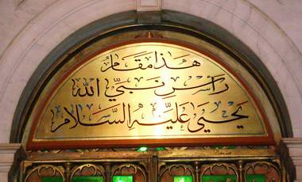

+++
title = "هنا رأس النبي (يحيى)"
date = 2009-02-12
authors = ["راما أحمد"]

[taxonomies]
authors = ["rama-ahmed"]
sections = ["deen"]

[extra]
section_name = "دين"
share_image = "/media/currentarticleassets/s7301392.jpg"
summary = "ما إن تصل إلى حرم المسجد الأموي وبعد الانتهاء من صلاتك وسماعك لبعض التسبيح والأدعية بالأصوات السورية الشجية، تطالع على اليسار منك قبة خضراء ترى الكثير من الناس "
section_slug = "deen"
section_colour = "#2D6A4F"
thumb = "/media/currentarticleassets/s7301392.jpg"
n_comments = 0
original_url = "http://20at.com/20at/religious/11282.html"
archived = "20100105183144"
date_source = "byline/meta"
aliases_20at = ["/20at/religious/11282.html"]

[extra.provenance]
original_url = "http://20at.com/20at/religious/11282.html"
capture_url = "https://web.archive.org/web/20100105183144/http://20at.com/20at/religious/11282.html"
capture_label = "٥ يناير ٢٠١٠، ١٨:٣١ UTC"
date_note = "من سطر التوقيع في المقال"
other_urls = []
comments = ""
missing_images = ""
+++

<figure></figure>

ما إن تصل إلى حرم المسجد الأموي وبعد الانتهاء من صلاتك وسماعك لبعض التسبيح والأدعية بالأصوات السورية الشجية، تطالع على اليسار منك قبة خضراء ترى الكثير من الناس يقفون عندها من جنسيات مختلفة من العرب والأعاجم المسلمين، يلتقطون الصور ويقرؤون القرآن الكريم، وعندما تقترب من اللوحة المكتوبة أعلى القبة تقرأ "رأس النبي يحيى عليه وعلى نبينا محمد الصلاة والسلام".

حيث يقال أن رأس النبي يحيى موجود فيه، في حين أن الشيخ الألباني يقول بوجود الرأس هناك غير صحيح، وهو الأمر الذي اختلف المؤرخون عليه اختلافا كبيرا، حيث يذهب البعض أن رأس يحيى عليه السلام مدفون في مسجد حلب وليس في المسجد الأموي.

أما عن قصة الرأس فهي تلقى إجماعا.. فيُروى أنه كان في زمن النبي يحيى ملك طاغية ضيق العقل غبي القلب يستبد برأيه، وكان الفساد منتشرا في بلاطه.. وكان يسمع أنباء متفرقة عن يحيي فيدهش لأن الناس يحبون أحدا بهذا القدر، وهو ملك ورغم ذلك لا يحبه أحد.

وكان الملك يريد الزواج من ابنة أخيه، حيث أعجبه جمالها، وهي أيضا طمعت بالملك، وكانوا يعلمون أن هذا حرام في دينهم، فأرد الملك أن يأخذ الإذن من يحيى، فذهبوا يستفتون يحيى ويغرونه بالأموال ليستثني الملك، لكن يحيى عليه السلام أعلن أمام الناس تحريم زواج البنت من عمّها، فغضب الملك، لكن الفتاة كانت لا تزال طامعة في الملك.

وفي إحدى الليالي أخذت البنت تغني وترقص فأرادها الملك لنفسه فأبت، وقالت: "إلا أن تتزوجني"، قال: "كيف أتزوجك وقد نهانا يحيى"، قالت: "ائتني برأس يحيى مهرا لي" وأغرته إغراء شديدا، فأمر في حينه بإحضار رأس يحيى له.

فذهب الجنود ودخلوا على يحيى وهو يصلي في المحراب وقتلوه، وقدموا رأسه على صحن للملك، فقدّم الصحن إلى هذه البغيّ وتزوجها بالحرام.

<h3>أهم المعالم</h3>

رغم الاختلاف على مكان وجود الرأس إلا أن القبر يجذب العديد من الزوار ومن مختلف الجنسيات.. سلوى شعبان، من الصومال، تقول أنها استغربت وجود قبر للنبي يحيى في المسجد الأموي وأنها لم تكن تعلم بذلك، ولكنها سعدت كثيرا عندما عرفت أنه قبر أحد الأنبياء.

أما رائد عبد السميع، جزائرية، يقول: "لما وصلت إلى أرض الشام سألتهم عن أهم المعالم الموجودة فيها فقيل لي المسجد النبوي الذي فيه رأس النبي يحيى، وهو ما دفعني للإسراع لزيارة المسجد والقبر، وفوجئت أيضا بعد الخروج من المسجد قبر يقال أن الحسين أو جزء منه مدفون به، وبالقرب منهم قبر البطل صلاح الدين الأيوبي".

<h3>غير جائز</h3>

شيماء سلمان، شابة عراقية، تقول: "أنا متزوجة من عدة سنوات وانتهزت فرصة زيارتي لسوريا لزيارة قبر النبي يحيى للدعاء كما دعا النبي زكريا أن يرزقه الولد ودعيت هنا أيضا أن يرزقني الولد".

تتدخل في الحديث الحاجة أم أنور الحمصي، سورية، موضحة أن هذا الأمر ليس صحيح ومن غير الجائز أن يتم الدعاء عند القبر بطلب الرزق للولد من رب العالمين، كما أبدت أسفها لجهل الكثير من رواد المكان في الدين، بحيث من فقدت ابنها أو ضاع تضع ورقة تكتب بها طلبها وتودعها في سور القبر وهذا غير صحيح، ورغم وجود لوحة كتب عليها منع وضع هذه الأشياء بالقرب من القبر إلا أنه للأسف لازال الكثير من الناس يفعلون ذلك "ندعو الله عز وجل أن يهدي جميع المسلمين لما هو صواب وخير".

السيدة رجاء مسعود، بحرينية، تقول: "قمت بقراءة الفاتحة عند قبر النبي يحيى عليه السلام والدعاء له، واستذكرت قصته وكيف رُزق به والده زكريا، فزيارة القبور تكون للاتعاظ شريطة ألا يقال عندها ما يغضب الرب سبحانه وتعالى".

