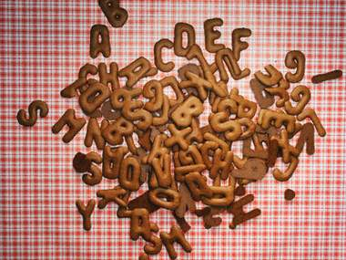

+++
title = "New words ..في جامعتنا"
date = 2009-02-24
authors = ["رنا خموس"]

[taxonomies]
authors = ["rana-khmos"]
sections = ["deen"]

[extra]
section_name = "دين"
share_image = "/media/currentarticleassets/wo333rds.jpg"
summary = "في كل سنة هناك صرعة وموضة جديدة تنطلق بين أروقة الجامعات ولكنها تتخذ المصطلحات والألقاب والاختصارات شكلا لها، وفي جامعاتنا الفلسطينية تنتشر موضة ال new words."
section_slug = "deen"
section_colour = "#2D6A4F"
thumb = "/media/currentarticleassets/wo333rds.jpg"
n_comments = 0
original_url = "http://20at.com/20at/religious/11402.html"
archived = "20100105183032"
date_source = "byline/meta"
aliases_20at = ["/20at/religious/11402.html"]

[extra.provenance]
original_url = "http://20at.com/20at/religious/11402.html"
capture_url = "https://web.archive.org/web/20100105183032/http://20at.com/20at/religious/11402.html"
capture_label = "٥ يناير ٢٠١٠، ١٨:٣٠ UTC"
date_note = "من سطر التوقيع في المقال"
other_urls = []
comments = ""
missing_images = ""
+++

<figure></figure>

في كل سنة هناك صرعة وموضة جديدة تنطلق بين أروقة الجامعات ولكنها تتخذ المصطلحات والألقاب والاختصارات شكلا لها، وفي جامعاتنا الفلسطينية تنتشر موضة ال new words.

بعد آخر نهار دراسي تبدأ " الشلة" بالتجمع في احدى الساحات المعروفة بتجمعات الشلل شباب وصبايا اتخذوا من الساحة مكانا وحيزا لروي مغامراتهم وآخر "فصول" الدكاترة والطلاب، فتركوا المقاعد الخشبية وافترشوا بلاط الساحة لحواراتهم، وحتى نتعرف أكثر على آخر الصرعات كنا من بين الموجودين.

<h3>أول الكلام</h3>

سامي من كلية الاقتصاد سنة ثالثة جامعة توسط متربعا الجلسة على درج ساحة الحمرا او ساحة "الكتكات" مسندا ظهره تحت شباك عميد كلية الشريعة مصفرا لبقية " الشلة" بالتجمع بعد انتهاء جدول محاضراته.."ايش يا كبير" هكذا رحب بأسيد أول الواصلين..كيف محاضراتك اليوم..سأله سامي.

أسيد: والله اخدت وحدة مع " شرشبيل" ويقصد طلاب السنة الأخيرة بالجامعة بما انه "السنافر" هم طلاب السنة أولى..ولم يحضر دكتور محاضرة الظهر لأنه " شرب red boll وطلعلو جوانح" فريحنا وارتاح " وتعني أن أستاذ المادة تم نقله أو فصله أو سحب مادته".

"وين لؤي؟" سال سامي أسيد .."راح يرندم" وتعني أن ذهب مع "الجو" أي الفتاة التي يحبها"، ولكن أسيد قال له " لا المسكين..هلأ بيجي..لأنو صار سويتي "sweety" اليوم" وتعني انه انفصل عن حبيبته، ولم يحالفهما الحظ".

" له له له..مش خبرية..طيب مين " سيكندو"؟؟ سأل سامي أسيد.." لسا مش معروف بس يمكن واحد من شباب " الفافي، الشكولاتة" " وتفسيرا لما تقدم الأولى تعني أن من هو الحبيب الجديد لها، والثانية تعني هم الشباب المدللين و"الهاي كلاس" على رأي من هم بالجامعة".

رد سامي على أسيد ..يللا اريحلو شو بدو فيها أصلا هي بتيجيش 3 مساطر فوق بعض.. كناية عن قصر قامتها، وتابع سامي ..بكرة بلاقي "مزة" جديدة أحسن من" الجوكر" اللي كان معها،"وهو تعبير يقصد به الفتاة الجميلة والآخر الفتاة البشعة".

أما الطالبات كن جالسات على الطرف الآخر من الساحة، وقد جمعن أنفسهن في وضعية تسمح للجميع سماع آخر أخبار الكلية.عندما كان هشام في طريقه لينضم إلى أصدقاءه على الجانب الآخر، بادرت سما في الحديث مشيرة إليه " هاد الشاب كان كتير "fun" في المحاضرة، طول الوقت وهو ينكت".

ولكن طول الحديث والقصص التي لا تنتهي أوقفتنا قليلا عند آراء الطلاب والطالبات حول "new words" التي شاعت بينهم.

<h3>كلية "الجنون" أو الفنون</h3>

مها فؤاد طالبة في كلية الهندسة أو كما يطلق على الكليات العلمية هناك " عبقرينو"، إن استخدام الطلبة مصطلحات وكلمات جديدة تغيير مطلوب في كل لغة وهو أمر لا يقتصر على لغتنا العربية ، فهناك كلمات انجليزية منعربها، ونضيف إليها أحرف عربية، فبتطلع " كول، ونايس"، الشباب بدهم تغيير واشي جديد على الساحة، وما يرفه عن أنفسهم أثناء حديثهم، ويخرجنا من جو الدراسة والامتحانات.

أما محمد عبد الله من كلية الفنون أو كما يطلق عليها "جنون" طالب أن تكون المحاضرات بهذه الطريقة، لان استخدام مصطلحات شبابية على حد تعبيره أو أسلوب شبابي في طريقة التدريس يبسط المحاضرات وتفهم بطريقة أسهل وأوضح، ويزيد استيعاب الطلبة فيها، وهو ما يخرج الطالب عن المألوف وكل ما هو غير مألوف مرغوب.

أما واثق سعيد وهو طالب في كلية الآداب وصف استخدام الكلمات الاجنبية او التي لا معنى لها استهتار باللغة الغربية، وقال واثق " هناك تعابير لا يعلمون معناها ولكن يتم استخدامها لأنها قيلت في فيلم أو أغنية ما ويتم ترديدها، أو باستخدام الانجليزية ويتم تعريبها وهو ما يشكل خطر حقيقي على لغتنا العربية.

وأكدت ميرال وهي طالبة في كلية الاقتصاد، أن ما ذلك يدل على نقص الوعي لدى الطلبة رغم أنهم بالجامعة، ويهدد بمحو لغتنا، فهناك كلمات أصبح الطالب منا لا يعرف معناها أو لم يعد يستخدمها بالعربية لان لسانه قد تعود على نطقها بالانجليزية، وبذلك نسي مفردها بالعربية، وهذا أمر خطير، ويدلل على تهديد باندثار لغة القران، وهو ما يهدد أيضا قوميتنا وعروبتنا.

