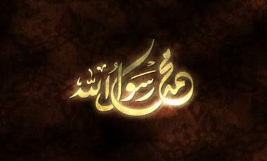

+++
title = "المولد النبوي .. سكوووت"
date = 2009-03-09
authors = ["مصري يوسف"]

[taxonomies]
authors = ["masri-youssef"]
sections = ["deen"]

[extra]
section_name = "دين"
share_image = "/media/currentarticleassets/moldd.jpg"
summary = "تحتفل بعض الدول العربية بالمولد النبوي الشريف بطريقتها الخاصة، فالرايات تملأ الشوارع والحلويات تحيط بك في المحلات، أما الوضع في قطر فمختلف تماما فلا راية في الط"
section_slug = "deen"
section_colour = "#2D6A4F"
thumb = "/media/currentarticleassets/moldd.jpg"
n_comments = 0
original_url = "http://20at.com/20at/religious/11514.html"
archived = "20100105183045"
date_source = "byline/meta"
aliases_20at = ["/20at/religious/11514.html"]

[extra.provenance]
original_url = "http://20at.com/20at/religious/11514.html"
capture_url = "https://web.archive.org/web/20100105183045/http://20at.com/20at/religious/11514.html"
capture_label = "٥ يناير ٢٠١٠، ١٨:٣٠ UTC"
date_note = "من سطر التوقيع في المقال"
other_urls = []
comments = ""
missing_images = ""
+++

<figure></figure>

تحتفل بعض الدول العربية بالمولد النبوي الشريف بطريقتها الخاصة، فالرايات تملأ الشوارع والحلويات تحيط بك في المحلات، أما الوضع في قطر فمختلف تماما فلا راية في الطريق أو المجمعات التجارية ولا علامة تذكرك بالمولد النبوي إلا خطبة الجمعة التي وظفت في جميع المساجد للهجوم على الاحتفالات ومنظموها كونها "بدعة خالصة ".

يوسف الأحمد، يقارن بين الاحتفالات في قطر وغيرها من الدول، قائلا: "نرى الكثير من الأمور التي تلتزم فيها قطر الدين وقد سألت عددا من المشايخ حول هذا الأمر وأكد جميعهم أن مثل هذه الاحتفالات ما هي إلا بدعة وليست من الدين في شيء فلم يكن الصحابة يحتفلون وهم أولى بحب الرسول (ص) منا".

وأضاف :" الاحتفال بالمولد النبوي يكون بالرجوع إلى سنة والرسول صلى الله عليه وسلم وليس بالاحتفالات التي تقوم بها عدد من الدول العربية والإسلامية".

من جانبه قال أحمد الحرمي: "أعتقد أن هذه الاحتفالات لا تخرج عن كونها موروث شعبي وليست من الإسلام في شيء، قد تكون حسنة أو سيئة ولا أعلم في هذا الأمر ولكن في النهاية علينا أن نقتضي بالسنة في هذا الأمر، فهي تقع ضمن الأمور المتشابهات التي يجب علينا أن نتجنبها".

وأوضح الحرمي: "بعض المواطنين في الدول العربية ينظمون احتفالات غريبة في مظهرها وتحتوي على بعض المحرمات تحت دعوى الاحتفال بالمولد النبوي الشريف وأعتقد أن هذا هو سر تحريم بعض المشايخ للاحتفال تجنبا لتطورها يوما بعد الآخر وتحولها إلى أمور غير شرعية ".

<h3>لماذا لا يحتفلون؟</h3>

أما هدى النداف، سورية مقيمة بقطر، فتقول: "نحن في بلدنا لدينا بعض المظاهر التي تقترب في شكلها من مصر، وأعتقد أن الاحتفالات شيء محبوب فهو إحياء لهذه الذكرى العظيمة وهي ذكري مولد الرسول، وهي احتفالات تذكرنا بالمناسبة".

وأضافت: "أبنائنا لا يعرفون المولد النبوي الشريف فهم نشئوا وتربوا هنا في قطر، وفي قطر ليست هناك مظاهر احتفال تماما، وهو أمر مهم أن نذكر أبنائنا وأن نحببهم في هذه المناسبات الإسلامية من خلال الاحتفال بها ".

وأضافت صديقتها ندى: "لا نعرف لماذا لا يحتفلون هنا في قطر بالمولد النبوي الشريف، بل يشنون ضد المحتفلين حملة تصفهم بأنهم يبتدعون في الدين ، وبالطبع قد يقتربون في ذلك من الصحة ولكن لماذا لا يحتفلون بحدود معينة أو من خلال طرق جديدة تبعث في نفوسنا الفرحة وتذكرنا بهذه المناسبة بما تحتويه مواقف إيمانية".

في حين اختلف علي أحمد، من مصر، مع هذا الرأي قائلا: "دائما البدايات تمتد بنا دون أن ندرك أن بدأنا في الطريق الخطأ، أي أننا إذا احتفلنا وقلنا أن الأمر خاضع للحلال والحرام سوف نضل الطريق عام بعد الآخر لنجد أنفسنا في قلب الحرام من خلال احتفالات تحتوي على جميع المحرمات، وأنا من صعيد مصر وأعرف جيدا أن هناك بعض القرى وصلت فيها الاحتفالات إلى حد شرب الخمور والرقص وغيرها".

