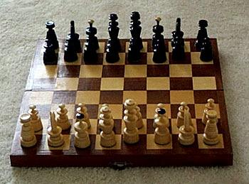

+++
title = "رستم اتهزم!"
date = 2006-12-03
aliases = ["/articles/doha2006-3207/"]

[taxonomies]
authors = []
sections = ["doha2006"]

[extra]
section_name = "دورة الدوحة ٢٠٠٦"
share_image = "/media/doha2006.20at.com/images/chess-finals.jpg"
summary = "تراجع بطل العالم السابق الأوزباكي رستم كاسيمدزهانوف من المرتبة الأولى إلى التاسعة عشرة في ترتيب مسابقة الشطرنج السريع التي تقام ضمن دورة الألعاب الآسيوية الخامس"
section_slug = "doha2006"
section_colour = "#8E1652"
thumb = "/media/doha2006.20at.com/images/chess-finals.jpg"
n_comments = 0
original_url = "http://20at.com/20at/religious/2848.html"
archived = "20100105174248"
date_source = "byline/meta"
aliases_20at = ["//doha2006.20at.com/article.php?sid=3207", "/20at/religious/2848.html"]

[extra.provenance]
original_url = "http://20at.com/20at/religious/2848.html"
capture_url = "https://web.archive.org/web/20100105174248/http://20at.com/20at/religious/2848.html"
capture_label = "٥ يناير ٢٠١٠، ١٧:٤٢ UTC"
date_note = "من سطر التوقيع في المقال"
other_urls = ["//doha2006.20at.com/article.php?sid=3207"]
comments = ""
missing_images = ""
+++

<figure></figure>

تراجع بطل العالم السابق الأوزباكي رستم كاسيمدزهانوف من المرتبة الأولى إلى التاسعة عشرة في ترتيب مسابقة الشطرنج السريع التي تقام ضمن دورة الألعاب الآسيوية الخامسة عشرة التي تقام في الدوحة، عقب خسارته في جولتين وتعادله في الثالثة خلال اليوم الثاني من منافسات اللعبة، ليحل مكانه اللاعب الكازاخستاني مورتاس كازغالييف الذي كان ثالثا في اليوم الأول.

وجاء الفيتنامي هاي داو ثانيا متقدما مركزين، وتلاه الصيني يان زي بو في المركز الثالث بعد أن كان تاسعا، وأصبح أليكسي بارسوف رابعا قادما من المركز الثاني عشر، في حين أصبح ياي وانغ خامسا بعد ما كان ثانيا.

وتقدم القطري محمد المضيحكي مركزا واحدا فأصبح بين اللاعبين العشرة الأوائل، كما فعل مواطنه محمد السيد الذي أصبح في المركز الرابع عشر. في حين كان أفضل المتقدمين السوري جوان بكر الذي قفز عشرة مراكز ليحتل المرتبة الثامنة عشرة.

وفي فئة السيدات حلت الهندية هامبي كونيرو في المركز الأول متقدمة على الصينية يو زاو والغيرانية أتوسة بوركاشييان والأندونيسية كاريزما سوكندار والفيتنامين آن نوين، وجاءت القطرية زهو تشين في المرتبة الثانية عشرة، والأردنية نتالي جمالية في المرتبة الرابعة عشرة أمام السورية أفاميا المير.

تراجع بطل العالم السابق الأوزباكي رستم كاسيمدزهانوف من المرتبة الأولى إلى التاسعة عشرة في ترتيب مسابقة الشطرنج السريع التي تقام ضمن دورة الألعاب الآسيوية الخامسة عشرة التي تقام في الدوحة، عقب خسارته في جولتين وتعادله في الثالثة خلال اليوم الثاني من منافسات اللعبة، ليحل مكانه اللاعب الكازاخستاني مورتاس كازغالييف الذي كان ثالثا في اليوم الأول.

وجاء الفيتنامي هاي داو ثانيا متقدما مركزين، وتلاه الصيني يان زي بو في المركز الثالث بعد أن كان تاسعا، وأصبح أليكسي بارسوف رابعا قادما من المركز الثاني عشر، في حين أصبح ياي وانغ خامسا بعد ما كان ثانيا.

وتقدم القطري محمد المضيحكي مركزا واحدا فأصبح بين اللاعبين العشرة الأوائل، كما فعل مواطنه محمد السيد الذي أصبح في المركز الرابع عشر. في حين كان أفضل المتقدمين السوري جوان بكر الذي قفز عشرة مراكز ليحتل المرتبة الثامنة عشرة.

وفي فئة السيدات حلت الهندية هامبي كونيرو في المركز الأول متقدمة على الصينية يو زاو والغيرانية أتوسة بوركاشييان والأندونيسية كاريزما سوكندار والفيتنامين آن نوين، وجاءت القطرية زهو تشين في المرتبة الثانية عشرة، والأردنية نتالي جمالية في المرتبة الرابعة عشرة أمام السورية أفاميا المير.

* المصدر: الجزيرة الرياضية

