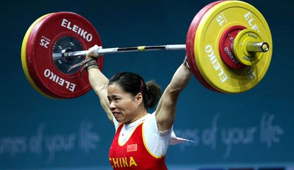

+++
title = "المرأة الحديدية!"
date = 2006-12-03
aliases = ["/articles/doha2006-3208/"]

[taxonomies]
authors = []
sections = ["doha2006"]

[extra]
section_name = "دورة الدوحة ٢٠٠٦"
share_image = "/media/doha2006.20at.com/images/china-final.jpg"
summary = "سجلت البطلة الاولمبية الصينية تشين يانجينج ثلاثة أرقام قياسية عالمية جديدة في طريقها للفوز بالميدالية الذهبية لمنافسات الوزن الخفيف بمسابقة رفع الاثقال للسيدات "
section_slug = "doha2006"
section_colour = "#8E1652"
thumb = "/media/doha2006.20at.com/images/china-final.jpg"
n_comments = 2
original_url = "http://20at.com/20at/religious/2849.html"
archived = "20100105173840"
date_source = "byline/meta"
aliases_20at = ["//doha2006.20at.com/article.php?sid=3208", "/20at/religious/2849.html"]

[extra.provenance]
original_url = "http://20at.com/20at/religious/2849.html"
capture_url = "https://web.archive.org/web/20100105173840/http://20at.com/20at/religious/2849.html"
capture_label = "٥ يناير ٢٠١٠، ١٧:٣٨ UTC"
date_note = "من سطر التوقيع في المقال"
other_urls = ["//doha2006.20at.com/article.php?sid=3208"]
comments = "٢"
missing_images = ""
+++

<figure></figure>

سجلت البطلة الاولمبية الصينية تشين يانجينج ثلاثة أرقام قياسية عالمية جديدة في طريقها للفوز بالميدالية الذهبية لمنافسات الوزن الخفيف بمسابقة رفع الاثقال للسيدات بدورة الالعاب الاسيوية الخامسة عشرة المقامة في العاصمة القطرية الدوحة يوم الأحد، ثاني أيام المنافسات.

فقد سجلت الرباعة الصينية التي يبلغ وزنها 58 كيلوجراما وتعد واحدة من أفضل الرباعات في فئتها بالعالم رقما قياسيا عالميا في رفعة الخطف بعد أن رفعت 111 كيلوجراما قبل أن تسجل رقما قياسيا عالميا في النطر بعد أن رفعت 140 كيلوجراما لتسجل رقما قياسيا ثالثا في مجموع رفعتي الخطف والنطر بلغ 251 كيلوجراما..

