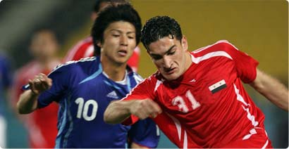

+++
title = "الأردن والإمارات.. لم ينجح أحد!"
date = 2006-12-03
aliases = ["/articles/doha2006-3209/"]

[taxonomies]
authors = []
sections = ["doha2006"]

[extra]
section_name = "دورة الدوحة ٢٠٠٦"
share_image = "/media/doha2006.20at.com/images/japan-vs-syria-1.jpg"
summary = "تعادل منتخب الإمارات لكرة القدم مع منتخب الأردن بهدف لكل منهما في اللقاء الذي جمع بينهما على ملعب السد ضمن منافسات المجموعة الأولى من مسابقة كرة القدم للرجال في"
section_slug = "doha2006"
section_colour = "#8E1652"
thumb = "/media/doha2006.20at.com/images/japan-vs-syria-1.jpg"
n_comments = 1
original_url = "http://20at.com/20at/religious/2850.html"
archived = "20100105174123"
date_source = "byline/meta"
aliases_20at = ["//doha2006.20at.com/article.php?sid=3209", "/20at/religious/2850.html"]

[extra.provenance]
original_url = "http://20at.com/20at/religious/2850.html"
capture_url = "https://web.archive.org/web/20100105174123/http://20at.com/20at/religious/2850.html"
capture_label = "٥ يناير ٢٠١٠، ١٧:٤١ UTC"
date_note = "من سطر التوقيع في المقال"
other_urls = ["//doha2006.20at.com/article.php?sid=3209"]
comments = "١"
missing_images = ""
+++

<figure></figure>

تعادل منتخب الإمارات لكرة القدم مع منتخب الأردن بهدف لكل منهما في اللقاء الذي جمع بينهما على ملعب السد ضمن منافسات المجموعة الأولى من مسابقة كرة القدم للرجال في دورة الألعاب الآسيوية الخامسة عشرة، وبالتالي سوف تكون مهمتهما في التأهل صعبة.

افتتح المنتخب الأردني التسجيل عبر عدي الصيفي في الدقيقة 46 قبل أن يعادل منتخب الإمارات عن طريق أحمد الخليفي في الدقيقة 59.

وكان منتخب الإمارات الأفضل في الشوط الأول لكن دون أن ينجح مهاجموه في ترجمة الفرص التي سنحت أمامهم، فيما تحسن أداء الأردن في الشوط الثاني، وأهدر وليد عباس في الدقيقة 29 فرصة ذهبية لافتتاح التسجيل عندما تلقى كرة عرضية داخل المنطقة لكنه سددها في القائم الأيسر للحارس الأردني محمد شطناوي.

ورد الأردن بهجمة مرتدة في الدقيقة 35 قادها عامر وريكات الذي مرر كرة متقنة إلى عدي الصيفي فكسر مصيدة التسلل وتوغل داخل المنطقة مراوغا احد المدافعين لكنه تسرع في التسديد فذهبت كرته بجوار القائم الأيمن للحارس الإماراتي يوسف الزعبي.

ومنح الصيفي التقدم للأردن في الدقيقة 46 عندما تلقى كرة في العمق وتوغل داخل المنطقة وسدد على يسار الحارس الزعبي.

وكان المنتخب الأردني سباقاً في الفرص في الشوط الثاني وكاد يعزز تقدمه في أكثر من مناسبة لكن دون جدوى قبل أن ينجح أحمد الخليفي في إدراك التعادل للإمارات في الدقيقة 59 عندما استغل كرة مرتدة من الحارس شطناوي فتابعها داخل المرمى.

وطرد الحكم الصيني كيانغ اللاعب الأردني منيف عبابني في الدقيقة 82 لنيله البطاقة الصفراء الثانية في المباراة.

<h3>العراق يفوز</h3>

حقق المنتخب العراقي فوزاً هاما على نظيره العماني بهدفين دون رد في المباراة التي جرت بين المنتخبين على إستاد نادي العربي في الجولة الثانية من مباريات المجموعة الخامسة بالدور الأول في مسابقة كرة القدم بدورة الألعاب الآسيوية الخامسة عشرة.

كان المنتخب العراقي الأفضل طول اللقاء ووضح رغبة لاعبيه الكبيرة في تحقيق الفوز خاصة وأنهم كانوا قد خسروا في مباراتهم الأولى بهدف مقابل لاشئ أمام المنتخب الصيني.

على الجانب الآخر بدا لاعبو عمان بعيدين عن مستواهم ووضح عليهم التوتر والعصبية في الأداء , وطرد قائد الفريق بدر الميمني لضربه أحد اللاعبين العراقيين بدون كرة, وقد كان هذا التوتر بلا أي داع خاصة وأن العمانيين كانوا قد حققوا فوزا مريحاً على المنتخب الماليزي بثلاثة أهداف لهدف في المباراة الأولى لهم بالمجموعة.

نعود للقاء لنجد أن المنتخب العراقي بدأ مهاجما وهدد مرمى الحارس العماني سليمان المزروعي, بينما قابل المنتخب العماني ذلك بانكماش غريب في منتصف ملعبه , مما ساعد العراقيين على إحراز الهدف الأول في الدقيقة 30 أحرزه اللاعب علي رحيمي من تسديده قوية من خارج منطقة الجزاء.

وفي الدقيقة 47 أحرز لاعب الوسط علاء خشن الهدف الثاني للمنتخب العراقي بعد أن استغل حالة ارتباك كان عليها مدافعو عمان إثر ضربة ركنية رفعت من الناحية اليمنى وأخفق الحارس العماني في الإمساك بها.

وفي لقاء أخر نجح المنتخب الإيراني في تعديل أوضاعه والفوز على منتخب هونغ كونغ بهدفين مقابل هدف في المباراة التي أقيمت على إستاد السد في الجولة الثانية من مباريات المجموعة الرابعة بالدور الأول.

بدأ منتخب هونغ كونغ المباراة مهاجما واستطاع تسجيل الهدف الأول في الدقيقة الثامنة عن طريق اللاعب كيونغ شام, إلا أن المنتخب الإيراني استطاع التعادل عن طريق لاعب الوسط مزيار زاري الذي سدد تسديدة رائعة سكنت شباك حارس هونغ كونغ في الدقيقة 38.

وفي الشوط الثاني حصل المنتخب الإيراني على ضربة جزاء صحيحة سجل منها أراش بوهراني الهدف الثاني لتفوز إيران بالمباراة وتتصدر المجموعة برصيد ست نقاط.

وفي مباراة ضعيفة المستوى فاز منتخب كوريا الشمالية على نظيرة الباكستاني بهدف دون رد أحرزه اللاعب هو كيم شول في الدقيقة35.

بهذا الفوز أصبح لدى كوريا الشمالية أربع نقاط من فوز على باكستان وتعادل مع سوريا, وبذلك يجب على المنتخب الكوري الشمالي الفوز على نظيره الياباني إذا ما أراد الصعود للدور ربع النهائي.

وفي منافسات المجموعة الثانية، وعلى ملعب العربي، فاز منتخب كوريا الجنوبية بهدفين دون مقابل على نظيره الفيتنامي ، سجّل هو لي الهدف الأول في الدقيقة السابعة بتسديدة صاروخية رائعة وأضاف جي كيو كيم في الدقيقة 92 الهدف الثاني برأسه مستغلاً ضعف التغطية الدفاعية لفيتنام.

وفي منافسات المجموعة الثالثة، حقق المنتخب التايلندي على ملعب نادي الريان فوزا مقنعاً على قيرغزستان بهدفين نظيفين من توقيع تيراتيب وينوتهاي في الدقيقة السابعة و سوتي سوكسومكيت في الدقيقة 46.

* المصدر: الجزيرة الرياضية

