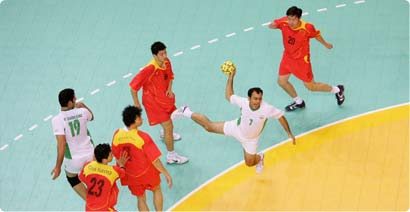

+++
title = "ما بـ (اليد) حيلة"
date = 2006-12-03
aliases = ["/articles/doha2006-3210/"]

[taxonomies]
authors = []
sections = ["doha2006"]

[extra]
section_name = "دورة الدوحة ٢٠٠٦"
share_image = "/media/doha2006.20at.com/images/iran-hanball_b.jpg"
summary = "شهد اليوم الأول من منافسات كرة اليد، فوزان كبيران لمنتخبي البحرين واليابان على منتخبي ماكاو وأوزبكستان على الترتيب بنتيجة 53/11، 56/30، فيما فازت كوريا الجنوبية"
section_slug = "doha2006"
section_colour = "#8E1652"
thumb = "/media/doha2006.20at.com/images/iran-hanball_b.jpg"
n_comments = 0
original_url = "http://20at.com/20at/religious/2851.html"
archived = "20100105173732"
date_source = "byline/meta"
aliases_20at = ["//doha2006.20at.com/article.php?sid=3210", "/20at/religious/2851.html"]

[extra.provenance]
original_url = "http://20at.com/20at/religious/2851.html"
capture_url = "https://web.archive.org/web/20100105173732/http://20at.com/20at/religious/2851.html"
capture_label = "٥ يناير ٢٠١٠، ١٧:٣٧ UTC"
date_note = "من سطر التوقيع في المقال"
other_urls = ["//doha2006.20at.com/article.php?sid=3210"]
comments = ""
missing_images = ""
+++

<figure></figure>

شهد اليوم الأول من منافسات كرة اليد، فوزان كبيران لمنتخبي البحرين واليابان على منتخبي ماكاو وأوزبكستان على الترتيب بنتيجة 53/11، 56/30، فيما فازت كوريا الجنوبية حاملة اللقب بصعوبة على سوريا 38/36.

وفي المجموعة الأولى لم يبذل القطريون أي جهد للفوز على منتخب الهند (48-19)، بعد أن فرضوا سيطرتهم على مجريات اللقاء، باستغلالهم فارق المستوى بينهم وبين خصمهم.

وكان سعد أحمد السعد أفضل هداف في المنتخب القطري بتسجيله 12 هدفا، بينما سجل أحمد خان للهند ستة أهداف.

<h3>البحرين تستعرض عضلاتها!</h3>

أما منتخب البحرين فقد نجح في أن يقدم عرضاً قوياً، ساعدهم على ذلك الرغبة في زيادة عدد الأهداف تحسباً لأي تساوي في عدد النقاط مع بقية الفرق داخل المجموعة التي تضم قطر والهند بجانب البحرين وماكاو.

وظهر منتخب ماكاو في أضعف حالاته، خاصة أنها المشاركة الأولى له في تاريخ بطولات اليد في دورات الألعاب الآسيوية.

وبدت حظوظ البحرين قوية للصعود مع قطر التي تصب الترشيحات نحوها في عبور مجموعتها، خاصة بعد حصول منتخبها على برونزية دورة بوسان في عام 2002.

في حين، فاز المنتخب الياباني على نظيره الأوزبكي 56/30 في أولى مباريات المجموعة الثالثة التي تضم أيضاً المنتخبين العربيين السعودي والإماراتي. وانتهى الشوط الأول بتقدم المنتخب الياباني 30/12، حيث ظهرت الفوارق الفردية واضحة بين الفريقين، ما أدى لحسم المباراة مبكراً من قبل اليابان.

وسيكون على المنتخب الياباني بذل جهد كبير في مباراته مع السعودية المُرشحة لتحقيق إحدى ميداليات بطولة اليد، خاصة وأنها صعدت 4 مرات إلى نهائيات كأس العالم، كما منتخبها للشباب مرتين إلى كأس العالم.

وفي المباراة الثالثة، قدم المنتخب السوري واحدة من أفضل مبارياته هذا الموسم، برغم هزيمته من كوريا الجنوبية 38/36.

ولم يكن الطريق سهلاً أمام كوريا، المُرشح الأول للفوز بالبطولة ووصيف بطل أسيا، حيث بادلهم السوريون الهجمات والأهداف، لم تُحسم نتيجة اللقاء إلا بعد إطلاق الحكم صفارته معلناً نهاية المباراة.

وتسعى كوريا الجنوبية حاملة اللقب في النسخ الخمس الأخيرة للاحتفاظ باللقب لسادس مرة على التوالي في 7 مشاركات لها في الألعاب الآسيوية.

* المصدر: الجزيرة الرياضية

