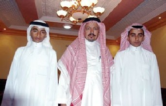

+++
title = "من بنت لشاب.. تغيير علي السريع"
date = 2008-09-20
authors = ["ناصر القحطاني"]
aliases = ["/articles/20at-religious-10108/"]

[taxonomies]
authors = ["nasr-elkhtani"]
sections = ["salamo-3lakom"]

[extra]
section_name = "السلام عليكم"
share_image = "/media/currentarticleassets/shaba.jpg"
summary = "في السعودية تجد شباب تحولوا إلى بنات، وفتيات تحولن إلى رجال في عمليات جراحية استهدفت تغيير الجنس، شباب يريدون حياة النواعم لاحياة التعب، وأخريات وجدوا أنفسهن في"
section_slug = "salamo-3lakom"
section_colour = "#1A661A"
thumb = "/media/currentarticleassets/shaba.jpg"
n_comments = 0
original_url = "http://20at.com/20at/religious/10108.html"
archived = "20100105184829"
date_source = "byline/meta"
aliases_20at = ["/20at/salamo-3lakom/10108.html", "/20at/religious/10108.html"]

[extra.provenance]
original_url = "http://20at.com/20at/religious/10108.html"
capture_url = "https://web.archive.org/web/20100105184829/http://20at.com/20at/religious/10108.html"
capture_label = "٥ يناير ٢٠١٠، ١٨:٤٨ UTC"
date_note = "من سطر التوقيع في المقال"
other_urls = ["/20at/religious/10108.html"]
comments = ""
missing_images = ""
+++

<figure></figure>

في السعودية تجد شباب تحولوا إلى بنات، وفتيات تحولن إلى رجال في عمليات جراحية استهدفت تغيير الجنس، شباب يريدون حياة النواعم لاحياة التعب، وأخريات وجدوا أنفسهن في البنطلون الرجالي والتصرفات الذكورية.

وكانت آخر هذه العمليات قبل نحو أسبوعين، وكتبت صحيفة "الوطن" عن تحول فتاتين إلى شابين بعد ان أجريت لهما عمليتان جراحيتان، فأسماء وشقيقتها سمر عرفهما مجتمعهما في محافظة النماص، جنوب المملكة، لأكثر من 25 عاما على أنهما فتاتين،و فجأة اتخذت حياتهما منحى جديدا عندما علما بأنهما شابان وأجريت لهما عمليتان جراحيتان لتغيير جنسهما.

الشقيقتان اللتان عاشتا مرحلتا الطفولة والمراهقة معا في ظل معاناة كبيرة من إزدواج الشخصية تحولا بقدرة الله إلى (وليد وياسر).

وبدأت قصة أسماء (24 عاما) وشقيقتها سمر التي ولدت بعد أسماء بـ10 أعوام عندما ظهرت عليهما علامات غريبة في جهازيهما التناسلي وفي معالمهما الشخصية أدت إلى إثبات جنسهما.

وقال والدهما محمد سعيد الشهري إن ابنيه الجديدين ولدا على أنهما فتاتين وكان يراجع آنذاك المستشفى التخصصي والمستشفى العسكري بالرياض مشككا في جنسهما، وحينما بلغت كل منهما السادسة سجلهما بمجمع الأبناء للبنات بطريق الخرج في الرياض".

وأضاف: أن طول المسافة بين منزله والمستشفيات زاد معاناة الأسرة، وعندما بلغ وليد الـ23، أحيل إلى قسم المسالك البولية بالمستشفى التخصصي واتخذ قرارا بإجراء عملية جراحية استغرقت 6 ساعات لتتحول أسماء إلى وليد.

وليد كما يذكر والده ظهرت عليه علامات الرجولة منذ صغره

وكان منعزلا عن المجتمع لفترة دامت عقدين من الزمن وكان مجبرا على الذهاب إلى مدرسة.

<h3>عبدالرحمن كان نجوى</h3>

عبد الرحمن( 23 عاما) تحول إلى ذكر بعد إن كان حبيسا في جسد أنثى طيلة ثمانى عشرة سنه قبل أن يجري عملية تغيير الجنس في مستشفى بجده، ويعيش الآن حياة مستقرة بعد ان أصبح يصنف رجل في عالم الرجال بعد إن كان يجالس فتيات ونسوة وبعد إن عاش في جسد نجوى وهو اسمه قبل إن يتحول أو تتحول إلى رجل.

سعد أيضا تحول إلى فتاة بعد إن اجري عملية في إحدى المستشفيات الغربية فهو ابن رجل إعمال ثري، لكن سعد أراد إن يتحول إلى فتاة يريد إن يعيش ماتبقى من حياته في نعومه ورقة !! فقال في حديث معه لا أريد عالم الرجال أريد إن أتحول إلى فتاة حتى أعيش حياة رومانسية.

وأوضح لعشرينات الداعية الاسلامى الدكتور محمد النجيمى إن تصحيح الجنس جائزا شرعا بموافقة جميع المجاميع الفقهية إلى إن تصحيح الجنس يحل مشكلة لدى الشاب أو الفتاة.

وأضاف "الحديث عن تغيير الجنس يعنى وجود عضو تناسلي للرجل أو المرأة يتطلب التصحيح الحتمي أما التغيير الذي يحدث حسب المزاج في بعض مستشفيات أوربا وأمريكا من قبل بعض الشباب أو الفتيات السعوديات غير جائز شرعا".

<h3>80 حالة</h3>

وكشف لعشرينات البروفيسور ياسر صالح جمال رئيس وحدة الجراحة للأطفال بكلية الطب والمستشفى الجامعى بجده أنهم اجروا حتى الآن أكثر من 600 عملية تصحيح جنس في السعودية خلال 25 عاما.

وأشار إلى إن العمليات التي تجرى في مركز تصحيح وتعديل الجنس التابع لمستشفى جامعة الملك عبد العزيز بجده عمليات تصحيح جنس وليس عمليات تجرى دون الحاجة.

وأوضح أنهم يراعون الشرع الذي يحرم عمليات تغيير الجنس التي تجرى خارج السعودية فيما كشف إن 80 سعوديا وسعودية على قوائم الانتظار لإجراء عمليات تغيير الجنس.

وذكر محمد عبد الموجود مساعد مدير عام مستشفى الدكتور عرفان أن خمس سعوديات أقدمن على تغيير جنسهن إلى رجال خلال عام واحد.

وأثيرت أزمة حول آلية التعامل الرسمي مع المسافرين بجنس والعائدين بجنس آخر، وأرجع الطبيب النفسي محمد عبد الموجود الرغبة في التحول لدى هؤلاء إلى فكرة نابعة من موروث ثقافي أو اجتماعي بتفضيل الذكر عن الأنثى، ما دفعهن إلى التحول إلى رجل يأمر وينهى ويتسلط.

وأشار إلى أن بذور هذه الفكرة تنشأ أثناء الطفولة ويعتبرون مرضى نفسيين ولابد من إخضاعهم لعلاج طبي.

<h3>حياة ناعمة !!</h3>

خلودي كما يريد إن يطلق عليه عمره 20 عاما ، والده رجل أعمال ثري يستعد للسفر في الأيام المقبلة إلى لندن للكشف الطبي فهو يريد إن يتحول إلى فتاة لإحساسه بالنعومة والدفء في علاقاته وان كانت شاذه، ويتأهب على حد قوله للعودة من لندن وقد ارتدى بنطالا نسائيا بدلا من البنطال الرجالي.

ومشاعل التي تبلغ من العمر قرابة 22 عاما والدتها سيدة أعمال ثرية في الرياض، كشفت هي الأخرى عن رغبتها في أن تتحول إلى رجل لإحساسها في ذاتها بأنها حبيسة مشاعر رجولية وليست أنثوية وهى دائما تشعر بميلها إلى الفتيات أكثر من الأولاد وتبدو عليها تصرفات ذكورية.

<h3>رجل والحمد لله</h3>

أحمد (20 عاما) يؤكد أنه راض بأن يكون رجل فذلك خلق الله التي خلق عليها ، لايريد أن يغيره لأنه يعتبر تغيير الجنس لغير الضرورة إثم ، وتتفق معه مروة (18 عاما) من الرياض تؤكد أنها تريد إن تحافظ على جنسها وأن تظل أنثى، وتتساءل وما لفائدة من تغيير الجنس طالما إن ذلك نعمة من الله فمن يغير خلق الله هو آثم.

دانة (22عاما) تنتقد عمليات تغير الجنس لكنها فى الوقت ذاته تتمنى لو كان الله خلقها ذكر وتقول:"أشعر بأنني محبوسة ومخنوقة لا لشيء إلا لأنني فتاة مقيدة بتقاليد و عادات بالية".

