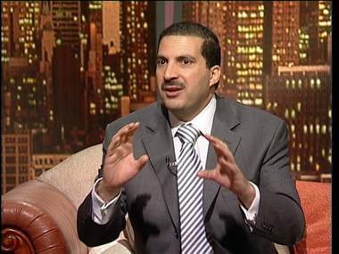

+++
title = "(قصص القران).. هل غيرت حياتك؟"
date = 2008-09-29
authors = ["رنا خموس"]
aliases = ["/articles/20at-religious-10176/"]

[taxonomies]
authors = ["rana-khmos"]
sections = ["salamo-3lakom"]

[extra]
section_name = "السلام عليكم"
share_image = "/media/currentarticleassets/images/amr_khaled99.jpg"
summary = "\"هو الدليل بطريق سوا نمشيه\".. ذاك هو القرآن الكريم الذي أطلت قصصه الشريفة علينا ببرنامج عمرو خالد بشهر رمضان الفضيل لهذا العام، ليرسل إلينا طوق نجاة للأمة من بي"
section_slug = "salamo-3lakom"
section_colour = "#1A661A"
thumb = "/media/currentarticleassets/images/amr_khaled99.jpg"
n_comments = 15
original_url = "http://20at.com/20at/religious/10176.html"
archived = "20100105184915"
date_source = "byline/meta"
aliases_20at = ["/20at/salamo-3lakom/10176.html", "/20at/religious/10176.html"]

[extra.provenance]
original_url = "http://20at.com/20at/religious/10176.html"
capture_url = "https://web.archive.org/web/20100105184915/http://20at.com/20at/religious/10176.html"
capture_label = "٥ يناير ٢٠١٠، ١٨:٤٩ UTC"
date_note = "من سطر التوقيع في المقال"
other_urls = ["/20at/religious/10176.html"]
comments = "١٥"
missing_images = ""
+++

<figure></figure>

"هو الدليل بطريق سوا نمشيه".. ذاك هو القرآن الكريم الذي أطلت قصصه الشريفة علينا ببرنامج عمرو خالد بشهر رمضان الفضيل لهذا العام، ليرسل إلينا طوق نجاة للأمة من بين سطور كتاب الله، رابطا تلك القصص بواقعنا المرير، وكيف يجب أن يأخذ الشباب منها ما يفيده حتى تتغير حياته..

(عشرينات) جالت بين الشباب الفلسطيني لتتعرف على رؤيتهم لهذا البرامج والجديد فيه وكيف أثر فيهم..

<h3>مفهوم جديد</h3>

يعتقد الباحث والإعلامي سليمان بشارات، أن الأستاذ عمرو خالد استطاع أن يوجد المفهوم الحقيقي للداعية الإسلامي المتنور والمتفهم للواقع الذي تعيش فيه الأجيال.

وفيما يخص برنامج "قصص القرآن" قال أنه برنامج ناجح لعدة أسباب أولا في المضمون؛ فهو يسرد مضمون قصص واقعية يثبتها القرآن في النص، وهي قصص قريبة لواقع يعيشه الإنسان وبحاجة إلى أن يدرك كيف يتعامل معه، لهذا نجد الناس يتفاعلون معه.

أما السبب الثاني باعتقاده أنه الأسلوب الذي يحرص عمرو خالد على استخدامه في طرح ما لديه، وهو أسلوب يتناغم ما بين العاطفة والعقل، وبذلك يمس داخل المستمع أو المشاهد، وبالنسبة للسبب الثالث هو الإبداع الفني في التصوير، فبساطة الأستوديو والديكور المشكل منه يمنحنا قربنا منه، ولا يشعرنا أننا نعيش في عالم مصطنع.

وأشار بشارات إلى أن هذه الميزات تكسب برنامج عمرو خالد ما هو جديد عن باقي الحلقات وبالتالي لا يكون هناك ملل في المتابعة أو السماع لما يقول، كما أن استخدامه لبعض المقاطع المصورة لأماكن تتعلق بالقصص التي يتحدث عنها هو شيء يجعل الإنسان يعيش الواقع بكل تفاصيله.

<h3>مشاعر روحانية</h3>

أما آلاء غسان، من نابلس وهي طالبة في كلية الاقتصاد، رأت أن وجود شخص مثل عمرو خالد على الشاشة في شهر رمضان أصبح أمرا معتادا كل عام، لكنه ليس مستهلكا كالكثير من البرامج الرمضانية، ففي برنامج "قصص القران" تجد التجديد دوما في انتقاء المواضيع وطريقة عرضها، وقربها من حياة الشباب والعامة، كما نجد بها المشاعر الروحانية التي نفتقدها في حياتنا.

تتابع آلاء: "بالنسبة لي أنتظر شهر رمضان كل عام حتى أرى ما لدى عمرو خالد، وما هو البرنامج الذي سيُحيي به همم الشباب في هذه السنة، وبرنامج قصص القرآن هذا العام من البرامج المفضلة لديّ، حيث يطرح القصص التي طالما قرأناها في القرآن لكننا لم نتفكر بها أو نحاول فهمها جيدا، ويعرضها بأسلوب واقعي وقريب لحد كبير من حياتنا".

<h3>طاقة وايجابية</h3>

أما سعيد الصالح، 22 عاما، من جنين، أن برنامج قصص القرآن استطاع أن يغير به الكثير، وغير نظرته السلبية للحياة إلى إيجابية، وبات تدريجيا يعمل على تغير نمط حياته، وأضاف: "لقد كنت مستسلما للأمور، وحالة إحباط من الحياة جميعها تتملكني، ولكن قصص القرآن غير بي الكثير، فمن ينظر إلى الأمم السابقة وما قام به الأنبياء والصالحين يعلم أنه لا يوجد هناك نقطة يجب أن نقف عندها، وأن التغيير لا بد أن يحصل في يوم من الأيام".

أما سمية أبو قادوس، فتبدي إعجابها الكبير بالبرنامج، قائلة: "لقد كان فعلا طريق جديد لي، فكل يوم أشاهد به البرنامج أغير شيء في نفسي وتصرفاتي، فالبرنامج طاقة جديدة تغمرني كل يوم بقصة مختلفة تلامس واقعنا المرير الذي نعيشه، وكل يوم عندما أشاهده أبكي على ما فاتني من الدين وعمل الخير".

كما أشارت سمية أن ما اثر بها كثيرا هي قصة السيدة مريم وأصحاب الكهف وقصة ذو القرنين، لأنها شحذت همتها لتكون إيجابية بحياتها ولا تقنط من رحمة الله عز وجل.

<h3>زي كل مرة</h3>

على العكس من الآراء السابقة يرى سامي عبد الرحمن، 24 عاما، طالب في كلية الاقتصاد، أن البرامج التي يبثها عمرو خالد ليست سوى طقس رمضاني، كغيره من برامج شهر رمضان، فهو يأتي بالعام مرة واحدة ومن ثم يختفي، ولا يحدث شيء عميق في نفوسنا، مضيفا: "لا أشعر بالشيء الجديد في أسلوب عمرو خالد، فطريقته هي نفسها بالكلام والتحدث، فأصبح أمرا مألوفا ولم يكن هناك متعة في الاستماع إليه، لأن ما يحدثنا به أمر انتهى وولى، وزمن المعجزات لم يعد موجودا في هذا الزمن".

وذكر أسيد أبو صلاح،20 عاما، أن برنامج عمرو خالد لا ينطبق علينا هنا في فلسطين، وإن حاولنا أن نقوم به ولو مرة واحدة لن نستطيع ذلك، فالأمر ليس كما في مصر والتشيك والخليج أو لبنان، فالوضع هنا مختلف، فالمشاكل التي نعيشها أكبر بكثير من أفكار إيجابية وأمل يبث هنا وهناك.

وأضاف أسيد: "أنا لا أقصد بذلك أن ننسى الموضوع وألا أمل في حياتنا هنا، والقدس لن ترجع لنا، ولكن على المدى القريب، أو حتى بالنسبة لحياتنا الشخصية كشباب، لا حياة ولا أمل فيها، فأي مشروع نقوم به يذهب مع أدراج الرياح، لأن الظروف لا تسمح له بالنجاح، وإن حاولنا التغيير لن نفلح، فالصراعات الداخلية لها تأثير كبير على ما نقوم به".

