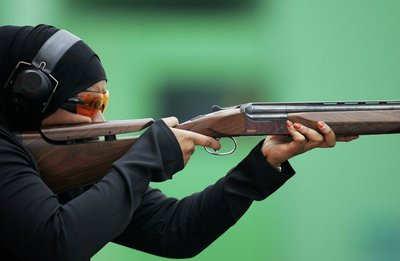

+++
title = "لا تعلموا أولادكم الرماية.. فقط!"
date = 2006-12-03
aliases = ["/articles/20at-religious-2852/", "/articles/doha2006-3211/"]

[taxonomies]
authors = []
sections = ["doha2006"]

[extra]
section_name = "دورة الدوحة ٢٠٠٦"
share_image = "/media/doha2006.20at.com/images/qatar-main-topic.jpg"
summary = "ذهبيتان وفضية للكويت وبرونزية للبنان.. هذه هي حصيلة العرب خلال 48 ساعة من أولمبياد آسياد 2006 التي تنظمها قطر هذه الأيام.."
section_slug = "doha2006"
section_colour = "#8E1652"
thumb = "/media/doha2006.20at.com/images/qatar-main-topic.jpg"
n_comments = 1
original_url = "http://20at.com/20at/religious/2852.html"
archived = "20100105174446"
date_source = "byline/meta"
aliases_20at = ["//doha2006.20at.com/article.php?sid=3211", "/20at/salamo-3lakom/2852.html", "/20at/religious/2852.html"]

[extra.provenance]
original_url = "http://20at.com/20at/religious/2852.html"
capture_url = "https://web.archive.org/web/20100105174446/http://20at.com/20at/religious/2852.html"
capture_label = "٥ يناير ٢٠١٠، ١٧:٤٤ UTC"
date_note = "من سطر التوقيع في المقال"
other_urls = ["//doha2006.20at.com/article.php?sid=3211", "/20at/religious/2852.html"]
comments = "١"
missing_images = ""
+++

<figure></figure>

ذهبيتان وفضية للكويت وبرونزية للبنان.. هذه هي حصيلة العرب خلال 48 ساعة من أولمبياد آسياد 2006 التي تنظمها قطر هذه الأيام..

لكن هذه الـ 48 ساعة شهدت توزيع 151 ميدالية على 18 دولة، لم ينل العرب من هذه الحصيلة سوى 4 ميداليات فقط، والغريب أن الميداليات الأربع كانت في لعبة واحدة.. هي الرماية!..

فقد قاد ناصر المقلد فريق الرماة الكويتي لتحقيق أول ميداليتين ذهبيتين في منافسات الرماية التي يحتضنها ميدان لوسيل الأولمبي، وذلك بعد فوزه بذهبية الفردي في مسابقة التراب (الحفرة) ومساهمته في فوز فريقه بذهبية الفرق بنفس المسابقة.

وأضاف خالد المضف ميدالية أخرى لرصيد الكويت بحصوله على برونزية الفردي، بينما ذهبت الفضية للهندي مينافت سينغ ساندو المصنف الأول عالمياً.

كما حققت لبنان أول ميدالية له بحصوله على برونزية الفرق في نفس المسابقة، في الوقت الذي ذهبت فيه الفضية للفريق الهندي.

ويذكر أن المقلد يحتل المركز السابع الثلاثين في التصنيف العالمي، بينما يحتل المضف المركز الثامن والعشرين.

الترتيب النهائي لفئة الفردي

1. الكويتي ناصر المقلد – 133 نقطة

2. الهندي مانافيت سينغ ساندو – 130

3. الكويتي خالد المضف – 128

4. الإيراني أمير لافاساني – 125 (+3)

5. الفيليبيني جيثرو ديونيسيو – 125 (+2)

6. الهندي أنور سلطان – 122

الترتيب النهائي لفئة الفرق

1. الكويت – 327 نقطة

2. الهند – 322

3. لبنان – 316

4. الفيليبين – 309

5. سنغافورة – 309

6. كوريا الجنوبية – 296

7. ماليزيا – 293

8. قطر – 293

9. فيتنام – 278

