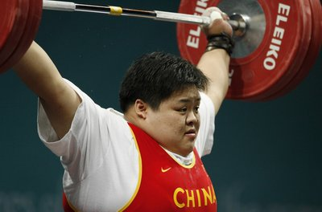

+++
title = "فيلم المرأة الحديدية.. الجزء الثاني!"
date = 2006-12-03
aliases = ["/articles/doha2006-3223/"]

[taxonomies]
authors = []
sections = ["doha2006"]

[extra]
section_name = "دورة الدوحة ٢٠٠٦"
share_image = "/media/doha2006.20at.com/images/china2-final.jpg"
summary = "بعد أقل من 48 ساعة من تحطيم البطلة الاولمبية الصينية (تشين يانجينج) لثلاثة أرقام قياسية عالمية، الأمر الذي جعلنا نطلق عليها في عشرينات المرأة الحديدية في نفس هذ"
section_slug = "doha2006"
section_colour = "#8E1652"
thumb = "/media/doha2006.20at.com/images/china2-final.jpg"
n_comments = 0
original_url = "http://www.20at.com:80/20at/salamo-3lakom/2863.html"
archived = "20090619063005"
date_source = "byline/meta"
aliases_20at = ["//doha2006.20at.com/article.php?sid=3223", "/20at/salamo-3lakom/2863.html"]

[extra.provenance]
original_url = "http://www.20at.com:80/20at/salamo-3lakom/2863.html"
capture_url = "https://web.archive.org/web/20090619063005/http://www.20at.com:80/20at/salamo-3lakom/2863.html"
capture_label = "١٩ يونيو ٢٠٠٩، ٠٦:٣٠ UTC"
date_note = "من سطر التوقيع في المقال"
other_urls = ["//doha2006.20at.com/article.php?sid=3223"]
comments = ""
missing_images = ""
+++

<figure></figure>

بعد أقل من 48 ساعة من تحطيم البطلة الاولمبية الصينية (تشين يانجينج) لثلاثة أرقام قياسية عالمية، الأمر الذي جعلنا نطلق عليها في عشرينات <a href="/articles/20at-religious-2849/"> المرأة الحديدية</a> في نفس هذا المكان، الذي يبدو أن أنه سيخصص للرباعات الصينيات.. المفتريات!

إلا أن زميلتها الرباعة الصينية (شوانج شوانج مو) رفضت أن تنفرد (تشين) باللقب، بعد أن أحرزت الميدالية الذهبية لوزن فوق 75 كلج ضمن منافسات رفع الأثقال بدورة الألعاب الآسيوية الخامسة عشرة محطمة الرقم القياسي العالمي لرفعة الخطف برفعها 139 كلج.

واحتلت الرباعة الكورية الجنوبية مي ران جانج حاملة الرقم القياسي السابق لرفعة الخطف (138 كلج)، والحالي للمجوع العام (318 كلغ)، المركز الثاني لتحصل على الفضية، بينما كانت البرونزية من نصيب التايلاندية أنيبا مونتار.

رفعت "مو" وزناً إجمالياً بلغ 317 كلج (139 في رفعة الخطف و178 في رفعة النتر) بفارق 3 كلج فقط عن منافستها الكورية (135 في النتر و178 في الخطف)، بينما كان مجموع التايلاندية مونتار الفائزة بالبرونزية هو 265 كلج.

وثأرت "مو" بذلك من "جانج" التي خطفت منها الذهب مرتين من قبل، الأولى في بطولة العالم عام 2005 في الدوحة بفارق وزن الجسم بعد أن رفعت الاثنتين إجمالي وزن واحد هو (300 كلج)، والثانية في بطولة العالم الأخيرة بجمهورية الدومينيكان عام 2006 بفارق وزن الجسم أيضاً بعد تعادلهما في إجمالي الوزن المرفوع (314 كلج).

