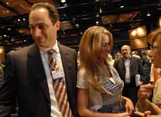

+++
title = "جمال مبارك.. زوجتك نفسي"
date = 2007-04-29
authors = ["رويترز"]
aliases = ["/articles/masr-n9995/"]

[taxonomies]
authors = ["reuters"]
sections = ["masr"]

[extra]
section_name = "ولاد البلد"
share_image = "/media/admins.20at.com/masr/gamalmubarak2.jpg"
summary = "قال شهود إن جمال مبارك نجل الرئيس المصري حسني مبارك عقد قرانه على خديجة الجمال أمس السبت في حفل عائلي."
section_slug = "masr"
section_colour = "#666666"
thumb = "/media/admins.20at.com/masr/gamalmubarak2.jpg"
n_comments = 5
original_url = "http://www.20at.com:80/2khbar/5656.html"
archived = "20090522133455"
date_source = "byline/meta"
aliases_20at = ["//masr.20at.com/newarticle.php?sid=9995", "/2khbar/5656.html"]

[extra.provenance]
original_url = "http://www.20at.com:80/2khbar/5656.html"
capture_url = "https://web.archive.org/web/20090522133455/http://www.20at.com:80/2khbar/5656.html"
capture_label = "٢٢ مايو ٢٠٠٩، ١٣:٣٤ UTC"
date_note = "من سطر التوقيع في المقال"
other_urls = ["//masr.20at.com/newarticle.php?sid=9995"]
comments = "٥"
missing_images = ""
+++

<figure></figure>

قال شهود إن جمال مبارك نجل الرئيس المصري حسني مبارك عقد قرانه على خديجة الجمال أمس السبت في حفل عائلي.

وقال مصدر من الحاضرين إن شيخ الأزهر محمد سيد طنطاوي هو الذي عقد قران العروسين الذي أعقبه حفل استقبال أكبر في مقر الرئاسة أيضا، ومن المقرر إقامة حفل الزفاف في مدينة شرم الشيخ في الرابع من مايو وهو نفس يوم عيد ميلاد الرئيس مبارك الذي سيبلغ 79 عاما.

وجمال (43 عاما) مصرفي سابق وهو حاليا الأمين العام المساعد بالحزب الوطني الديمقراطي الحاكم وأمين السياسات بالحزب. وهو يكبر خديجة بنحو 20 عاما وهي ابنة مقاول ثري.

وتقول المعارضة في مصر ومحللون سياسيون إن الكثير من الدلائل تشير إلى أن عائلة مبارك والحزب الوطني الديمقراطي يسعيان لكي يخلف جمال والده كرئيس للبلاد. ولكن مبارك ونجله ينفيان أن يكون له أي طموح في الرئاسة.

ويقول محللون إن من الصعب على المصريين قبول رئيس أعزب. وحصل مبارك على فترة ولاية خامسة في انتخابات رئاسية أجريت في سبتمبر أيلول عام 2005 ولم يعين أبدا نائبا له.

