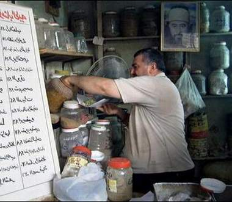

+++
title = "الشباب والأعشاب.. أصحاب!"
date = 2009-02-16
authors = ["فؤاد فليح حسن"]
aliases = ["/articles/20at-health-11314/"]

[taxonomies]
authors = ["fouad-falih-hassan"]
sections = ["3abkrino"]

[extra]
section_name = "عبقرينو"
share_image = "/media/currentarticleassets/shababas7ab.jpg"
summary = "\"تناولت أنواعا كثيرة من الأدوية لمعالجة التهاب القولون لكن دون فائدة، وأخيرا نصحني أحد أصدقائي بالتوجه إلى محال بيع الإعشاب الطبية في منطقة الشورجة وسط بغداد، و"
section_slug = "3abkrino"
section_colour = "#880088"
thumb = "/media/currentarticleassets/shababas7ab.jpg"
n_comments = 0
original_url = "http://20at.com/20at/health/11314.html"
archived = "20100105210155"
date_source = "byline/meta"
aliases_20at = ["/3abkrino/11314.html", "/20at/health/11314.html"]

[extra.provenance]
original_url = "http://20at.com/20at/health/11314.html"
capture_url = "https://web.archive.org/web/20100105210155/http://20at.com/20at/health/11314.html"
capture_label = "٥ يناير ٢٠١٠، ٢١:٠١ UTC"
date_note = "من سطر التوقيع في المقال"
other_urls = ["/20at/health/11314.html"]
comments = ""
missing_images = ""
+++

<figure></figure>

"تناولت أنواعا كثيرة من الأدوية لمعالجة التهاب القولون لكن دون فائدة، وأخيرا نصحني أحد أصدقائي بالتوجه إلى محال بيع الإعشاب الطبية في منطقة الشورجة وسط بغداد، واشتريت بعض الأعشاب وبدأت أتناولها يوميا، فكانت النتيجة الايجابية للعلاج والحمد لله".

هذا ما يقوله الشاب سلمان علي، 25 عاما، طالب في الجامعة المستنصرية، حيث تشهد محلات الإعشاب الطبية في العراق إقبالا متزايدا هذه الأيام خاصة من جانب الشباب لشراء الإعشاب كبديل عن الأدوية والعقاقير الطبية، حيث أثبتت الإعشاب الطبية فاعليتها بعلاج الكثير من الإمراض والجروح.

<h3>أغلبهم جامعيين</h3>

الحاج أبو احمد البهادلي، صاحب محل متخصص لبيع الإعشاب في منطقة الدورة جنوب بغداد، يخبرنا أن زبائنه أغلبهم من الناس المتعلمين وطلبة الجامعات الذين يدركون فوائد الأعشاب، ويقول: "بعض الناس يعتقدون بأن تناول أو استخدام الإعشاب هو عمل خاطئ ومتخلف، لكن العلم والعلماء أثبتوا بأن الإعشاب الطبية تفيد وإذا لم تؤدِ الغرض منها فإنها لا تضر".

"يعتمد نجاح التداوي بالإعشاب بحسب العشابين على خبرة العشاب نفسه حيت يجب أن يكون لديه الإلمام العلمي الكافي حول وصف العلاجات العشبية"، هذا ما يقوله رزاق البغدادي، صاحب محل كبير للأعشاب في منطقة الشورجة، مضيفا: "مهنتنا هذه تتطلب معرفة كافية لكل صنف من العشب وفائدته للإنسان"، موضحا أن أكثر الإعشاب مبيعا هي للأمراض المنتشرة هذه الأيام مثل مرض السكري والعقم عند الرجال والنساء معا وأمراض الكلى وتفتيت الحصى والمجاري البولية وأمراض المعدة وأمراض أخرى أثبتت الأعشاب فاعليتها في علاجها".

بعد كلامنا مع البغدادي كانت الفتاة هند فوزي، 24عاما، تهم بالدخول إليه، عن سبب قدومها إلى أسواق منطقة الشورجة تقول: "أذهب كل أسبوعين إلى محال بيع الإعشاب الطبية لأشتري مادة (طين خاوة) حيث استخدمها للشعر، كما أن لها فوائد أخرى فهي تساعد على إزالة الدهون وتنظيف البشرة حيث أثبت فعاليتها في سحب الدهون من البشرة، بالإضافة إلى سعرها الزهيد جدا قياسا بفائدتها وخصوصا أذا ما قوُرنت بأسعار مواد التجميل".

كذلك وجدنا الشاب أحمد جاسم، 23 عاما، يقف أمام محل للإعشاب وعند سؤالنا له عن سبب وجوده قال: "أعاني من نقصان في الوزن فجئت لأشتري أعشاب تجعلني أقبل على الطعام أكثر لأنني لا اشتهي الأكل إلا قليلا، لقد ذهبت إلى أكثر من طبيب ووصفوا لي عدة أدوية مشهية لكنها لم تعالج شيء بل أن أغلبها جعلني أنام كثيرا ولا أستطيع أن أزاول عملي".

رافد جعفر، 22 عاما، طالب في كلية الرافدين، يقول: "الأعشاب الطبية مفيدة جدا وخصوصا الحبة السوداء التي تعتبر علاج لمئات من الإمراض وخصوصا في الجهاز الهضمي، بخلاف الأعشاب التي تعالج الصلع وسقوط الشعر فهي كثير ومفيدة ويستخدمها الكثير من أصدقائي لكونها فعالة ورخيصة جدا".

<h3>طب قائم بذاته</h3>

"الإعشاب الطبية تفيد في شفاء الكثير من الأمراض منها الأمراض المزمنة والمستعصية والأمراض الجلدية وحتى الأمراض النفسية"، هذا ما يقوله الصيدلاني عمار سعد، 30 عاما، مضيفا أن طب الأعشاب هو طب قائم بذاته يعتمد على الدراسة والاكتشاف والمتابعة وتحليل النتائج والاستفادة منها.

لكنه حذر من أن هناك أعشاب يجب وصفها من قبل إنسان متخصص في مجال عمله لكون بعض هذه الأعشاب مؤذية وتسبب مضاعفات أن أُسيء استخدامها أو وُصِفَت من دون معرفة، فهناك مواد أن استمر عليها المريض أكثر من أسبوعين قد تولد له فشل كلوي، أو تسبب إجهاض بالنسبة للنساء الحوامل فهي تساعد على تنشيط الرحم، وهناك مواد تزيد من ارتفاع ضغط الدم، لذا يجب التأكد والاستفسار قبل وصف العلاج والاعتماد على التحاليل المختبرية الخاصة.

