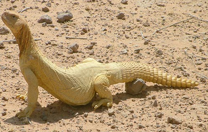

+++
title = "(الضب) لا يزال في فمي!"
date = 2007-03-08
authors = ["وفاء العلي"]
aliases = ["/articles/20at-health-3391/", "/articles/harb-n5040/"]

[taxonomies]
authors = ["wafa-elali"]
sections = ["harb"]

[extra]
section_name = "الحرب الآن"
share_image = "/media/admins.20at.com/do3a2/dab.jpg"
summary = "الصحراء تمثل حياة خاصة للشباب السعودي لممارسة هوايات متعددة، من هذه الهوايات هواية اصطياد حيوان (الضب) ثم إعداده وطبخه وتناوله، وهناك من يفضل بيعه والربح المادي"
section_slug = "harb"
section_colour = "#7A1E1E"
thumb = "/media/admins.20at.com/do3a2/dab.jpg"
n_comments = 4
original_url = "http://20at.com/20at/health/3391.html"
archived = "20100105211411"
date_source = "byline/meta"
aliases_20at = ["//harb.20at.com/newarticle.php?sid=5040", "/3abkrino/3391.html", "/20at/health/3391.html"]

[extra.provenance]
original_url = "http://20at.com/20at/health/3391.html"
capture_url = "https://web.archive.org/web/20100105211411/http://20at.com/20at/health/3391.html"
capture_label = "٥ يناير ٢٠١٠، ٢١:١٤ UTC"
date_note = "من سطر التوقيع في المقال"
other_urls = ["//harb.20at.com/newarticle.php?sid=5040", "/20at/health/3391.html"]
comments = "٤"
missing_images = ""
+++

<figure></figure>

الصحراء تمثل حياة خاصة للشباب السعودي لممارسة هوايات متعددة، من هذه الهوايات هواية اصطياد حيوان (الضب) ثم إعداده وطبخه وتناوله، وهناك من يفضل بيعه والربح المادي من ذلك.

والضب حيوان من الزواحف، جسمه قصير وغليظ، يتميز بأطراف تشبه أطراف الإنسان، لونه يميل للرمادي أو البني ويتخلله لون أصفر على جهة الظهر منه، ذيله مزود بحلقات شوكيه للدفاع عن نفسه إذا تعرض للخطر، وهو حيوان نباتي التغذية لا يشرب الماء إلا نادراً جداً، لأنه يستفيد من الماء الموجود في النباتات التي يتغذى عليها، ويعد مصدراً للبروتين الحيواني لسكان البادية.

حول هذه الهواية التي يمارسها الشباب..استطلعت "عشرينات" أراء هواة الضب..

<h3>هواة صيد الضبان</h3>

محمد الظفيري، أحد هواة صيد الضب وأكله، يقول: "مع دخول فصل الربيع يبدأ الشباب من هواة صيد الضبان التوجه كأفواج إلى الصحراء لصيد الضبان، فغالبية مناطق المملكة توجد فيها الضبان، ولكن أفضل أنواعها وأبرزها يتواجد في مناطق نجد والصمان والبياضة".

وعن أوقات صيد الضبان، يقول: "هناك أشخاص لهم خبرة طويلة في صيد الضبان، فهم يتخيرون وقت صيدها عندما تكون الضبان أكثر صحة وسمنة، فهناك أشخاص لا يذهبون لصيد الضبان إلا في آخر شهر من فصل الربيع، والسبب أنهم يمنحون الضب فرصة للأكل من العشب بعد خروجه من سباته الشتوي الذي يخرج منه نحيلاً، وعندما يمر شهران على فصل الربيع، يكون الضب قد أخذ الفرصة الكافية ويكون عندها جاهزاً ليصبح فريسة لخبراء صيد الضبان".

<h3>الأسر لا يحبون الضب</h3>

أما جابر الحربي، فيوضح أن فئة الشباب هم من يقبلوا على أكل الضبان بعكس باقي أفراد الأسرة الذين يتقززون كثيرا منها، مما يجعل الشباب أنفسهم يقوموا بإعدادها وطبخها.

ويذكر جابر أن بعض الأشخاص يقومون باصطياد الضبان لغرض بيعها وتسويقها بأسعار تبدأ من 5 ريالات للأحجام الصغيرة وتصل إلى 50 ريالا للأحجام الكبيرة، كما أن عشرات الزبائن يترددون أسبوعيا إلى مسوقي الضبان ويطلبون الأنواع التي تم اصطيادها حديثا ليقوموا بتناول لحومها، أما الأطفال فيفضلون الأنواع الصغيرة للهو بها.

<h3>طريقة صيده</h3>

وعن طرق صيد حيوان الضب يقول "عامر الذيابي": "هناك طرق مختلفة لصيد الضبان، ولكن أبرزها صيده بالبنادق النارية أو مطاردته ومسكه باليد، ولكن هناك طرقاً ظهرت حديثاً من الشباب، حيث يستخدمون الماء في إغراق جحر الضب حتى يخرج هرباً من الغرق وعندها يكونوا في انتظاره عند مدخل الجحر، وأيضاً هناك طريقة خاطئة يستخدمها البعض، وقد تعرضهم لأمراض كثيرة وهي استخدام (شكمان) السيارة والدخان الخارج منه في إخراج الضب من الجحر".

أما أم إبراهيم، المتخصصة في الأكلات العربية، فتحدثنا عن طريقة طهي الضب قائلة: "تتنوع طرق الطهي حسب طبخها بين شخص وآخر، فمنهم من يفضلها وهي مسلوقة مع البطاطس، فيما يفضلها آخرون على شكل كبسة، وهكذا حسب ذوق ورغبة كل شخص".

<h3>قوانين لهذه الهواية</h3>

هذه الهواية تثير الكثير من الجدل البيئي والديني والصحي، حيث تعرض الضب للانقراض من ناحية، وشرعية تناول لحمه من ناحية أخرى..

الدكتور عبد العزيز بن حامد أبو زنادة، الأمين العام للهيئة الوطنية لحماية الحياة الفطرية، حذر من انقراض حيوان الضب بسبب هواية الصيد، حيث يبين أن الهيئة حريصة على الحفاظ على هذا النوع حتى لا يصل إلى مرحلة الانقراض ثم الاندثار كما حدث من قبل وتعرضت حيوانات عديدة إلى الاختفاء، منها على سبيل المثال وليس الحصر النعام العربي والفهد الآسيوي والمها العربي والغزال العفري السعودي، وجميعها لم يتوقع أحد باختفائها نظرا لانتشارها الواسع وأعدادها الكبيرة في ذلك الحين.

وأوضح د. أبو زنادة أن الهيئة بالتعاون مع وزارة الداخلية وضعت نظام الصيد ولوائحه التنفيذية بعد تعديلها لتصبح ستة مواسم، منها موسم صيد الضبان الذي يستمر لمدة ثلاثة أشهر، لذلك يجب على الجميع الحرص على الثروة الوطنية والالتزام بأنظمة ولوائح الصيد التي تتيح لهم فرصة كاملة لممارسة هوايتهم ولا يجب أن تتحول الهواية إلى تجارة غير مشروعة.رؤية شرعيةأما عن حكم أكل لحم الضب، فقد اختلف أهل العلم في حل أكل الضب فذهب بعضهم إلى النهي عن أكله مثل أبو حنيفة والثوري، وقد ورد في حديث ابن عباس رضي الله عنه وأرضاه الصحيح، وحديث أم سلمة: "أن الرسول صلى الله عليه وسلم قدم له ضب فقالت أم سلمة : أخبروا رسول الله صلى الله عليه وسلم بما قدم له، فأخبروه فرفع يده صلى الله عليه وسلم، قالوا: أحرام هو يا رسول الله؟ قال: لا ولكن أجد نفسي تعافه. وفي لفظ: (لا أجده في أرض قومي)، فالضب لا يعيش في مكة ولا في جبال مكة ، والرسول صلى الله عليه وسلم عافته نفسه؛ لأنه لا يوجد في أرض قومه.

وما ورد في النهي عنه كما جاء في سنن أبي داوود عن عبد الرحمن ابن شبل أن النبي صلى الله عليه وسلم "نهى عن أكل الضب" ليس محمولا على نهي التحريم ولا الكراهة المطلقة، وإنما هو كراهة التنزيه كمن عافت نفسه الأكل منه.

أما علماء جامعة الملك سعود فقد توصلوا إلى أن الإكثار من أكل لحم الضب يشكل خطورة على صحة الإنسان، إذ تم اكتشاف أن لحم الضب يحتوي على ضعف نسبة الكولسترول الموجود في الخروف النجدي.

