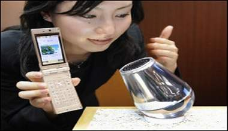

+++
title = "اشحن الموبايل بالعطور المختلفة"
date = 2008-04-09
authors = ["ا ف ب"]
aliases = ["/articles/20at-health-8724/", "/articles/harb-n15101/"]

[taxonomies]
authors = ["a-f-b"]
sections = ["harb"]

[extra]
section_name = "الحرب الآن"
share_image = "/media/currentarticleassets/images/saudi/riha.jpg"
summary = "قدم فرع من عملاق الاتصالات الياباني \"ان تي تي\" هذا الأسبوع نظاما جديدا يتيح \"شحن روائح\" ومن ثم توجيه انبعاثاتها إلى جهاز بث منفصل عبر هاتف محمول."
section_slug = "harb"
section_colour = "#7A1E1E"
thumb = "/media/currentarticleassets/images/saudi/riha.jpg"
n_comments = 7
original_url = "http://20at.com/20at/health/8724.html"
archived = "20100105211620"
date_source = "byline/meta"
aliases_20at = ["//harb.20at.com/newarticle.php?sid=15101", "/3abkrino/8724.html", "/20at/health/8724.html"]

[extra.provenance]
original_url = "http://20at.com/20at/health/8724.html"
capture_url = "https://web.archive.org/web/20100105211620/http://20at.com/20at/health/8724.html"
capture_label = "٥ يناير ٢٠١٠، ٢١:١٦ UTC"
date_note = "من سطر التوقيع في المقال"
other_urls = ["//harb.20at.com/newarticle.php?sid=15101", "/20at/health/8724.html"]
comments = "٧"
missing_images = ""
+++

<figure></figure>

قدم فرع من عملاق الاتصالات الياباني "ان تي تي" هذا الأسبوع نظاما جديدا يتيح "شحن روائح" ومن ثم توجيه انبعاثاتها إلى جهاز بث منفصل عبر هاتف محمول.

وعرض هذا النظام بشكل آلة بث صغيرة للروائح مجهزة بكتلة تتضمن 16 رائحة أساسية يمكنها إنتاج مئات الروائح الأخرى إذا خلطت حسب وصفات معينة.

ومن اجل بث رائحة في شقة شخص ما على المستخدم أن يقوم بشحن صيغة محددة على هاتفه النقال تتيح اختيار وصفات روائح ضمن قائمة وخلق أخرى جديدة وتقاسمها مع أصدقاء وتوجيه هذه المعلومات لاحقا لآلة البث عبر الأشعة تحت الحمراء.

وقال "شينيشي هامادا" المسؤول في هذا المشروع خلال مؤتمر صحفي "سنقوم بتجربة مع أجهزة استخدام رائدة هذا الشهر لتحديد المشاكل المحتملة وتلبية التوقعات وتقييم الخدمات".

ومن الممكن أيضا توجيه آلة البث عن مسافة انطلاقا من هاتف نقال عبر الانترنت من خلال ربطها بآلة متصلة بالشبكة ومجهزة ببرنامج محدد. وهذه الخدمة توفر إمكانية برمجة لائحة روائح مختلفة لبثها وفقا لأوقات اليوم المختلفة.

وقال مسؤول في شركة "سيمرايز" شريكة "ان تي تي" في هذا النشاط "في المستقبل سيكون من الممكن تحميل موسيقى أو أشرطة فيديو وروائح لتواكبها في الوقت نفسه".

وفي الوقت الراهن لم يحدد بعد سعر جهاز البث مع لاقط الأشعة تحت الحمراء لكن الشركة ترغب في ألا يتجاوز 125 يورو.

